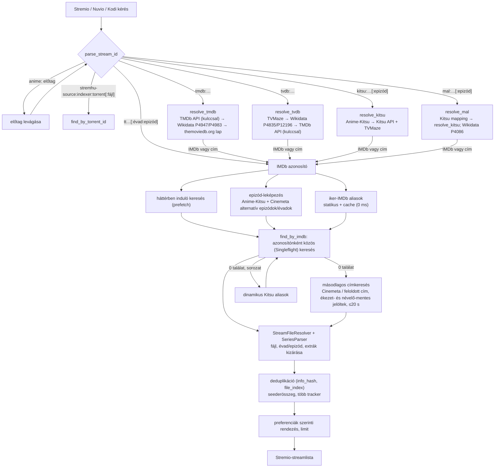

<p align="center">
  <a href="https://stremhu.app" target="_blank">
  </a>
</p>

<p align="center">Self-hosted streaming szerver, amellyel <b>közvetlenül a torrent oldalakról</b> nézheted a tartalmat várakozás nélkül!</p>
<p align="center">További információkért és útmutatókért látogass el a <a href="https://stremhu.app" target="_blank">https://stremhu.app</a> oldalra!</p>

<p align="center">
  <a href="https://discord.gg/jRSPPY5XaN" target="_blank">
    
  </a>&nbsp;
  <a href="https://hub.docker.com/r/s4pp1/stremhu-source" target="_blank">
    
  </a>
</p>

<p align="center">
  Ha hasznosnak találod a projektet, támogasd egy ⭐-gal, és ha teheted, hívd meg az eredeti készítőt egy kávéra! ☕<br><br>
  <a href='https://ko-fi.com/s4pp1' target='_blank'>
    
  </a>
</p>

> [!IMPORTANT]
> **Fork információk és köszönetnyilvánítás**
> Ez a repository, a **`stremhu-source-VibeCodedEdition`**, a hivatalos **[StremHU Source](https://github.com/s4pp1/stremhu-source)** projekt forkja. Az eredeti szerzője és fejlesztője **[s4pp1](https://github.com/s4pp1)**; minden alapfunkció az ő munkája.
> - **Viszonyítási alap (Upstream):** [`s4pp1/stremhu-source`](https://github.com/s4pp1/stremhu-source), `8c99c7d` commit. A dokumentumban: **`s4pp1/stremhu-source` (Upstream `@8c99c7d`)**.
> - **Hivatalos weboldal és dokumentáció:** [https://stremhu.app](https://stremhu.app)
> - **Hivatalos Docker image:** [s4pp1/stremhu-source:latest](https://hub.docker.com/r/s4pp1/stremhu-source)
> - **A fork Docker image-e:** [levfero/stremhu-source:dev](https://hub.docker.com/r/levfero/stremhu-source)

---

## Tartalom

1. [Összehasonlító mátrix](#1-összehasonlító-mátrix)
2. [Multi-ID routing és keresési lánc](#2-multi-id-routing-és-keresési-lánc)
3. [Hangsáv, felirat és lejátszás (Relay)](#3-hangsáv-felirat-és-lejátszás-relay)
4. [Stabilitási, konkurencia- és biztonsági hardening (CR01–CR19)](#4-stabilitási-konkurencia--és-biztonsági-hardening-cr01cr19)
5. [Mérések](#5-mérések)
6. [Fejlesztői ellenőrzés és dokumentáció](#6-fejlesztői-ellenőrzés-és-dokumentáció)

---

## 1. Összehasonlító mátrix

### 1.1 Funkcionális bővítések

| Terület | `s4pp1/stremhu-source` (Upstream `@8c99c7d`) | `stremhu-source-VibeCodedEdition` |
| :--- | :--- | :--- |
| **Stremio/Nuvio azonosítók** | IMDb (`tt…`) és saját torrent-azonosító | IMDb + iker-IMDb aliasok, `tmdb:`, `tvdb:`, `kitsu:`, `mal:`, `anime:` előtag, saját `stremhu-source:` azonosító fájlindexszel ([2. fejezet](#2-multi-id-routing-és-keresési-lánc)) |
| **Azonosító-feloldás** | — | TMDb API (ha van kulcs), kulcs nélkül Wikidata SPARQL, TVMaze, Anime-Kitsu, Kitsu API, Cinemeta, végső esetben a TMDb weboldal |
| **IMDb nélküli műsorok** | Nincs találat | Másodlagos címkeresés (ékezet- és névelő-mentes jelöltek), 20 s-os monoton határidővel |
| **Katalóguskeresés** | Csak `t-<torrent_id>` | `t-<torrent_id>` és szabadszavas keresés a trackereken, sorozatszűréssel |
| **Fájlszintű feloldás** | Legnagyobb videófájl | `StreamFileResolver` + `SeriesParser`: évad/epizód (abszolút és szezonális számozás), évadcsomagok, extrák és menük kiszűrése |
| **Deduplikáció** | Indexerenként külön találat | `(info_hash, file_index)` kulcs, összesített seeder, több tracker jelölése, forráskonzisztens lejátszási URL (kikapcsolható) |
| **Tracker-sorrend** | Seeder szerinti top-lista | Trackerenként váltakozó (fair) kiválasztás, legfeljebb 40 jelöltig |
| **Hangsáv- és feliratjelölés** | Kategóriából becsült nyelv | Tech Info / MediaInfo elemző: valós `🇯🇵 Jap`, `🇬🇧 Eng`, `🇭🇺 Hun` sávok, téves `ENG` eltávolítása, `💬 🇭🇺 Felirat` jelölés |
| **Külső feliratok** | — | `.srt`, `.vtt`, `.ass`, `.ssa` a torrentből; ASS/SSA → WebVTT, kooperatív (szeletelt) konverzióval |
| **Aktív lejátszás követése** | — | A felirat a ténylegesen lejátszott torrenthez tartozik; nincs második torrentindítás a felirat miatt |
| **Lejátszás indítása** | A fájl első és utolsó darabja azonnali | Ugyanígy, az upstream határidő-képletével (SP02, mérve gyorsabb indulás); a korábbi 3+3 darabos indulás `RELAY_START_POLICY=legacy` és `RELAY_READAHEAD_POLICY=legacy` értékkel visszaállítható |
| **Letöltöttség jelzése** | Torrentszinten | Fájlszintű `file_progress`; csak a kész videófájl kap `⚡ Letöltve` jelzést, a katalógusból megnyitott torrent fájllistájában is; a jelölés és az előresorolás a Preferenciák között kikapcsolható |
| **Gyorsítótár** | Rövid tracker-cache | IMDb-keresés 1800 s, szöveges keresés 300 s TTL, generációs stream-cache; tech-info cache 3600 s; lejárt trackerlista azonnal, háttérfrissítéssel, 24 órás kemény határig (SP07) |
| **Webes felület** | Fix 1 s-os frissítés | Adaptív frissítés: 1,5 s aktív letöltésnél, 5 s egyébként, háttérben szünetel |

### 1.2 Stabilitási és biztonsági munkacsomagok (CR01–CR19)

A CR-azonosítók a [stabilitási terv](./docs/feature/stability-and-optimization/implementation-plan.md) tételei. Minden lezárt tételt előre rögzített mérési vagy funkcionális kapu igazol; a negatív eredmények is dokumentáltak.

| CR | Terület | `stremhu-source-VibeCodedEdition` állapota |
| :--- | :--- | :--- |
| CR01 | Torrentenkénti kapcsolatkorlát | Egyetlen író tartja a tényleges limitet (drift 100/100 → 0/100); a felület „alapérték” megnevezést kapott (termékdöntés) |
| CR02 | SQLite WAL / checkpoint | Méréssel lezárva: nincs változtatás (WAL-újrahasznosítás és p99 a kereten belül) |
| CR03 | gzip a Stremio-válaszokon | Nem került be: lassú linken gyorsít, de a LAN-késleltetés és a szerver-CPU romlik |
| CR04 | Torrentlista renderelés | A lista sora `React.memo` mögött: változatlan sor nem renderel újra a pollnál; a frissesség változatlan |
| CR05 | `SESSION_SECRET` | Erős aláírókulcs plug & play módon: megadva legalább 32 karakter, megadás nélkül az első indulás generálja és az adatkötetben tárolja; a régi nyilvános alapérték soha nem használható; titok nem kerül hibaüzenetbe |
| CR06 | TLS | Termékdöntés: a `LOCAL` mód Plug & Play tartalék marad; egyedi szerverazonosság `MANUAL` (saját tanúsítvány / reverse proxy) vagy `AUTO` (ACME) móddal |
| CR07 | Naplózás | Titokmentes hálózati hibanaplózás (`log_safety`), szűkített accesslog |
| CR08 | Pairing | Atomikus állapotgép, egyszeri/idempotens link, korlátos retry; hitelesítési rate-limiter |
| CR09 | Aktív lejátszás | Hitelesítés az írás előtt; véges, TTL-es regiszter, takarítással |
| CR10 | Range / numerikus bemenet | RFC 9110 Range és HEAD, szabályozott 416, túlcsordulás-védelem; hibás azonosító nem jut hálózatra |
| CR11 | Singleflight / relogin | Megosztott relogin-task, a várakozó megszakítása nem állítja le a közös munkát |
| CR12 | Stream-cache | Generációs `StreamCacheState`, compare-put, invalidálás commit után (stale 100/100 → 0/100) |
| CR13 | Event loop | Aszinkron DNS monoton határidővel (a); korlátos `ResumeWriter` (b); kooperatív ASS→VTT (c) |
| CR14 | Torrentlista | Skalár projekció BLOB-ok és lazy SQL nélkül |
| CR15 | Indexerletöltés és keresés | Korlátos `.torrent` letöltés (48 MiB dekódolt törzs); hosthoz kötött, HTTPS-en `Secure` sütik; redirect törzsolvasás nélkül, csak a tracker domainjére; keresési terheléskorlát (12 egyidejű egyedi keresés, 15 s határidő, bájtkeret) |
| CR16 | Session | `session_epoch` (jelszócsere után a régi sütik érvénytelenek), explicit Secure/Origin-szabály |
| CR17 | Lifecycle és Session-élettartam | Rendezett leállítás; Session-mentes megosztott keresési eredmények; `shared_read_session()`; a policy-snapshot (CR17/b) félretéve |
| CR18 | Bootstrap | Atomikus első admin létrehozás |
| CR19 | Cache-fejlécek | `Cache-Control: no-store` az érzékeny válaszokon |

### 1.3 Streamgyorsítás (SP01–SP10)

Az SP-azonosítók a [streamgyorsítási terv](./docs/feature/stream-performance/implementation-plan.md) tételei; a végrehajtás menete a stabilitási munkáé: előre rögzített kapu, ugyanazon image-en a kapcsoló előtte/utána állása. Minden élő változás egy környezeti változóval visszaállítható; új kötelező beállítás vagy migráció nincs.

| SP | Terület | `stremhu-source-VibeCodedEdition` állapota |
| :--- | :--- | :--- |
| SP01 | Bájtalapú előtöltési ablak | Nem került be: a leíró mérésen a 16 MiB-os ablak a vegyes swarmban csökkentette az akadást, de egy cellában lassabban indult, és több cellában lassabb lett a tekerés utáni újraindulás |
| SP02 | Indulási darabsorrend és határidők | **Bekapcsolva:** upstream-szerű indulás (`RELAY_START_POLICY=edges`, `RELAY_READAHEAD_POLICY=upstream`); 16 MiB-os darabnál a tekerés +0,2–0,7 s, ahogy az upstreamben |
| SP03 | Lejátszási előzmény | **Bekapcsolva:** playbackenként egyszer, a háttérben íródik, nem minden Range-kérés előtt (`PLAYBACK_HISTORY_BACKGROUND`) |
| SP04 | Átfedő darabolvasás | Nem került be: a helyben lévő fájl olvasása mindkét változatban ~1 s / 512 MiB |
| SP05 | Tracker-időkorlát és rövidzár | Egy közös időkorlát-segéd; **bekapcsolva:** 2 egymás utáni hiba után a tracker 120 s-ig (ismétlődéskor legfeljebb 600 s-ig) kimarad, figyelmeztetéssel (`INDEXER_BREAKER_THRESHOLD=0` kikapcsolja) |
| SP06 | Tech Info | A hibás lekérés nem kerül a cache-be; **bekapcsolva:** háttér-előtöltés a legtöbb seederű 5 találatra (`TECH_INFO_PREFETCH`) |
| SP07 | Lejárt trackercache | **Bekapcsolva:** a 30 perces puha TTL után azonnali régi lista háttérfrissítéssel, 24 órás kemény határ (`INDEXER_CACHE_HARD_TTL_SECONDS=0` a korábbi szinkron keresés); a torznab mindig friss listát kap |
| SP08 | Név szerinti tartalékkeresés | Nem került be: a párhuzamosítás mért felső korlátja sem lényeges, és megduplázná a trackerhívásokat |
| SP09 | `Connection: close` | Változatlan: a keep-alive mérve gyorsított (HTTP/1.1 kliensnél, mesterséges késleltetéssel), de a kis és bizonytalan nyereség és az upstream ismeretlen oka miatt termékdöntéssel elvetve |
| SP10 | Beragadó peerek | Nem került be: a watchdog két kapun is elbukott, csak egy cellában javult az indulás, a korábbi 4 MiB-os nyereség nem ismétlődött |

---

## 2. Multi-ID routing és keresési lánc

A `/stremio/stream/{type}/{id}.json` kérés azonosítóját a `stremio/utils.py: parse_stream_id` bontja; a feloldást a `stremio/service.py` és a `stremio/tvdb_resolver.py`, a keresést a `torrent_streams/service.py` és a `torrent_source_provider/service.py` végzi.



| Azonosító | Példa | Feloldás | Epizódkezelés |
| :--- | :--- | :--- | :--- |
| IMDb | `tt0903747:1:1` | közvetlen; iker-IMDb aliasok statikus listából, 0 találatnál dinamikusan Kitsun keresztül | Anime-Kitsu és Cinemeta alapján alternatív (abszolút ↔ szezonális) epizód- és évadszámok |
| TMDb | `tmdb:1399:1:1` | TMDb API kulccsal; kulcs nélkül Wikidata SPARQL (P4947 film, P4983 sorozat), végül a TMDb weboldal IMDb-hivatkozása; IMDb hiányában a cím | `évad:epizód` |
| TheTVDB | `tvdb:121361:1:1` | TVMaze → Wikidata (P4835 sorozat, P12196 film) → TMDb API (kulccsal) | `évad:epizód` |
| Kitsu | `kitsu:12:5` | Anime-Kitsu meta (IMDb + évad/epizód), tartalékként Kitsu API cím + TVMaze | abszolút epizód → évad/epizód, alternatív számozás; az adaptációk külön IMDb-azonosítót kapnak |
| MyAnimeList | `mal:21:5` | Kitsu mapping API → `resolve_kitsu`; tartalékként Wikidata P4086 | mint a Kitsu |
| `anime:` előtag | `anime:kitsu:12:5` | az előtag levágása után a fenti szabályok | — |
| Saját torrent | `stremhu-source:ncore:12345:3` | közvetlen torrent, opcionális fájlindex | — |
| Katalógus | `t-12345`, szabad szöveg | `t-<torrent_id>` torrentkeresés; szabad szöveg: trackerkeresés, fair kiválasztás (≤40), `SeriesParser` szűrés | — |

**Fájlszintű feloldás és deduplikáció**
- **`StreamFileResolver`:** a torrent fájlfáján keresi az évad/epizód szerint illeszkedő videófájlt (évadmappák, abszolút számozás), és párosítja a hozzá tartozó feliratfájlokat. Normál résznél a `BD Menü`, `Extras`, `NCED` jellegű fájlokat kizárja, a 0. évadnál (Specials) engedi.
- **`SeriesParser`:** `SxxExx`, évadlisták, tartományok és abszolút epizódszámok értelmezése a torrentnévből.
- **Deduplikáció:** erős kulcs az `(info_hash, file_index)`; azonos hash különböző fájljai (például két epizód) sosem vonódnak össze. Hash nélkül a tisztított név és a méret adja a tartalék kulcsot. Az összevont találat seederszáma összegződik, a trackerek felsorolva jelennek meg; letöltött forrásnál a lejátszási URL a letöltött forrásra mutat.
- **Fair interleaving:** szöveges keresésnél trackerenként seeder szerint rendezve, váltakozva választ, legfeljebb 40 jelöltig, hogy egy domináns tracker ne szorítsa ki a többit.

---

## 3. Hangsáv, felirat és lejátszás (Relay)

**Tech Info / MediaInfo elemző (`media_attributes/tech_info_parser.py`)**
- Az nCore MediaInfo (`nfo`) és leírás (`torrent_drop`) adataiból külön kezeli a hang- és a feliratszekciót, így egy felirat nyelve sosem minősül hangsávnak.
- Valós `🇯🇵 Jap`, `🇬🇧 Eng`, `🇭🇺 Hun` hangsávok; ha nincs angol hang, a kategóriából becsült téves `ENG` jelölés eltűnik. Dual-audio esetén mindkét zászló megmarad.
- Magyar felirat (beágyazott, leírásban jelzett vagy külön `.srt`/`.ass` fájl) esetén `💬 🇭🇺 Felirat` jelölés.
- Gyors útvonal: névalapú felirat-felismerés, először csak a MediaInfo lekérése, torrentenkénti csoportosítás; 3600 s-os cache.

**Külső feliratok**
- `.srt`, `.vtt`, `.ass`, `.ssa` a torrentből; az ASS/SSA szerveroldalon WebVTT-re alakul, mert a webes és tévés lejátszók az ASS-t nem kezelik.
- **CR13/c:** a dekódolás (256 KiB-os szeletek, UTF-8-sig, hibánál cp1250) és a konverzió (~32 K karakteres, sorvégen vágott szeletek) között a szerver visszaadja a vezérlést az event loopnak; a kimenet bájtra azonos a korábbival. A gyorsítótár keret 32 MiB, csak teljes (bájtpontos) feliratfájl kerül bele.
- **Aktív lejátszás (`stream/active_playback.py`, CR09):** a felirat a ténylegesen lejátszott torrenthez tartozik, így nem indul második torrent a felirat miatt. A regiszter hitelesítés után ír, véges és TTL-es.

**Relay és lejátszás**
- **Range/HEAD (CR10):** RFC 9110 szerinti `bytes=a-b`, `a-`, `-n` értelmezés; nem kielégíthető vagy többtartományos kérésre szabályozott `416` `Content-Range: bytes */N` fejléccel.
- Olvasási határidő (`relay_read_timeout_seconds` = 15 s, `relay_piece_timeout_seconds` = 120 s); leállításkor és torrenttörléskor a függő olvasások rendezetten zárulnak.
- **Natív leállítás (CR17/a):** a libtorrent riasztásai `set_alert_fd` socketpairen érkeznek; a lifespan rendezett sorrendben zár, egy hiba nem akasztja meg a többi takarítást.

---

## 4. Stabilitási, konkurencia- és biztonsági hardening (CR01–CR19)

### Adatbázis és Session-élettartam (CR17, CR14, CR13/b)
- **Session-mentes megosztott keresés (CR17/c–d):** a közös (Singleflight) keresés eredménye frozen hivatkozásokat és snapshotokat hordoz, ORM-objektumot nem, így a kérést indító Session lezárása után is olvasható. Ez szüntette meg a `DetachedInstanceError`-t.
- **`shared_read_session()` (CR17/d, 22b):** egyhelyes olvasási kapu, a QueuePool nem telik meg párhuzamos keresésektől.
- **Torrentlista (CR14):** explicit oszlopprojekció; a lista se BLOB-ot, se kérésenkénti lazy SQL-t nem tölt.
- **Rendezett lifespan (CR17/a)** és **korlátos `ResumeWriter` (CR13/b):** a resume-adatok mentése bájt- és hash-korlátos, a függő és a folyamatban lévő írásokat együtt számolja, és leálláskor kiüríti.

### Keresési és hálózati védelem (CR11, CR13/a, CR15)
- **Singleflight (CR11):** a várakozó megszakítása nem szakítja meg a közös munkát; az adapter relogin megosztott taskban fut.
- **Aszinkron DNS (CR13/a):** a TXT-ellenőrzés nem blokkolja az event loopot, a teljes várakozást monoton határidő korlátozza.
- **Korlátos `.torrent` letöltés (CR15/a):** legfeljebb 48 MiB dekódolt törzs; a deklarált túl nagy hosszt olvasás előtt elutasítja, tömörítési bomba ellen a dekódolt bájtokat számolja. A Docker-image a glibc mmap/trim küszöbét rögzíti (32/64 MiB), így a felszabadított törzs memóriája a következő letöltésnél újrahasznosul.
- **Süti-hatókör (CR15/b, 26a):** a mentett indexersütik csak a tracker hostjára kerülnek, HTTPS-nél `Secure` jelzéssel.
- **Redirect és host (CR15/b, 26b):** a redirect törzse nem olvasódik be, legfeljebb 10 lépés, és minden lépés csak a tracker saját domainjére vagy aldomainjére mehet.
- **Keresési terhelés (CR15/c, 27):** legfeljebb 12 egyidejű egyedi keresés (a 13. azonnali `503`), 15 s-os teljes határidő részleges eredménnyel, folyamatszintű függőbájt-keret (32 MiB), egyszerre egy, legfeljebb 16 MiB-os mentési köteg, és fájlszámra korlátos `TorrentInfo`-gyorsítótár.

### Hitelesítés és HTTP-védelem (CR05, CR06, CR07, CR08, CR12, CR16, CR18, CR19)
- **CR05:** a `SESSION_SECRET` megadása nem kötelező. Ha nincs megadva (vagy a régi nyilvános `stremhu-source` érték), az első indulás erős kulcsot generál, és `0600` joggal a `data/system/session_secret` fájlba menti (az adatkötetet meg kell tartani; a hely a `SESSION_SECRET_FILE` változóval állítható). Megadott, de 32 karakternél rövidebb kulccsal (a szóközöket nem számolva) az alkalmazás nem indul; csak olvasható vagy idegen tulajdonú adatkötetnél érthető hibaüzenettel áll le. **Frissítéskor:** ha korábban nem volt megadva `SESSION_SECRET` (a régi nyilvános értékkel futott), az első indulás után egyszer újra be kell jelentkezni, és a Stremio/Nuvio a stream-listát újrakéri, mert a nyilvános kulcs szándékosan cserélődik.
- **CR07:** a hálózati hibák csak titokmentes összegzéssel naplózódnak (`common/log_safety.py`).
- **CR08:** atomikus pairing-állapotgép és hitelesítési rate-limiter (`common/auth_rate_limit.py`).
- **CR18:** atomikus bootstrap: pontosan egy első admin és session.
- **CR16:** `session_epoch` (jelszócsere után a régi sütik érvénytelenek) és Origin-ellenőrzés (`common/session_origin.py`).
- **CR12:** generációs `StreamCacheState` compare-put írással, invalidálás csak sikeres commit után.
- **CR19:** `Cache-Control: no-store` az érzékeny végpontokon (`common/sensitive_responses.py`).
- **CR06 – TLS-módok:** `LOCAL` (Plug & Play, közös tanúsítvány), `AUTO` (ACME), `MANUAL` (saját tanúsítvány vagy reverse proxy). A `LOCAL` mód termékdöntés alapján változatlan.

---

## 5. Mérések

Minden szám a [`docs/feature/stability-and-optimization/evidence/`](./docs/feature/stability-and-optimization/evidence/) alatti, előre rögzített protokollú, helyi Docker-mérésből származik: szintetikus fixture, élő tracker nélkül, rögzített CPU/memória mellett, a megadott profilon. Az **A** az upstream (`s4pp1/stremhu-source` `@8c99c7d`) image, a **before** a fork adott változtatás előtti állapota, az **after** a `stremhu-source-VibeCodedEdition`. Ahol az upstreamben nincs megfelelő funkció, ott `N/A`.

| Mérés (CR) | Profil | A (Upstream) | before | after (`VibeCodedEdition`) | Bizonyíték |
| :--- | :--- | :--- | :--- | :--- | :--- |
| Torrentlista, 500 torrent, 8 párhuzamos (CR14) | warm p95, 5 indexer, 64 KiB BLOB-ok | 2 368 ms | 2 438 / 2 436 ms | **187 / 201 ms** | [cr14-list](./docs/feature/stability-and-optimization/evidence/cr14-list.json) |
| ugyanez: SQL-lekérdezés / 100 kérés | | 51 000 | 51 000 | **200** | ugyanott |
| ugyanez: anon memóriacsúcs | | — | 646,8 MiB | **137,8 MiB** | ugyanott |
| Kodi/multi-kliens keresés (CR17/c) | megosztott keresés, zárt request-Session | N/A (fork-specifikus hibaút) | 276 HTTP 500 (`DetachedInstanceError`) | **12 280× HTTP 200, 0 hiba** | [cr17c-after-v2](./docs/feature/stability-and-optimization/evidence/cr17c-after-v2-assessment.json) |
| Aszinkron DNS, 8 párhuzamos (CR13/a) | event-loop késés p99, 30 ms-os helyi lookup | 2 984,5 ms | 2 984,7 / 2 985,0 ms | **0,235 / 0,236 ms** | [cr13a-dns](./docs/feature/stability-and-optimization/evidence/cr13a-dns.json) |
| Resume-író, 500 torrent (CR13/b) | event-loop késés p99, szintetikus IO/piece | — | 252,1 / 246,3 ms | **28,8 / 29,0 ms** | [cr13b-resume](./docs/feature/stability-and-optimization/evidence/cr13b-resume.json) |
| ASS→VTT, 3 MB felirat (CR13/c) | event-loop stall p95 | N/A (nincs konverzió) | 45,6 / 45,7 ms | **2,6 / 2,8 ms** | [g13conv-v2](./docs/feature/stability-and-optimization/evidence/g13conv-v2-assessment.json) |
| ASS→VTT, 8 MiB alatti felirat (CR13/c) | event-loop stall p95 | N/A | 125,7 / 127,2 ms | **3,9 / 3,9 ms** | ugyanott |
| Torrentlista renderelés, 500 torrent, 1 változó sor (CR04) | 5 perces böngészős profil, production profiling build | — | 99 500 sorrender, 8 848–9 211 ms commit-idő | **199 sorrender, 121 ms** | [g04-candidate-v1](./docs/feature/stability-and-optimization/evidence/g04-candidate-v1-assessment.json) |
| Óriás `.torrent` válasz: 64 MiB chunked és 128 MiB-ra dekódolódó gzip (CR15/a) | 1/4/8 párhuzamos, 1 GiB-os konténer | — | OOM (megerősítő futás) | **0 OOM; 1200 kérésből mind `too-large`, anon csúcs ≤ 294 MiB** | [cr15a-after-v6](./docs/feature/stability-and-optimization/evidence/cr15a-after-v6-assessment.json) |
| Redirect-törzs letöltésenként (CR15/b, 26b) | 64 MiB-os redirect-válasz | — | 64,0 MiB beolvasva, idegen host követve | **≤ 3,6 MiB, idegen host 0 kérés** | [cr15b2-redirect-v6](./docs/feature/stability-and-optimization/evidence/cr15b2-redirect-v6-assessment.json) |
| Nehéz forráskeresés, 4 / 12 egyidejű (CR15/c, 27) | nehéz stresszprofil, 1 GiB | — | OOM 5/10 és 10/10 | **OOM 0/10 és 0/10** | [cr15c-after-v4](./docs/feature/stability-and-optimization/evidence/cr15c-after-v4-assessment.json) |
| Tipikus forráskeresés, 12 egyidejű (27) | p95 | — | 9 728 / 9 731 ms | **9 716 / 9 723 ms** (nincs romlás) | ugyanott |

A „/” két független mérési sorozat mediánját választja el. A számok a megnevezett szintetikus profilra érvényesek; élő tracker- vagy hálózati gyorsulást nem állítanak.

**Streamgyorsítás (SP):** a [`docs/feature/stream-performance/evidence/`](./docs/feature/stream-performance/evidence/) alatti, előre rögzített kapukból. A **before** és az **after** ugyanaz az image, a kapcsoló két állásával; szintetikus swarm és tracker belső Docker-hálózaton, az alkalmazás 2 CPU / 1 GiB kerettel. Az értékek karonként és cellánként 10 futás átlagai (a keresési kapuknál a futásonkénti steady-ablak p50-éé).

| Mérés (SP) | Profil | before | after | Bizonyíték |
| :--- | :--- | :--- | :--- | :--- |
| Lejátszás indulása (SP02) | gyors swarm, 16 / 4 MiB-os darab, indulási idő | 12,6 / 6,4 s | **9,0 / 4,5 s** | [gsp02-v4](./docs/feature/stream-performance/evidence/gsp02-v4-assessment.json) |
| ugyanez | vékony swarm, 16 / 4 / 1 MiB-os darab | 14,1 / 9,8 / 6,3 s | **11,5 / 6,7 / 5,5 s** | ugyanott |
| Keresés nem válaszoló trackerrel (SP05) | hideg / meleg kérés, steady p50 | 12 984 / 12 555 ms | **907 / 35 ms** | [gsp05-v1](./docs/feature/stream-performance/evidence/gsp05-v1-assessment.json) |
| Hideg keresés Tech Info-val (SP06) | 0,2 s-os Tech Info, hideg kérés p50 | 884 ms | **683 ms** | [gsp06-v2](./docs/feature/stream-performance/evidence/gsp06-v2-assessment.json) |
| ugyanez, lassú (2 s) Tech Info | 1 s múlva ismételt kérés p50 | 1 513 ms | **11 ms**, dúsítva | ugyanott |
| Keresés lejárt trackercache-sel (SP07) | új kiadás nélkül / új kiadással, p50 | 467 / 671 ms | **9,6 / 9,6 ms** | [gsp07-v2](./docs/feature/stream-performance/evidence/gsp07-v2-assessment.json) |
| Első Range-kérés SQLite-írási terhelés alatt (SP03) | 1 / 20 ms RTT, első bájtig eltelt idő | 21,5 / 63,4 ms | **16,1 / 53,8 ms** | [gsp03-v1](./docs/feature/stream-performance/evidence/gsp03-v1-assessment.json) |

A számok a megnevezett szintetikus profilra érvényesek; valós trackeren, valós swarmon és távoli kapcsolaton a nyereség nincs mérve.

**Korábbi funkcionális/cache mérés (történeti kontextus):** a fork korábbi állapotában (a CR01–CR19 munka előtt) élő trackereken futtatott A/B/C összevetés a meleg gyorsítótárból kiszolgált streamválaszra ~3 ms-ot mért, az upstream ~3,3 s-os átlagához képest; a hideg indítás átlaga 3 754 ms (A) és 3 877 ms között volt. Ez nem ismételt, előre rögzített kapu, és élő trackerforgalmat használt, ezért csak tájékoztató jellegű.

---

## 6. Fejlesztői ellenőrzés és dokumentáció

**Backend** (a repó gyökeréből, helyi, nem loopback tesztcímmel):

```powershell
$env:HOST_IP = "<HOST_IP>"
$env:PYTHONIOENCODING = "utf-8"
Push-Location server
.venv\Scripts\python.exe -m ruff check .
.venv\Scripts\basedpyright.exe
.venv\Scripts\python.exe -m pytest tests
Pop-Location
```

Utolsó ellenőrzött eredmény: Ruff `All checks passed!`, basedpyright `0 errors, 0 warnings, 0 notes`, pytest **835 passed / 64 snapshot**.

**Frontend** (a `client/` könyvtárban):

```bash
npx vitest run
npm run lint
npm run format
npm run build
```

`--fix` és teljes repóformázás nélkül; utolsó ellenőrzött eredmény: vitest 2 tesztfájl / 11 teszt, lint, format és build sikeres.

**Dokumentáció**
- Belépési pont: [docs/README.md](./docs/README.md)
- Téma- és forrásindex (AI-ágenseknek is): [docs/AI-INDEX.md](./docs/AI-INDEX.md)
- Stabilitási terv és végrehajtási napló: [docs/feature/stability-and-optimization.md](./docs/feature/stability-and-optimization.md)
- Streamgyorsítási terv és végrehajtási napló: [docs/feature/stream-performance.md](./docs/feature/stream-performance.md)

---

> [!NOTE]
> A StremHU Source egy szabadidős közösségi projekt. Kérdéseiddel és észrevételeiddel bátran keresd a közösséget a hivatalos Discord szerveren!
