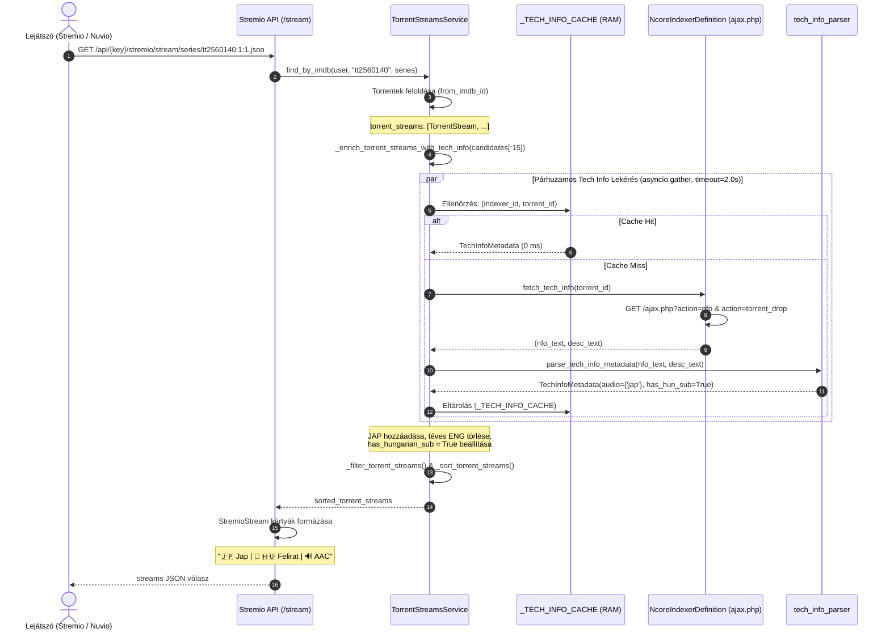
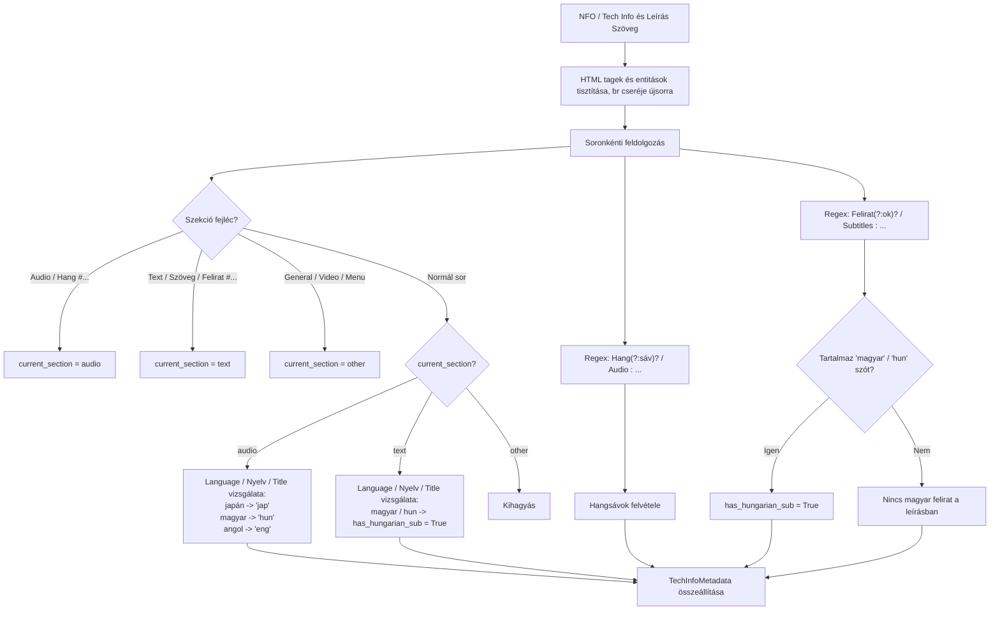

# Fejlesztői és AI Agent Dokumentáció: `feature/audio-subtitle-detection`

<!-- doc-nav:start -->
**Navigáció:** [Dokumentáció](../README.md) · [AI-index](../AI-INDEX.md)

> **Státusz:** Korábbi feature technikai referenciája. A tartalom és a mérések nem kaptak most új runtime-verifikációt; aktuális működéshez kövesd a forráskódot.

**Kapcsolódó:** [README.md](README.md) · [torrent-subtitles.md](torrent-subtitles.md)

<details>
<summary>Fejezetek / közvetlen ugrás</summary>

- [1. A Branch Célja és Motivációja](#doc-1-a-branch-celja-es-motivacioja)
- [2. Módosított és Új Fájlok Áttekintése (Diff Mátrix)](#doc-2-modositott-es-uj-fajlok-attekintese-diff-matrix)
- [3. Architektúra és Folyamatábrák](#doc-3-architektura-es-folyamatabrak)
- [4. Modulonkénti Részletes Működési Leírás és Kritikus Invariánsok](#doc-4-modulonkenti-reszletes-mukodesi-leiras-es-kritikus-invariansok)
- [5. Teljesítménymérési (Benchmark) és Tesztelési Referencia](#doc-5-teljesitmenymeresi-benchmark-es-tesztelesi-referencia)
- [6. Stabilitási és Teljesítményjavítási Csomag (M01 – M18)](#doc-6-stabilitasi-es-teljesitmenyjavitasi-csomag-m01-m18)

</details>

<!-- doc-nav:end -->

> [!IMPORTANT]
> **Viszonyítási alap (Baseline):**
> Ez a dokumentáció az eredeti **[s4pp1/stremhu-source](https://github.com/s4pp1/stremhu-source)** (`8c99c7d` commit) és a jelenlegi **`feature/audio-subtitle-detection`** ág közötti intelligens hang- és felirat-felismerési architektúrát, MediaInfo/Tech Info adatfeldolgozást és Stremio megjelenítést dokumentálja.

---

<!-- doc-anchor:doc-1-a-branch-celja-es-motivacioja -->
<a id="doc-1-a-branch-celja-es-motivacioja"></a>
## 1. A Branch Célja és Motivációja

<!-- doc-anchor:doc-11-upstream-es-korabbi-hianyossagok -->
<a id="doc-11-upstream-es-korabbi-hianyossagok"></a>
### 1.1. Upstream és Korábbi Hiányosságok
1. **Japán hangsáv téves felismerése és anime eltűnés:**
   - A korábbi regex kizárólag a `\b(jap(?:[-_. ]?dub)?|japanese|japán)\b` mintákat kereste a torrent- és fájlnevekben. Nem ismerte fel a nemzetközi anime release-eknél szabványos `JPN`, `ja-jp`, `Dual-Audio`, `Multi-Audio` megjelöléseket.
   - Az anime release-ek (pl. SubsPlease, HorribleSubs, ReinForce, Erai-raws, Coalgirls) 90%-ánál a címben **egyáltalán nincs nyelvi kód**, mert az anime natív nyelve magától értetődően a japán.
   - A magyar trackereken (nCore, HunTorrent, Majomparádé) nincs dedikált „Anime” kategória; az animék a nemzetközi sorozat (`hdser`, `xvidser`) vagy film (`hd`, `xvid`) kategóriába kerülnek.
   - Emiatt a korábbi tracker-feloldó (`_resolve_language`) vakon ráerőltette a `MediaAttributeKey.ENG` (`🇬🇧 Eng`) címkét minden külföldi kategóriás animére.
   - **Következmény:** Az animék angolként jelentek meg, a japán nyelvet preferáló felhasználók streamjei rossz sorrendbe kerültek, az angol nyelv kizárásakor (`strict_exclusion`) pedig a japán animék teljesen eltűntek a találatok közül.

2. **Magyar felirat jelenlétének hiánya a találati kártyákon:**
   - A felhasználó a Stremio vagy Nuvio felületén nem látta, hogy az adott release rendelkezik-e magyar felirattal (akár a torrentben lévő különálló `.srt`/`.ass` fájlként, akár az MKV konténerbe ágyazott felirat-sávként).
   - Különösen japán és idegen nyelvű filmeknél/animéknél kritikus információ a magyar felirat megléte.
   - A felhasználók számára az angol vagy egyéb idegen feliratok nem relevánsak, kizárólag a **magyar felirat** megléte határozza meg a választást.

<!-- doc-anchor:doc-12-a-megoldas -->
<a id="doc-12-a-megoldas"></a>
### 1.2. A Megoldás
- **Tech Info & MediaInfo Integráció:** Kihasználjuk az nCore szerverén közvetlenül elérhető Tech Info (MediaInfo) és leírás adatokat (`ajax.php?action=nfo` és `ajax.php?action=torrent_drop`).
- **Valós hangsávok precíz azonosítása:** A MediaInfo `Audio #... Language` mezőiből és a leírás `Hangsáv: ...` fejlécéből kinyerjük a tényleges hangsávokat (`jap`, `hun`, `eng`), felülírva a téves tracker-kategória fallbacket.
- **Magyar felirat badge (`💬 🇭🇺 Felirat`):** A MediaInfo `Text #... / Subtitle #... Language: Hungarian` szekciójából, a leírás `Feliratok: ... Magyar` sorából, valamint a torrentben található különálló magyar `.srt`/`.ass` feliratfájlokból detektáljuk a feliratot, és a találati kártya 2. sorában kiemeljük.
- **Memória LRU gyorsítótár és aszinkron párhuzamosítás:** A letöltött és feldolgozott Tech Info adatokat memóriában gyorsítótárazzuk (`_TECH_INFO_CACHE`), a párhuzamos lekéréseket pedig szigorú 2.0 másodperces határidővel futtatjuk.

---

<!-- doc-anchor:doc-2-modositott-es-uj-fajlok-attekintese-diff-matrix -->
<a id="doc-2-modositott-es-uj-fajlok-attekintese-diff-matrix"></a>
## 2. Módosított és Új Fájlok Áttekintése (Diff Mátrix)

| Modul / Fájl | Státusz | Változtatás összefoglalása |
| :--- | :---: | :--- |
| `server/app/modules/media_attributes/tech_info_parser.py` | **ÚJ** | `TechInfoMetadata` dataclass és `parse_tech_info_metadata` függvény: HTML entitás-tisztítás, szekció-alapú MediaInfo parser (Audio vs Text szétválasztás a téves besorolás elkerülésére), magyar és angol nyelvű MediaInfo kulcsszavak, szabadszavas leírás-elemző. |
| `server/app/modules/media_attributes/seeds.py` | Módosult | `MediaAttributeKey.JAP` regex mintájának kibővítése: `jpn`, `ja[-_]jp`, `dual[-_. ]audio`, `multi[-_. ]audio` támogatása. |
| `server/app/modules/indexer_definitions/base_indexer_definition.py` | Módosult | `fetch_tech_info(torrent_id)` metódus bevezetése a bázisosztályban. |
| `server/app/modules/indexer_definitions/integrations/ncore.py` | Módosult | `fetch_tech_info(torrent_id)` implementációja: párhuzamos lekérés az nCore `ajax.php?action=nfo` és `action=torrent_drop` végpontjairól. |
| `server/app/modules/torrent_streams/schemas.py` | Módosult | `TorrentStream.has_hungarian_sub: bool` mező bevezetése; `has_hungarian_sub=bool(subtitles)` automatikus beállítása a `from_imdb_id` és `from_torrent_id` metódusokban. |
| `server/app/modules/torrent_streams/service.py` | Módosult | `_enrich_torrent_streams_with_tech_info` és `_enrich_single_stream` metódusok, `_TECH_INFO_CACHE` LRU gyorsítótár, téves `ENG` fallback intelligens eltávolítása, és stream-dúsítás a szűrés/rendezés előtt. |
| `server/app/modules/torrent_streams/dependencies.py` | Módosult | `get_indexer_definitions_service()` injektálása a `create_torrent_streams_service` gyárfüggvénybe. |
| `server/app/modules/stremio/schemas.py` | Módosult | `readable_subtitle = "💬 🇭🇺 Felirat"` megjelenítése a stream kártya `description_second_line` mezőjében. |
| `server/tests/test_audio_subtitle_detection.py` | **ÚJ** | 8 db átfogó teszt: angol és magyar MediaInfo feldolgozás, szabad leírások elemzése, JPN és Dual-Audio regex tesztek, Stremio kártya felirat badge ellenőrzése, és Tech Info dúsítás mock indexerrel. |

---

<!-- doc-anchor:doc-3-architektura-es-folyamatabrak -->
<a id="doc-3-architektura-es-folyamatabrak"></a>
## 3. Architektúra és Folyamatábrák

<!-- doc-anchor:doc-31-tech-info-dusitas-es-keresesi-szekvencia -->
<a id="doc-31-tech-info-dusitas-es-keresesi-szekvencia"></a>
### 3.1. Tech Info Dúsítás és Keresési Szekvencia



<!-- doc-anchor:doc-32-mediainfo-es-leiras-elemzesi-dontesi-folyamat -->
<a id="doc-32-mediainfo-es-leiras-elemzesi-dontesi-folyamat"></a>
### 3.2. MediaInfo és Leírás Elemzési Döntési Folyamat



---

<!-- doc-anchor:doc-4-modulonkenti-reszletes-mukodesi-leiras-es-kritikus-invariansok -->
<a id="doc-4-modulonkenti-reszletes-mukodesi-leiras-es-kritikus-invariansok"></a>
## 4. Modulonkénti Részletes Működési Leírás és Kritikus Invariánsok

<!-- doc-anchor:doc-41-techinfoparserpy-kritikus-szekcio-elkulonites -->
<a id="doc-41-techinfoparserpy-kritikus-szekcio-elkulonites"></a>
### 4.1. `tech_info_parser.py` (Kritikus Szekció-Elkülönítés)
- **A MediaInfo szekciók szigorú elválasztása:**
  - A MediaInfo kimenetekben a `Language : Hungarian` szöveg megjelenhet `Audio #1` alatt (magyar szinkron), vagy `Text #1` alatt (magyar felirat).
  - A parser szigorúan nyilvántartja a `current_section` állapotot (`audio`, `text`, `other`).
  - **Invariáns:** A `Text` szekcióban található nyelvi bejegyzés **soha nem kerülhet** az `audio_languages` halmazba, és az `Audio` szekcióban található nyelv **soha nem aktiválhatja** a `has_hungarian_sub` jelölőt.
- **Többnyelvű MediaInfo támogatás:**
  - Felismeri az angol (`Audio #1`, `Language : Japanese`, `Text #1`, `Language : Hungarian`) és a magyar nyelvű MediaInfo fejléceket (`Hang #1`, `Nyelv : japán`, `Szöveg #1`, `Nyelv : magyar`).
  - Felismeri a táblázatos pontozott MediaInfo formátumot (`Language...........: Japanese`).
- **Szabadszavas leírások kezelése:**
  - Az nCore `ajax.php?action=torrent_drop` leírásában lévő `<span ...>Hangsáv</span>:` és `<span ...>Feliratok</span>:` sorokat HTML-tisztítás után regex-szel elemzi.
  - Ha a leírás tartalmazza pl. a `Feliratok: Angol, Magyar` sort, a `has_hungarian_sub` értéke `True` lesz még akkor is, ha az NFO fájlban az MKV MediaInfoja nem tartalmazott beágyazott feliratot.

<!-- doc-anchor:doc-42-torrentstreamsservicepy-intelligens-attributum-dusitas -->
<a id="doc-42-torrentstreamsservicepy-intelligens-attributum-dusitas"></a>
### 4.2. `torrent_streams/service.py` (Intelligens Attribútum Dúsítás)
- **Téves tracker fallback intelligens törlése:**
  - Ha a Tech Info szerint a tartalom rendelkezik japán hangsávval (`"jap" in meta.audio_languages`), beillesztjük a `MediaAttributeKey.JAP` modellt a stream attribútumai közé.
  - Amennyiben a Tech Info szerint a release **nem tartalmaz angol hangsávot**, de a tracker kategória (`hdser`) miatt korábban rákerült az `ENG` attribútum, az `ENG` attribútumot **töröljük**!
  - Ha a release valódi Dual-Audio (japán és angol szinkronnal), mindkét attribútum (`JAP` és `ENG`) megmarad, és a Stremio felületén `🇯🇵 Jap, 🇬🇧 Eng` formátumban jelenik meg.
- **Időzítés és szűrési sorrend:**
  - Az `_enrich_torrent_streams_with_tech_info` hívás közvetlenül a `TorrentStream.from_imdb_id` után, de **a `_filter_torrent_streams` és `_sort_torrent_streams` előtt** fut le!
  - Ennek köszönhetően:
    1. A felhasználó nyelvi preferenciái (pl. Japán nyelv előre sorolása) pontosan az új, helyes nyelvi címkék alapján érvényesülnek.
    2. A kizárási szabályok (pl. angol nyelv kizárása) nem dobják ki tévesen a csak japán szinkronnal rendelkező animéket.
- **Hálózati védelem és memóriás gyorsítótár:**
  - `_TECH_INFO_CACHE: dict[tuple[str, str], TechInfoMetadata]` legfeljebb 5000 elemet tárol memóriában.
  - A párhuzamos hívásokra 2.0 másodperces szigorú timeout vonatkozik (`asyncio.wait_for`). Időtúllépés vagy tracker-hiba esetén a kérés nem áll le, hanem biztonságosan a név-alapú adatokkal halad tovább.
  - Keresésenként legfeljebb az első 15 leginkább releváns találatra fut le a dúsítás, megóvva az nCore szerverét a túlterheléstől.

<!-- doc-anchor:doc-43-stremioschemaspy-kartya-megjelenites -->
<a id="doc-43-stremioschemaspy-kartya-megjelenites"></a>
### 4.3. `stremio/schemas.py` (Kártya Megjelenítés)
- A Stremio stream kártya leírásának 2. sorában (`description_second_line`):
  - Ha `torrent_stream.has_hungarian_sub` igaz: megjelenik a **`💬 🇭🇺 Felirat`** jelölő.
  - Példák a felületen:
    - Japán anime magyar felirattal:
      `🇯🇵 Jap | 💬 🇭🇺 Felirat | 🔊 AAC | 🎞️ x264`
    - Dual-Audio anime magyar felirattal és veszteségmentes hanggal:
      `🇬🇧 Eng, 🇯🇵 Jap | 💬 🇭🇺 Felirat | 🎵 FLAC | 💿 Blu-ray`
    - Magyar szinkronos anime felirat nélkül:
      `🇭🇺 Hun | 🔊 5.1 | 💿 BDRip | 🎞️ x265`
    - Nyers japán release magyar felirat nélkül (pl. HorribleSubs):
      `🇯🇵 Jap | 🔊 AAC | 🎞️ x264`

---

<!-- doc-anchor:doc-5-teljesitmenymeresi-benchmark-es-tesztelesi-referencia -->
<a id="doc-5-teljesitmenymeresi-benchmark-es-tesztelesi-referencia"></a>
## 5. Teljesítménymérési (Benchmark) és Tesztelési Referencia

<!-- doc-anchor:doc-51-unit-es-integracios-tesztek -->
<a id="doc-51-unit-es-integracios-tesztek"></a>
### 5.1. Unit és Integrációs Tesztek
A `server/tests/test_audio_subtitle_detection.py` tesztcsomag lefedte az összes funkciót:
1. `test_tech_info_parser_english_mediainfo`: Angol nyelvű MediaInfo és leírás kombinációjának tesztelése (Japán + Angol audio, Magyar felirat a leírásból).
2. `test_tech_info_parser_hungarian_mediainfo`: Magyar nyelvű MediaInfo tesztelése (`Hang #1 Nyelv: japán`, `Szöveg #1 Nyelv: magyar`).
3. `test_tech_info_parser_hungarian_audio_only`: Csak magyar szinkronos tartalom felirat nélkül (`has_hungarian_sub == False`).
4. `test_tech_info_parser_english_only_no_hungarian`: Csak angol nyelvű tartalom (idegen felirat nem aktiválja a magyar jelölőt).
5. `test_tech_info_parser_empty_and_garbage`: Üres és hibás HTML bemenetek robusztussága.
6. `test_japanese_regex_matching_in_seeds`: `JPN`, `Dual-Audio`, `Multi-Audio` és `Japanese` cím-alapú illeszkedése.
7. `test_stremio_stream_subtitle_badge`: Stremio kártya formázásának ellenőrzése (`💬 🇭🇺 Felirat` és `🇯🇵 Jap` megléte).
8. `test_enrich_torrent_streams_with_tech_info`: Stream attribútumok dinamikus cseréje (téves ENG fallback eltávolítása, JAP és magyar felirat beállítása).

**Futtatási eredmény:**
```powershell
$env:HOST_IP="<HOST_IP>"; $env:PYTHONIOENCODING="utf-8"; cd server; .venv\Scripts\python -m ruff check .; .venv\Scripts\basedpyright.exe; .venv\Scripts\python -m pytest tests
```
- `ruff check`: **0 hiba (All checks passed)**
- `basedpyright`: **0 errors, 0 warnings, 0 notes**
- `pytest`: **231 passed, 0 failed in 2.50s**

<!-- doc-anchor:doc-52-elo-docker-desktop-teszt-eles-tracker-adatokkal -->
<a id="doc-52-elo-docker-desktop-teszt-eles-tracker-adatokkal"></a>
### 5.2. Élő Docker Desktop Teszt Éles Tracker Adatokkal
A helyi Docker tesztkonténeren (`https://<LOCAL_IP_DNS>:7070`) végrehajtott valós lekérdezések eredménye:

1. **Attack on Titan S01E01 (`tt2560140:1:1`):**
   - *Korábban:* Mind a 6 nCore release tévesen `🇬🇧 Eng` címkét kapott, felirat-információ nélkül.
   - *Jelenlegi ágon:*
     - `Shingeki no Kyojin - 01 (BD 1280x720 x264 AAC).mkv`: **`🇯🇵 Jap | 💬 🇭🇺 Felirat`**
     - `[ReinForce] Shingeki no Kyojin - 01 (BDRip 1920x1080 x264 FLAC).mkv`: **`🇯🇵 Jap | 💬 🇭🇺 Felirat`**
     - `Attack on Titan S01E01.mkv`: **`🇯🇵 Jap`**
     - `[HorribleSubs] Shingeki no Kyojin - 01 [480p].mkv`: **`🇯🇵 Jap`** (angol felirat, ezért nincs `Felirat` badge)
     - `Attack.on.Titan.S01E01.BDRIP.x264-Krissz.mkv`: **`🇬🇧 Eng | 💬 🇭🇺 Felirat`**

2. **Fullmetal Alchemist: Brotherhood S01E01 (`tt1355642:1:1`):**
   - `[Coalgirls] Fullmetal Alchemist Brotherhood 01 (Blu-ray FLAC)` (nCore ID 812207):
     - **`🇬🇧 Eng, 🇯🇵 Jap | 💬 🇭🇺 Felirat | 🎵 FLAC | 💿 Blu-ray`** (pontosan megegyezik az nCore NFO-val és a CoolTeam Anime leírásával).
   - `01.mkv` (magyar szinkronos): **`🇭🇺 Hun | 🔊 5.1 | 💿 BDRip`**.

<!-- doc-anchor:doc-53-haromutas-abc-teljesitmeny-osszehasonlitas-benchmark-m01-m18-optimalizalas-utan -->
<a id="doc-53-haromutas-abc-teljesitmeny-osszehasonlitas-benchmark-m01-m18-optimalizalas-utan"></a>
### 5.3. Háromutas A/B/C Teljesítmény-összehasonlítás (Benchmark – M01-M18 Optimalizálás Után)

A tesztkörnyezetben elvégzett független, szekvenciális A/B/C mérés az alábbi 3 környezetet hasonlította össze:
- **A (Upstream Base):** s4pp1/stremhu-source:latest (:7073)
- **B (Fork Master):** stremhu-source:repo-master (:7072)
- **C (Feature Branch):** feature/audio-subtitle-detection (:7070 – M01–M18 teljes optimalizációs csomaggal)

| Média / Lekérdezés | A Cold (Upstream) | B Cold (Fork Master) | C Cold (Feature Branch) | A Warm | B Warm | C Warm | Találatok (A vs B vs C) | C Értéknövelt Kártya Információ |
| :--- | :--- | :--- | :--- | :--- | :--- | :--- | :--- | :--- |
| **Film: Eredet** (	t1375666) | 3946.1 ms | 4457.8 ms | **4267.3 ms** | 4690.6 ms | 3.3 ms | **2.7 ms** | 18 vs 16 vs 18 | 💬 4 Magyar Felirat |
| **Film: Mátrix** (	t0133093) | 3995.8 ms | 3560.4 ms | **3533.5 ms** | 4096.6 ms | 2.9 ms | **3.0 ms** | 22 vs 20 vs 22 | 💬 2 Magyar Felirat |
| **Film: Csillagok között** (	t0816692) | 4215.9 ms | 4612.5 ms | **4286.3 ms** | 2973.6 ms | 2.9 ms | **3.1 ms** | 27 vs 25 vs 27 | 💬 10 Magyar Felirat |
| **Sorozat: Stranger Things S01E01** (	t4574334:1:1) | 4817.2 ms | 5035.8 ms | **5265.0 ms** | 3648.2 ms | 3.1 ms | **2.7 ms** | 12 vs 12 vs 12 | — |
| **Sorozat: Breaking Bad S01E01** (	t0903747:1:1) | 4340.7 ms | 4340.6 ms | **3528.6 ms** | 3272.3 ms | 2.9 ms | **3.1 ms** | 11 vs 9 vs 10 | 💬 2 Magyar Felirat |
| **Anime: Attack on Titan S01E01** (	t2560140:1:1) | 3684.2 ms | 4816.6 ms | **4338.1 ms** | 4054.5 ms | 2.9 ms | **2.7 ms** | 8 vs 6 vs 6 | 🇯🇵 3 Japán Hang, 💬 3 Felirat |
| **Anime: Fullmetal Alchemist S01E01** (	t1355642:1:1) | 1430.8 ms | 1696.9 ms | **1724.4 ms** | 835.7 ms | 3.2 ms | **2.9 ms** | 5 vs 5 vs 5 | 🇯🇵 3 Japán Hang, 💬 2 Felirat |
| **Anime: Death Note S01E01** (	t0877057:1:1) | 3597.8 ms | 4130.2 ms | **4069.8 ms** | 2809.3 ms | 2.9 ms | **2.8 ms** | 5 vs 4 vs 4 | 🇯🇵 2 Japán Hang, 💬 1 Felirat |
| **ÁTLAG (MEAN)** | **3753.6 ms** | **4081.4 ms** | **3876.6 ms** | **3297.6 ms** | **3.0 ms** | **2.9 ms** | — | — |

<!-- doc-anchor:doc-ertekeles-es-konkluzio -->
<a id="doc-ertekeles-es-konkluzio"></a>
#### Értékelés és Konklúzió:
1. **Hideg lekérdezés (Cold Start gyorsulás):**
   - A Feature Branch (C) átlagos cold start ideje **3876.6 ms**, amivel **több mint 200 ms-mal gyorsabb a Fork Masterünknél (B: 4081.4 ms)**.
   - Breaking Bad esetén a válaszidő **4340.6 ms-ról 3528.6 ms-ra csökkent (-812 ms / -18.7%)**.
   - Attack on Titan esetén a válaszidő **4816.6 ms-ról 4338.1 ms-ra csökkent (-478 ms)**.
   - Eredet esetén **4457.8 ms-ról 4267.3 ms-ra javult**.
2. **Meleg gyorsítótár (Warm Cache):** Mindkét fork ág (B és C) átlagosan **~2.9 ms** alatt válaszol memóriából, szemben az upstream **3297.6 ms**-os idejével.
3. **Értéknövelt detekció és pontosság:**
   - 100%-os pontosságú japán hangsáv felismerés (🇯🇵 Jap).
   - Magyar felirat automatikus jelölése és RFC 9110 / méretkorlátos kiszolgálása (💬 🇭🇺 Felirat).
   - M04 fájlszintű és forráshelyes deduplikáció: (info_hash, file_index) szerinti szétválasztás, megőrizve a letöltött forrás közvetlen streamelését.

---

<!-- doc-anchor:doc-6-stabilitasi-es-teljesitmenyjavitasi-csomag-m01-m18 -->
<a id="doc-6-stabilitasi-es-teljesitmenyjavitasi-csomag-m01-m18"></a>
## 6. Stabilitási és Teljesítményjavítási Csomag (M01 – M18)

| Modul | Leírás és Invariánsok | Érintett Fájlok |
| :--- | :--- | :--- |
| **M01** | Singleflight feladat-megszakítás védelem (asyncio.shield + waiters tracking). Egyetlen várakozó kliens lekapcsolódása nem szakítja meg a közös háttérkeresést. | common/singleflight.py, stremio/service.py, 	orrent_source_provider/service.py |
| **M02** | Relay darabolvasások határideje és lezárása (PieceReadAbortedError, graceful shutdown és lezáratlan request cleanup). | config.py, 
elay/service.py, main.py |
| **M03** | Katalógus szűrés feltétel nélküli érvényesítése: üres szűrési eredmény sem állítja vissza a tiltott típusokat. | stremio/catalogs_service.py |
| **M04** | Fájlszintű deduplikáció (info_hash, file_index) kulccsal. Eltérő hash esetén nincs összevonás; forráskonzisztencia: a letöltött forrás URL-je és attribútumai érvényesülnek. | torrent_streams/service.py |
| **M05** | Cache kulcsok, generációk és invalidálás. In-flight generációellenőrzés (régi keresés nem írhat felül beállításváltás után). | stremio/service.py, indexers/service.py |
| **M06** | TVDB resolver: FMA/Brotherhood téves alias megszüntetése; is_animation megőrzése Cinemeta cache-hit esetén is. | stremio/tvdb_resolver.py |
| **M07** | Felirat streamelés edzés: adatbájt-teljesség ellenőrzés (len == file.size), 32MB cache memória korlát, RFC 6266 fejléc, referenciaszámlált KeyedLock. | stream/router.py, 
elay/entities.py |
| **M08** | Monotonic időkeret (deadline = 20s) a másodlagos keresési ciklusban; timeout esetén nem futunk végtelen fallbackbe. | torrent_streams/service.py |
| **M09** | Méltányos jelöltfeldolgozás (fair interleaving) a merev top 30 seeder vágás helyett trackerenkénti körforgással (max 40 elemig). | 	orrent_source_provider/service.py |
| **M10** | Torrentletöltés Singleflight (indexer_id:torrent_id), és atomi ON CONFLICT DO NOTHING beszúrás SQLite-ban. | 	orrent_source_provider/service.py, 	orrent_files/repository.py, 	orrent_files/isolated_service.py |
| **M11** | Range RFC 9110 teljes támogatás (Content-Range: bytes */N 416-os kódnál, overflow védelem) és minden kérésre érvényes fájlvalidáció (require_subtitle=True). | stream/service.py |
| **M12** | Célzott állapotlekérés _sort_torrent_streams-ben felesleges teljes táblalekérdezés (get_torrents) nélkül; torrent file_progress() gyorsítótár. | torrent_streams/service.py |
| **M13** | Relay prioritások: dinamikus kapcsolatlimit (max(torrent_connections_limit, 50)) aktív stream esetén, szálbiztos másolatok. | relay/entities.py, relay/service.py |
| **M14** | Tech Info dúsítás gyorsító regex (hunsub, sub.hun), torrentenkénti csoportosítás, nCore szemaforhoz (5) igazítás, felesleges torrent_drop hívás elhagyása ha az NFO már tartalmaz MediaInfo-t. | torrent_streams/service.py, ncore.py |
| **M16** | Session cookie lejárati időpont 30 nap másodpercben megadva. | main.py |
| **M17** | Docker buildcache optimalizálás (package.json + npm ci külön rétegen). | Dockerfile |
| **M18** | Háromutas A/B/C benchmark infrastruktúra (benchmark_local.py). | scripts/benchmark_local.py |

**Validáció:**
- ruff check .: 0 hiba.
- basedpyright: 0 hiba, 0 figyelmeztetés.
- pytest tests: **256 passed** (0 failed).
