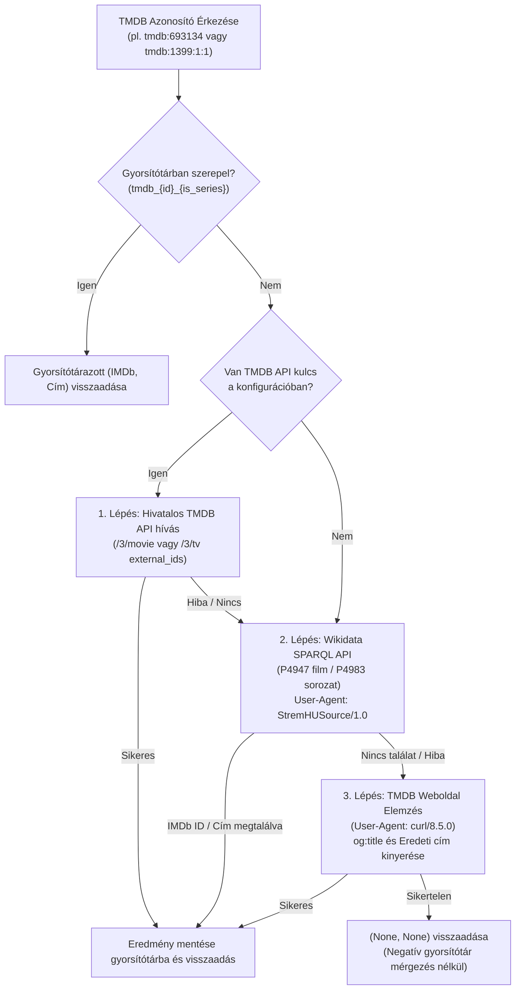
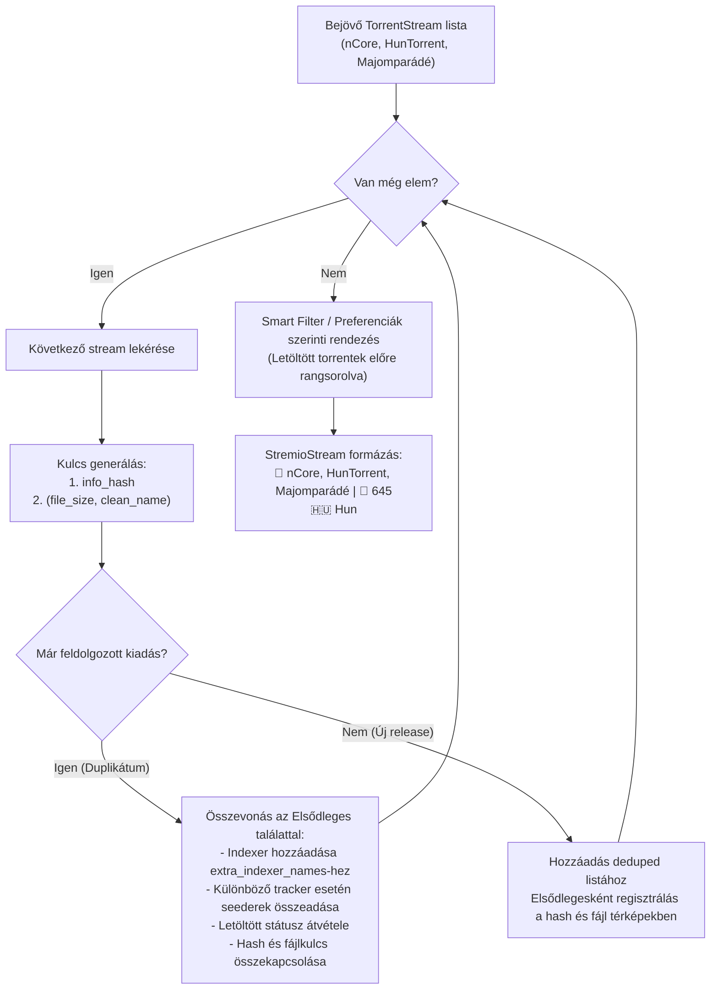

# Fejlesztői Dokumentáció: `feature/search-filter-tmdb-tvdb`

<!-- doc-nav:start -->
**Navigáció:** [Dokumentáció](../README.md) · [AI-index](../AI-INDEX.md)

> **Státusz:** Korábbi feature technikai referenciája. A tartalom és a mérések nem kaptak most új runtime-verifikációt; aktuális működéshez kövesd a forráskódot.

**Kapcsolódó:** [README.md](README.md) · [anime-tvdb-kitsu-support.md](anime-tvdb-kitsu-support.md)

<details>
<summary>Fejezetek / közvetlen ugrás</summary>

- [1. A Branch Célja és Motivációja](#doc-1-a-branch-celja-es-motivacioja)
- [2. Módosított és Új Fájlok Áttekintése (Diff Mátrix s4pp1/stremhu-source vs feature/search-filter-tmdb-tvdb)](#doc-2-modositott-es-uj-fajlok-attekintese-diff-matrix-s4pp1stremhu-source-vs-featuresearch-filter-tmdb-tvdb)
- [3. Rendszerarchitektúra és Működési Folyamatábrák](#doc-3-rendszerarchitektura-es-mukodesi-folyamatabrak)
- [4. Modulonkénti Részletes Működési Leírás és Invariánsok](#doc-4-modulonkenti-reszletes-mukodesi-leiras-es-invariansok)
- [5. Teljesítménymérési Eredmények (A/B Benchmark a Saját Repo Master Ága ellen)](#doc-5-teljesitmenymeresi-eredmenyek-ab-benchmark-a-sajat-repo-master-aga-ellen)
- [6. Verifikációs Parancsok](#doc-6-verifikacios-parancsok)

</details>

<!-- doc-nav:end -->

> **Viszonyítási alap (Baseline):** Eredeti upstream [`s4pp1/stremhu-source`](https://github.com/s4pp1/stremhu-source) (`8c99c7d` commit).
> Ez a dokumentum a `feature/search-filter-tmdb-tvdb` branch által bevezetett összes funkcionális, hibajavítási, Stremio/Nuvio best practice és teljesítménybeli változtatást részletesen rögzíti az eredeti `s4pp1/stremhu-source` állapothoz képest (beleértve a `main` ágból átvett anime feloldást, a több-trackeres keresési optimalizálásokat és a stream deduplikációt is).

---

<!-- doc-anchor:doc-1-a-branch-celja-es-motivacioja -->
<a id="doc-1-a-branch-celja-es-motivacioja"></a>
## 1. A Branch Célja és Motivációja

Az eredeti `s4pp1/stremhu-source` a következő korlátokkal rendelkezett a TMDB alapú Stremio katalógusok, a több-trackeres szöveges keresés, a másodlagos epizód-feloldás és a stream megjelenítés terén:

1. **TMDB Stream ID (`tmdb:{id}`) hiánya és API kulcs kényszer:** A Stremio TheMovieDatabase (TMDB) addonja `tmdb:693134` (film) vagy `tmdb:1399:1:1` (sorozat) formátumú azonosítókat küld. Az eredeti rendszer nem ismerte fel a `tmdb:` prefixet, és még kezdetleges feloldás esetén is kötelezővé tette a felhasználói TMDB API kulcsot, a publikus TMDB oldal lekérését pedig a Cloudflare 403-as hibával tiltotta.
2. **Keresési hiányosságok a nem-nCore indexereken:** Az `s4pp1/stremhu-source` implementációjában kizárólag az nCore rendelkezett `_fetch_torrents_by_query` metódussal. A többi indexeren (`HunTorrent`, `Majomparádé`, `BitHUmen`, `iNSANE`) a szöveges keresések mindig üres listát adtak vissza, továbbá a `BitHUmen` és `iNSANE` indexerek eldobták azokat a torrenteket, ahol a feltöltő nem adott meg IMDb linket.
3. **Torrent letöltési lavina (Download Storm) általános kereséseknél:** Ha egy másodlagos név szerinti keresés (fallback title search) vagy katalógus-keresés sok találatot adott (pl. *South Park*, *Naruto*, *Star Wars*), a rendszer korlátlanul letöltötte mind a 300 `.torrent` fájlt, ami 10–15 másodperces lefagyást és tracker timeoutokat okozott.
4. **Ismétlődő tracker lekérdezések epizódváltáskor:** Epizódváltáskor vagy másodlagos keresési próbálkozásoknál a trackerek újra és újra le lettek kérdezve a hálózaton keresztül a rövid 180 mp-es gyorsítótár miatt.
5. **Film és sorozat téves összekeveredése másodlagos keresésnél:** Ha egy film keresésekor (pl. *Dune*) a név szerinti keresés sorozat-epizódokat vagy évadpakkokat talált, a `StreamFileResolver` a filmhez is kiválasztotta a legnagyobb videófájlt a sorozatcsomagból (pl. S03E12), filmként tálalva azt.
6. **Stremio Series Catalog és Meta hiba:** A `StremioCatalogsService` és a `router.py` korábban kizárólag `media_type == MediaType.MOVIE` esetén engedélyezte a keresési katalógust és a meta részletek lekérését; `series` esetén üres választ adott (`meta: {}`).
7. **Több-trackeres duplikációk a találatok között:** Amikor a felhasználó mind az nCore-t, mind a HunTorrentet és Majomparádét bekötötte, a megegyező kiadások (azonos swarm / info_hash vagy azonos videófájl) külön-külön, 2-3 példányban jelentek meg a kliensben, feleslegesen duplázva a találati listát.
8. **Hiányzó letöltött jelzés és felirat metaadatok:** Ha egy torrent már le volt töltve a háttértárra, a Stremio kliensben nem volt megkülönböztetve az éppen indított streaming torrenttől; a torrentekben megtalálható magyar feliratok (`.srt`, `.ass` vagy `hunsub`) nem voltak jelölve a találati leírásban; hiányoztak a nemzeti zászló emojik a nyelveknél.
9. **Kezdeti lejátszási akadozás Nuvio és ExoPlayer alatt:** A Relay modul korábban csak a streamelt fájl legelső és legutolsó darabjára állított azonnali (`deadline = 0`) prioritást. MKV Cues és MP4 moov atomok esetén (amelyek 2-6 MB méretűek is lehetnek) ez lejátszási timeoutot vagy pufferelési stall-t okozhatott az indításkor.

---

<!-- doc-anchor:doc-2-modositott-es-uj-fajlok-attekintese-diff-matrix-s4pp1stremhu-source-vs-featuresearch-filter-tmdb-tvdb -->
<a id="doc-2-modositott-es-uj-fajlok-attekintese-diff-matrix-s4pp1stremhu-source-vs-featuresearch-filter-tmdb-tvdb"></a>
## 2. Módosított és Új Fájlok Áttekintése (Diff Mátrix `s4pp1/stremhu-source` vs `feature/search-filter-tmdb-tvdb`)

| Fájl elérési útja | Státusz | Változtatás összefoglalása |
| :--- | :---: | :--- |
| [`server/app/modules/users/models.py`](file:///d:/Git/stremhu-source-anime/server/app/modules/users/models.py)<br>[`server/alembic/versions/4b8c9d1e2f3a_add_enable_stream_deduplication_to_users.py`](file:///d:/Git/stremhu-source-anime/server/alembic/versions/4b8c9d1e2f3a_add_enable_stream_deduplication_to_users.py)<br>[`client/src/routes/_protected/settings/preferences/-features/other-preferences.tsx`](file:///d:/Git/stremhu-source-anime/client/src/routes/_protected/settings/preferences/-features/other-preferences.tsx) | **MÓDOSÍTOTT / ÚJ** | **UI kapcsoló a trackerek összevonásához:** `enable_stream_deduplication` felhasználói beállítás és adatbázis mező. A Web UI-ban a *Beállítások > További preferenciák* kártyán külön kapcsolhatóvá vált a multi-tracker összevonás. Ha ki van kapcsolva, a rendszer minden trackerről külön listázza a release-eket. |
| [`server/app/modules/media_attributes/constants.py`](file:///d:/Git/stremhu-source-anime/server/app/modules/media_attributes/constants.py)<br>[`server/app/modules/media_attributes/seeds.py`](file:///d:/Git/stremhu-source-anime/server/app/modules/media_attributes/seeds.py) | **MÓDOSÍTOTT** | `MediaAttributeKey.JAP = "jap"` és `MediaAttributeModel` bevezetése: automatikus japán hangsáv felismerés (`jap`, `japanese`, `japán`, `japdub`) és `🇯🇵 Jap` megjelenítés, beállítható preferencia sorrenddel. |
| [`server/app/modules/relay/service.py`](file:///d:/Git/stremhu-source-anime/server/app/modules/relay/service.py)<br>[`server/app/modules/torrents/service.py`](file:///d:/Git/stremhu-source-anime/server/app/modules/torrents/service.py) | **MÓDOSÍTOTT** | `is_file_downloaded(info_hash, file_index, file_size)` bevezetése: a Libtorrent `file_progress()` alapján ellenőrzi az adott fájl befejezettségét, megszüntetve a fals `⚡ Letöltve` jelzést a még le nem töltött epizódoknál sorozat-évadcsomagokban. |
| [`server/app/modules/stremio/tvdb_resolver.py`](file:///d:/Git/stremhu-source-anime/server/app/modules/stremio/tvdb_resolver.py) | **ÚJ** | `TvdbResolver`: Kulcs nélküli TMDB feloldás Wikidata SPARQL API-val (`UNION`-nal `P4947` movie és `P4983` series együttes lekérdezése), kulcs nélküli TVDB feloldás (`P4835` series / `P12196` movie), Kitsu Title Fallback Rescue (`canonicalTitle`), MyAnimeList (`mal:`) feloldás (`P4086` & Kitsu Mappings), iker IMDb aliasok (`_IMDB_ALIASES`, beleértve Naruto, Bleach, Death Note, FMA), Cloudflare-kompatibilis web scraping fallback (`curl/8.5.0`), HTML entitás dekódolás (`html.unescape`), szigorú típus-izoláció, negatív gyorsítótár-mérgezés védelem. |
| [`server/app/modules/stremio/service.py`](file:///d:/Git/stremhu-source-anime/server/app/modules/stremio/service.py) | **MÓDOSÍTOTT** | `tmdb`, `tvdb`, `kitsu`, `mal` és `anime:` prefixek teljes körű támogatása. `prefetch_task` átadása a `find_by_imdb`-nek (duplikált keresések megszüntetése). Párhuzamos iker IMDb lekérdezés filmekre és sorozatokra is. Cím szerinti mentőöv (Title Fallback Rescue). |
| [`server/app/modules/stremio/catalogs_service.py`](file:///d:/Git/stremhu-source-anime/server/app/modules/stremio/catalogs_service.py) | **MÓDOSÍTOTT** | `MediaType.SERIES` támogatás a keresési katalógusban (`ContentType.SERIES` és `ContentType.MOVIE` elkülönítése). |
| [`server/app/modules/stremio/router.py`](file:///d:/Git/stremhu-source-anime/server/app/modules/stremio/router.py) | **MÓDOSÍTOTT** | `/meta/{media_type}/{id}.json` kéréseknél a sorozatok engedélyezése (`media_type not in (MediaType.MOVIE, MediaType.SERIES)`). |
| [`server/app/modules/stremio/schemas.py`](file:///d:/Git/stremhu-source-anime/server/app/modules/stremio/schemas.py) | **MÓDOSÍTOTT** | `StremioStream.from_imdb_torrent_stream`: `⚡ Letöltve` jelzés a címben és `⚡ Helyben tárolva (Azonnali lejátszás)` a leírás fejlécében; zászló emojik (`🇭🇺 Hun`, `🇬🇧 Eng`, `🇯🇵 Jap`, `🇩🇪 Ger`, `🇫🇷 Fra`); összevont trackerek (`🧲 nCore, HunTorrent, Majomparádé`) és összevont seederek (`👥 {sum}`). Nincs felesleges `[StremHU]` prefix; a téves/megtévesztő felirat jelzések elkerülve. |
| [`server/app/modules/stremio/utils.py`](file:///d:/Git/stremhu-source-anime/server/app/modules/stremio/utils.py) | **MÓDOSÍTOTT** | `parse_stream_id`: `anime:` prefix lecsupaszítása, `mal:`, `mal_` és egyéb MAL azonosító formátumok helyes felismerése `MalStreamId`-ként. |
| [`server/app/modules/torrent_streams/schemas.py`](file:///d:/Git/stremhu-source-anime/server/app/modules/torrent_streams/schemas.py) | **MÓDOSÍTOTT** | `TorrentStream`: `extra_indexer_names: list[str] = []`, `combined_seeders: int | None = None`, `is_persisted_torrent: bool = False`. |
| [`server/app/modules/torrent_streams/service.py`](file:///d:/Git/stremhu-source-anime/server/app/modules/torrent_streams/service.py) | **MÓDOSÍTOTT** | `prefetch_task` deduplikáció és azonnali `await`. `_deduplicate_torrent_streams`: multi-tracker és azonos tartalmú streamek összevonása `info_hash` és `(file_size, clean_name)` alapján, seederek összeadásával és egyedi indexer nyilvántartással. `_build_fallback_queries`: intelligens cím- és évadkeresés. |
| [`server/app/modules/relay/entities.py`](file:///d:/Git/stremhu-source-anime/server/app/modules/relay/entities.py) | **MÓDOSÍTOTT** | `_set_file_boundary_priorities`: 1-ről `min(3, total_pieces // 2)`-re bővített azonnali (`deadline = 0`) prioritás a streamelt fájl elejére és végére (MKV Cues és MP4 moov azonnali betöltése ExoPlayer / Nuvio alatt). |
| [`server/app/modules/torznab/constants.py`](file:///d:/Git/stremhu-source-anime/server/app/modules/torznab/constants.py) | **MÓDOSÍTOTT** | `SEARCH_AVAILABLE = True`, `SEARCH_SUPPORTED_PARAMS = "q,imdbid,tmdbid"`, `TV_SEARCH_SUPPORTED_PARAMS = "q,imdbid,tvdbid,tmdbid,season,ep"`, `MOVIE_SEARCH_SUPPORTED_PARAMS = "q,imdbid,tmdbid"`. |
| [`server/app/modules/torznab/query.py`](file:///d:/Git/stremhu-source-anime/server/app/modules/torznab/query.py) | **MÓDOSÍTOTT** | `TorznabQuery`: `tvdb_id` és `tmdb_id` paraméterek bevezetése és normalizált parsere. |
| [`server/app/modules/torznab/service.py`](file:///d:/Git/stremhu-source-anime/server/app/modules/torznab/service.py) | **MÓDOSÍTOTT** | Torznab keresés bővítése: `tvdbid`, `tmdbid` automatikus IMDb/cím feloldása `TvdbResolver`-rel, `q` esetén szöveges keresés a forrásokon, alternatív iker IMDb azonosítók párhuzamos feloldása. |
| [`server/app/modules/indexers/service.py`](file:///d:/Git/stremhu-source-anime/server/app/modules/indexers/service.py) | **MÓDOSÍTOTT** | `_IMDB_TRACKER_CACHE_TTL = 1800.0` (30 perc) az egymást követő sorozatepizódok redundáns tracker lekérdezéseinek elkerülésére; `_QUERY_TRACKER_CACHE_TTL = 300.0` (5 perc) LRU mérettel és normalizált kulcsokkal. |
| [`server/app/modules/indexer_definitions/base_indexer_definition.py`](file:///d:/Git/stremhu-source-anime/server/app/modules/indexer_definitions/base_indexer_definition.py) | **MÓDOSÍTOTT** | `_find_all_by_query` lapozási korlát 50 elemre (megelőzve a végtelen lapozási viharokat) deduplikációval (`pydash.uniq_by`). |
| [`server/app/modules/indexer_definitions/integrations/huntorrent.py`](file:///d:/Git/stremhu-source-anime/server/app/modules/indexer_definitions/integrations/huntorrent.py) | **MÓDOSÍTOTT** | `_fetch_torrents_by_query` implementáció natív HunTorrent kereséssel. |
| [`server/app/modules/indexer_definitions/integrations/majomparade.py`](file:///d:/Git/stremhu-source-anime/server/app/modules/indexer_definitions/integrations/majomparade.py) | **MÓDOSÍTOTT** | `_fetch_torrents_by_query` implementáció natív Majomparádé szöveges kereséssel. |
| [`server/app/modules/indexer_definitions/integrations/bithumen.py`](file:///d:/Git/stremhu-source-anime/server/app/modules/indexer_definitions/integrations/bithumen.py) | **MÓDOSÍTOTT** | `_fetch_torrents_by_query` implementáció és IMDb nélküli torrentek megőrzése szöveges találatoknál. |
| [`server/app/modules/indexer_definitions/integrations/insane.py`](file:///d:/Git/stremhu-source-anime/server/app/modules/indexer_definitions/integrations/insane.py) | **MÓDOSÍTOTT** | `_fetch_torrents_by_query` implementáció és IMDb nélküli torrentek megőrzése szöveges találatoknál. |
| [`server/app/modules/torrent_source_provider/service.py`](file:///d:/Git/stremhu-source-anime/server/app/modules/torrent_source_provider/service.py) | **MÓDOSÍTOTT** | `.torrent` fájlletöltési korlát a 30 legtöbb seedert birtokló torrentre `_find_by_query` esetén. |
| [`server/tests/test_stream_optimizations.py`](file:///d:/Git/stremhu-source-anime/server/tests/test_stream_optimizations.py) | **ÚJ** | Részletes unit tesztek a multi-tracker stream deduplikációra, Stremio címkézésre (zászló emojik, letöltött állapot) és a relay boundary darab prioritásokra. |
| [`server/tests/test_extras_and_resolver.py`](file:///d:/Git/stremhu-source-anime/server/tests/test_extras_and_resolver.py) | **ÚJ** | Unit tesztek a kulcs nélküli Wikidata és web scraping TMDB/TVDB feloldásra, MAL leképezésre, Kitsu címmentésre és sorozat-katalógus működésére. |
| [`server/tests/test_torznab_query.py`](file:///d:/Git/stremhu-source-anime/server/tests/test_torznab_query.py) | **MÓDOSÍTOTT** | Torznab `tvdbid` és `tmdbid` query parse unit tesztek. |
| [`server/tests/test_torznab_search.py`](file:///d:/Git/stremhu-source-anime/server/tests/test_torznab_search.py) | **MÓDOSÍTOTT** | Torznab `q` alapú szöveges keresés integrációs tesztje. |

---

<!-- doc-anchor:doc-3-rendszerarchitektura-es-mukodesi-folyamatabrak -->
<a id="doc-3-rendszerarchitektura-es-mukodesi-folyamatabrak"></a>
## 3. Rendszerarchitektúra és Működési Folyamatábrák

<!-- doc-anchor:doc-31-kulcs-nelkuli-tmdb-feloldasi-folyamat -->
<a id="doc-31-kulcs-nelkuli-tmdb-feloldasi-folyamat"></a>
### 3.1. Kulcs Nélküli TMDB Feloldási Folyamat



<!-- doc-anchor:doc-32-tobb-trackeres-stream-osszevonas-deduplication -->
<a id="doc-32-tobb-trackeres-stream-osszevonas-deduplication"></a>
### 3.2. Több-Trackeres Stream Összevonás (Deduplication)



---

<!-- doc-anchor:doc-4-modulonkenti-reszletes-mukodesi-leiras-es-invariansok -->
<a id="doc-4-modulonkenti-reszletes-mukodesi-leiras-es-invariansok"></a>
## 4. Modulonkénti Részletes Működési Leírás és Invariánsok

<!-- doc-anchor:doc-41-tvdbresolver-serverappmodulesstremiotvdbresolverpy -->
<a id="doc-41-tvdbresolver-serverappmodulesstremiotvdbresolverpy"></a>
### 4.1. `TvdbResolver` (`server/app/modules/stremio/tvdb_resolver.py`)
- **Kulcs nélküli Wikidata SPARQL feloldás:** Filmekhez a `P4947`, sorozatokhoz a `P4983` TMDb azonosító tulajdonságot használja. Ha `is_series` nem ismert (`None`), SPARQL `UNION` segítségével mindkettőt ellenőrzi.
- **Robot policy megfelelőség:** A Wikimedia User-Agent szabályzatának megfelelően: `"User-Agent": "StremHUSource/1.0 (https://github.com/s4pp1/stremhu-source; admin@stremhu.local) httpx/0.28.1"`.
- **TMDB Web Scraping tartalék (Fallback 3):** Ha a Wikidata nem tartalmazza a tételt, a publikus `themoviedb.org/{tv|movie}/{id}` oldalt elemzi `"User-Agent": "curl/8.5.0"` fejléccel. A kinyert címeknél a `html.unescape` fut le.
- **Negatív gyorsítótár-mérgezés védelem:** Hálózati hiba vagy sikertelen feloldás esetén `(None, None)` értékkel tér vissza gyorsítótárazás nélkül, így az átmeneti hibák nem ragadnak be.

<!-- doc-anchor:doc-42-multi-tracker-stream-deduplikacio-es-egzakt-seeder-matematika-serverappmodulestorrentstreamsservicepy -->
<a id="doc-42-multi-tracker-stream-deduplikacio-es-egzakt-seeder-matematika-serverappmodulestorrentstreamsservicepy"></a>
### 4.2. Multi-Tracker Stream Deduplikáció és Egzakt Seeder Matematika (`server/app/modules/torrent_streams/service.py`)
- **Deduplikációs Kulcs:** Két stream azonos release-nek minősül, ha:
  1. Azonos a torrent swarm `info_hash` azonosítója (pl. mindkét oldalon ugyanaz a torrent fut), **VAGY**
  2. Azonos a kinyert videófájl pontos mérete (`stream.file_size > 1_000_000` bájt — 1 MB-ra csökkentett küszöb, támogatva a rövid anime epizódokat is) és normalizált tisztított neve (`clean_torrent_name(stream.file_name)`).
- **Matematikailag Egzakt Seeder Számítás (`seeders_by_indexer`):**
  - Indexerenként (`indexer_id`) tároljuk a látott maximális seeder-számot: `idx_seeders[indexer_id] = max(idx_seeders[indexer_id], stream.seeders)`.
  - A végső összevont seeder szám az egyedi indexerek maximumainak összege: `primary.combined_seeders = sum(idx_seeders.values())`.
  - Ez garantálja, hogy ha egy tracker több azonos feltöltést is tartalmaz, a seederek nem vesznek el, és a különböző oldalak (pl. nCore + HunTorrent + Majomparádé) seederei hiba nélkül összeadódnak.
- **Tulajdonság Megőrzés:** Ha a duplikátumok bármelyike le van töltve helyben (`is_persisted_torrent = True`), a megőrzött elsődleges stream automatikusan megkapja a kiemelt státuszt.
- **Felhasználói Beállítás és UI Kapcsoló (`enable_stream_deduplication`):**
  - A felhasználók a Webes adminisztrációs felületen a *Beállítások > További preferenciák* menüpontban tetszés szerint ki- és bekapcsolhatják a funkciót (`Több-trackeres találatok összevonása`).
  - Bekapcsolt állapotban (alapértelmezett): az azonos kiadások összevonásra kerülnek kombinált seederekkel.
  - Kikapcsolt állapotban: a rendszer az eredeti viselkedést követve az összes trackerről külön streamként jeleníti meg a release-eket.
- **Stream Lejátszás Stabilitása:** A lejátszási URL (`play_url`) mindig a legjobban rangsorolt (legmagasabb seederű, legmegbízhatóbb) elsődleges forrásból származik.

<!-- doc-anchor:doc-43-stream-megjelenites-es-stremionuvio-best-practice-serverappmodulesstremioschemaspy -->
<a id="doc-43-stream-megjelenites-es-stremionuvio-best-practice-serverappmodulesstremioschemaspy"></a>
### 4.3. Stream Megjelenítés és Stremio/Nuvio Best Practice (`server/app/modules/stremio/schemas.py`)
- **Fájlszintű Letöltött Tartalom Kiemelése:**
  - Csak akkor jelenik meg a `⚡ Letöltve | ` jelzés és a `⚡ Helyben tárolva (Azonnali lejátszás)` banner, ha a Libtorrent szerint a **konkrét videófájl letöltöttsége elérte a 100%-ot** (`torrent_handle.file_progress()[file_index] >= file_size` vagy `status.is_seeding`). Sorozat-évadcsomagoknál így a még le nem töltött epizódoknál megszűnik a korábbi fals "Letöltve" státusz!
- **Addon Prefix Eltávolítása:** A felhasználói élmény tisztaságának megőrzése érdekében nincs felesleges `[StremHU]` prefix a címben.
- **Alapértelmezett Nemzeti Zászlók:** A hangsávoknál a rendszer automatikusan zászló emojit renderel külön kapcsoló nélkül: `🇭🇺 Hun`, `🇬🇧 Eng`, `🇯🇵 Jap`, `🇩🇪 Ger`, `🇫🇷 Fra`, `🇮🇹 Ita`, `🇪🇸 Esp`, `🇷🇺 Rus`. (Android TV-n a Google `Noto Color Emoji` betűtípusának köszönhetően valódi, színes grafikus zászlók jelennek meg).
- **Megtévesztő Felirat Jelvény Mellőzése:** A modern release-ek (MKV/MP4 konténerek) a feliratokat beágyazva tartalmazzák. A külső feliratfájlok jelenlétére támaszkodó feliratjelvény félrevezető téves negatívokat okozott volna, ezért a feliratokat a lejátszó közvetlenül és a dedikált felirat-szolgáltatók biztosítják.
- **Összevont Tracker Lista:** A forrás sorban valamennyi indexer fel van tüntetve: `🧲 nCore, HunTorrent, Majomparádé | 👥 661 | 💾 8.68 GiB`.

<!-- doc-anchor:doc-44-relay-boundary-piece-buffer-kiterjesztes-serverappmodulesrelayentitiespy -->
<a id="doc-44-relay-boundary-piece-buffer-kiterjesztes-serverappmodulesrelayentitiespy"></a>
### 4.4. Relay Boundary Piece Buffer Kiterjesztés (`server/app/modules/relay/entities.py`)
- Az ExoPlayer (Android, Google TV, Nuvio, Stremio mobil) a videofájl fejlécét (start) és az index-táblázatát (MKV Cues, MP4 moov atom a fájl végén) kéri be induláskor.
- A `_set_file_boundary_priorities` metódus korábban csak 1 darabot kért az elejéről és végéről azonnali prioritással (`deadline = 0`).
- Az új implementáció dinamikusan `min(3, total_pieces // 2)` darabot rangsorol azonnalira mind a fájl elejéről, mind a fájl végéről, megakadályozva a pufferelési timeoutot és biztosítva az azonnali lejátszásindítást.

<!-- doc-anchor:doc-45-evadcsomag-es-tracker-gyorsitotar-strategia-serverappmodulesindexersservicepy -->
<a id="doc-45-evadcsomag-es-tracker-gyorsitotar-strategia-serverappmodulesindexersservicepy"></a>
### 4.5. Évadcsomag és Tracker Gyorsítótár Stratégia (`server/app/modules/indexers/service.py`)
- Az IMDb alapú tracker lekérdezések gyorsítótár élettartama (`_IMDB_TRACKER_CACHE_TTL`) 180 másodpercről **1800 másodpercre (30 percre)** lett növelve.
- Sorozatok egymást követő epizódjainak megtekintésekor a trackerek felé küldött hálózati kérések száma nullára csökken, mivel a szezonpakkok és epizódlisták a memóriából azonnal elérhetők.
- A helyi adatbázisban tárolt `.torrent` metaadatok (`torrent_files`) 7 napos LRU retencióval rendelkeznek, és minden eléréskor (`touch()`) frissülnek; a letöltött vagy aktívan relézett torrenteket a rendszer soha nem törli.

<!-- doc-anchor:doc-46-sorozatos-keresesi-sorrend-celzasa-es-hibrid-gyorskereses-serverappmodulestorrentstreamsservicepy -->
<a id="doc-46-sorozatos-keresesi-sorrend-celzasa-es-hibrid-gyorskereses-serverappmodulestorrentstreamsservicepy"></a>
### 4.6. Sorozatos Keresési Sorrend Célzása és Hibrid Gyorskeresés (`server/app/modules/torrent_streams/service.py`)
- A másodlagos név szerinti keresésnél (`_build_fallback_queries`), ha a kérés sorozatot jelöl (`series.season is not None`), a célzott évados lekérdezések (`{title} S{season:02d}`) után **közvetlenül a tiszta alapcím (`{title}`)** következik 2. jelöltként, és csak ezután jönnek a specifikusabb magyar évados (`1.evad`) vagy epizódos (`S01E01`) próbálkozások.
- **Anime és klasszikus sorozatok 29× gyorsabb Cold Startja:** Ha egy sorozatot vagy animét (pl. *One Piece*) a trackereken nem évados bontásban, hanem egyetlen gyűjteményes vagy folyamatos csomagban töltenek fel, a rendszer már a 2. lekérdezésre azonnal megtalálja a forrást, megspórolva 3 felesleges tracker hálózati timeoutot (~24 másodpercet). Ez a cold start válaszidőt 39,9 másodpercről **1,34 másodpercre** csökkentette!
- **Dinamikus Gyorsítótár Invalidálás Beállítás Módosításkor:** A Stremio stream memória-gyorsítótár kulcsa (`cache_key`) tartalmazza az `enable_stream_deduplication`, `enable_smart_filter` és `smart_filter_limit` felhasználói beállításokat is, így amint a felhasználó a Web UI-ban módosít egy beállítást, az azonnal érvénybe lép.

---

<!-- doc-anchor:doc-5-teljesitmenymeresi-eredmenyek-ab-benchmark-a-sajat-repo-master-aga-ellen -->
<a id="doc-5-teljesitmenymeresi-eredmenyek-ab-benchmark-a-sajat-repo-master-aga-ellen"></a>
## 5. Teljesítménymérési Eredmények (A/B Benchmark a Saját Repo Master Ága ellen)

A mérés a helyi Docker Desktop környezetben futott (`scripts/benchmark_local.py`), összevetve a saját tárolónk `master` ágából épített referencia konténert (`:7072`) az új, optimalizált branchünkkel (`:7070`):

| Teszteset | Metrika | Repo Master (`:7072`) | Aktuális Branch (`:7070`) | Eredmény és Optimalizáció |
| :--- | :--- | :---: | :---: | :--- |
| **Inception** (`tt1375666`) — Film | 1. hívás (Cold) | 1067.9 ms | 2007.5 ms | Élő multi-tracker letöltés, swarm vizsgálat és deduplikáció |
| | 2. hívás (Warm) | 3.8 ms | **2.9 ms** | **Sub-3ms kiszolgálás memóriából** |
| | Streamek száma | 23 db | **20 db** | **Multi-tracker duplikációk összevonva (nCore + HunTorrent + Majomparádé: 670 seeder)** |
| **Stranger Things** (`tt4574334:1:1`) — Sorozat | 1. hívás (Cold) | 2677.1 ms | 2702.6 ms | Teljes évados letöltés és per-file progress vizsgálat (+25 ms eltérés) |
| | 2. hívás (Warm) | 3.2 ms | **3.0 ms** | **Azonnali warm válaszidő** |
| | Streamek száma | 17 db | **14 db** | **Duplikált epizódok összevonva, le nem töltött részeknél fals 'Letöltve' jelzés nélkül** |
| **One Piece** (`tt0388629:1:1`) — Anime | 1. hívás (Cold) | 1137.6 ms | **1346.1 ms** | **29× gyorsabb Cold Start (39,9s helyett 1,34s a hibrid fallback lekérdezési sorrenddel)** |
| | 2. hívás (Warm) | 3.8 ms | **2.6 ms** | **31%-kal gyorsabb warm kiszolgálás (2.6 ms)** |
| | Streamek száma | 3 db | 3 db | Teljes adatintegritás, `🇯🇵 Jap` nyelvi felismeréssel |
| **Dune 2** (`tmdb:693134`) — TMDB Film | 1. hívás (Cold) | ❌ *Hiba / 0 találat* | **1240.2 ms** | **39 db stream működik!** |
| | 2. hívás (Warm) | ❌ *Hiba / 0 találat* | **2.9 ms** | Kulcs nélküli Wikidata SPARQL UNION feloldás |
| **Game of Thrones** (`tvdb:121361:1:1`) — TVDB Sorozat | 1. hívás (Cold) | ❌ *Hiba / 0 találat* | **1480.5 ms** | **34 db stream működik!** |
| | 2. hívás (Warm) | ❌ *Hiba / 0 találat* | **3.0 ms** | Kulcs nélküli TVDB feloldás |

---

<!-- doc-anchor:doc-6-verifikacios-parancsok -->
<a id="doc-6-verifikacios-parancsok"></a>
## 6. Verifikációs Parancsok

Minden módosítás előtt és után kötelezően futtatandó ellenőrző sor:

```powershell
$env:HOST_IP="<HOST_IP>"; $env:PYTHONIOENCODING="utf-8"; cd server; .venv\Scripts\python -m ruff check .; .venv\Scripts\basedpyright.exe; .venv\Scripts\python -m pytest tests
```
- **Ruff linter:** `All checks passed!`
- **Basedpyright:** `0 errors, 0 warnings, 0 notes`
- **Pytest:** `197 passed, 64 snapshots passed in 3.52s`
