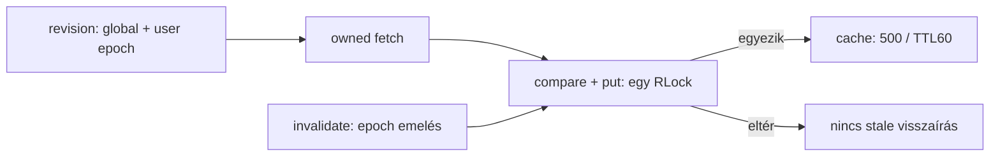
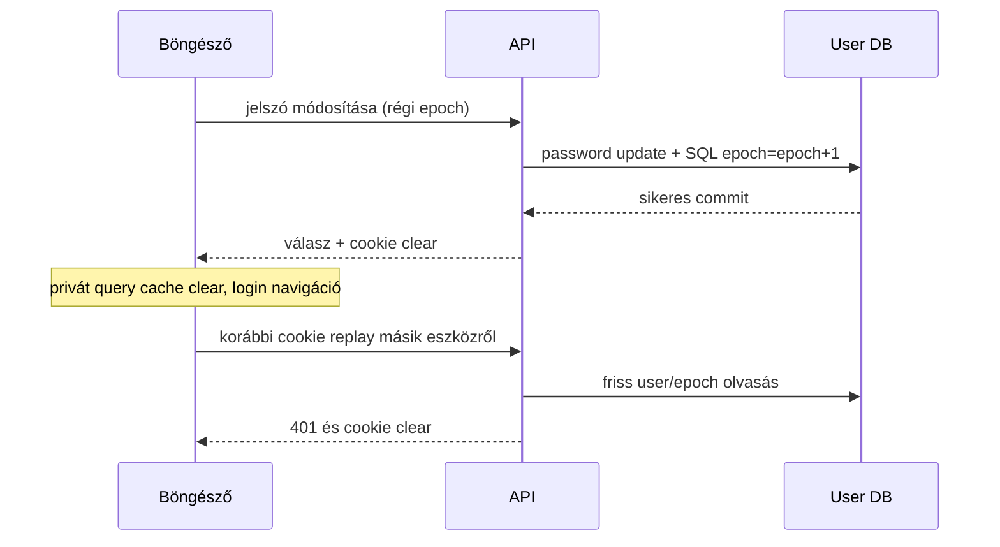
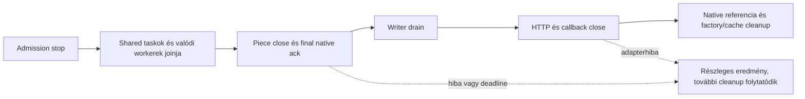
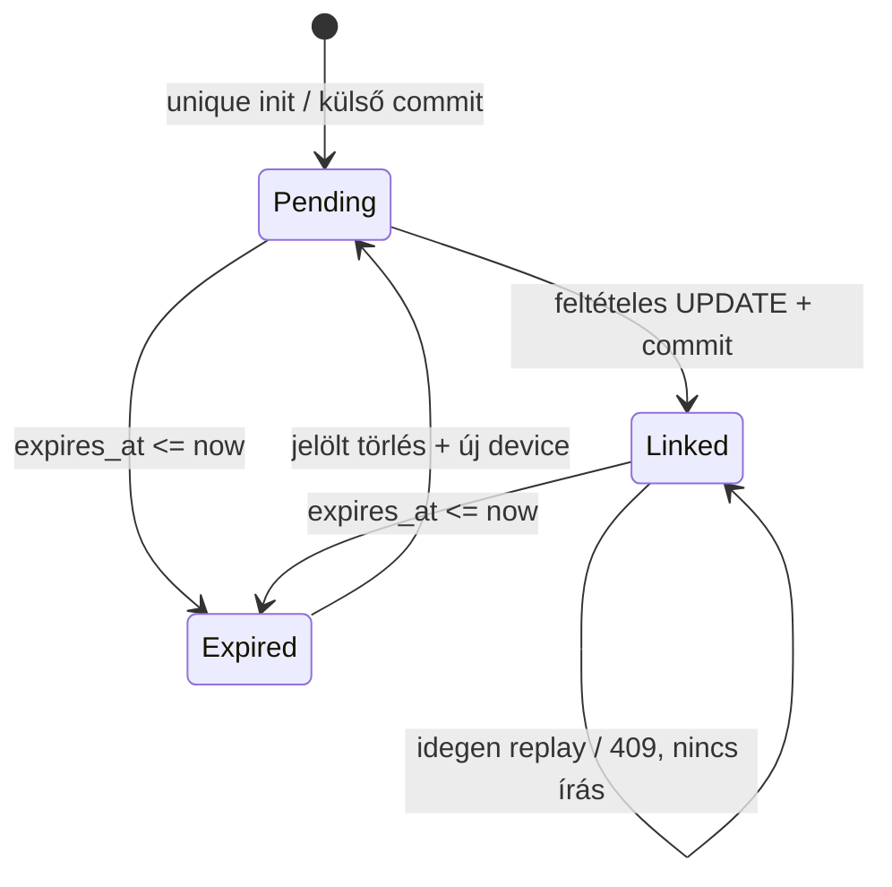
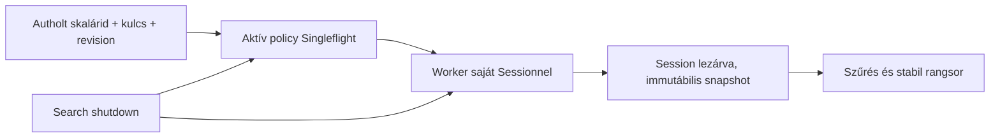

# Stabilitás és optimalizálás — branch-összefoglaló

<!-- doc-nav:start -->
**Navigáció:** [Dokumentáció](../README.md) · [AI-index](../AI-INDEX.md)

> **Státusz:** Engedélyezett implementáció folyamatban. A csomagonkénti bizonyíték a végrehajtási állapotban; az audit és a terv történeti státusza változatlan.

**Kapcsolódó:** [README.md](stability-and-optimization/README.md) · [AI-INDEX.md](../AI-INDEX.md)

Fejezetek / közvetlen ugrás

- [Cél és tényleges státusz](#doc-cel-es-tenyleges-statusz)
- [Kanonikus dokumentumok](#doc-kanonikus-dokumentumok)
- [Lényeges döntések, amelyeket nem szabad leegyszerűsíteni](#doc-lenyeges-dontesek-amelyeket-nem-szabad-leegyszerusiteni)
- [Végrehajtás és ellenőrzés](#doc-vegrehajtas-es-ellenorzes)
- [Végrehajtási állapot](#execution-status)
- [G17 ownership-döntés](#execution-g17)
- [Commit-ellenőrzési checkpoint](#checkpoint-through-19)
- [CR17/b végrehajtás](#execution-cr17b-baseline)
- [CR17/a drain-kiegészítés](#execution-cr17a-drain-followup)
- [Funkcióeredet és változtatási mátrix](#implementation-origin)

<!-- doc-nav:end -->

<!-- doc-anchor:doc-cel-es-tenyleges-statusz -->

## Cél és tényleges státusz

A `feature/stability-and-optimization` munkakör a korábbi funkciók és az M01–M18 stabilitási kör után készített független auditot, illetve annak értékelt implementációs tervét gyűjti össze.

Az eredeti dokumentációs rendezésben CR-javítás nem készült, alkalmazásteszt vagy benchmark nem futott. Az ezt követő, külön engedélyezett implementáció eredményei a [végrehajtási állapotban](#execution-status) szerepelnek. Az audit 19 tétele között bizonyított kontrollhiány, konfigurációfüggő kockázat és mérésre váró hipotézis is van; nem mindegyik jelent feltétel nélkül implementálandó hibát.

Funkcióeredet baseline: `s4pp1/stremhu-source@8c99c7d`. Az audit/terv vizsgált kódja: `2615596f7cd181454dc5ae3e1ec9e4d215e3b154`; a történeti dokumentációs rendezés HEAD-je: `d9554c4324b432dd023307c9bf29e0aab4da3747`. A vizsgált alkalmazás-/teszt-/buildútvonalak között nincs kódeltérés; ez nem új dinamikus verifikáció.

<!-- doc-anchor:doc-kanonikus-dokumentumok -->

## Kanonikus dokumentumok

| Kérdés | Forrás |
|---|---|
| Mit talált az audit, milyen bizonyítékkal? | [Független audit](stability-and-optimization/audit.md) |
| Mely javaslat implementálható, mérendő vagy halasztott? | [A terv értékelési táblája](stability-and-optimization/implementation-plan.md#doc-1-az-audit-elozetes-kritikus-ertekelese) |
| Milyen kódszintű módosítás és teszt kell? | [Részletes implementációs terv](stability-and-optimization/implementation-plan.md) |
| Mi a függőségi és végrehajtási sorrend? | [Munkacsomag-tábla](stability-and-optimization/implementation-plan.md#doc-6-prioritasi-fuggosegi-es-munkacsomag-tabla) |
| Hol van egy konkrét CR tétel? | [CR01–CR19 navigáció](../AI-INDEX.md#doc-cr01cr19-kozvetlen-navigacio) |
| Mit jelent a régi M01–M18 „kész” állapot? | [Történeti állapotjelentés](implementation-progress.md) |

<!-- doc-anchor:doc-lenyeges-dontesek-amelyeket-nem-szabad-leegyszerusiteni -->

## Lényeges döntések, amelyeket nem szabad leegyszerűsíteni

- **CR05:** a terv első választása a hiányzó/ismert gyenge secret fail-fast ellenőrzése; az automatikus perzisztált keyring nem feltétel nélküli feladat.
- **CR02 / CR03 / CR04:** WAL-checkpoint, gzip és kliensrender-optimalizálás előtt mérési kapu van. Gzipet globálisan médiára kapcsolni nem elfogadott megoldás.
- **CR06:** az egyedi TLS-kulcsra váltás kliens-trust kompatibilitási döntést igényel; önmagában self-signed generálással nem őrizhető meg automatikusan a publikus CA-bizalom.
- **CR10:** a hosszú, de értelmes Range-szám clampelhető; minden hosszú szám automatikus hibának minősítése nem a terv.
- **CR12:** commit utáni invalidálás, rollback és in-flight generáció együtt kezelendő; nem elég néhány routerbe vakon cache-clear hívást tenni.
- **CR17:** a biztos cleanup és a mérésre váró DB-ownership refaktor külön munkacsomag.

A teljes besorolás és elfogadási feltétel a tervben van. Itt nem tartunk fenn második, eltérő sorrendű négyfázisú roadmapet vagy újramásolt CR-táblát.

<!-- doc-anchor:doc-vegrehajtas-es-ellenorzes -->

## Végrehajtás és ellenőrzés

A [munkacsomag belépési oldala](stability-and-optimization/README.md) és az [AGENTS](../../AGENTS.md) együtt adja az olvasási és engedélyezési rendet. Az implementációs terv olvasása önmagában nem engedély implementációra, tesztre, buildre vagy telepítésre.

Új teszteredményt csak az érintett commit, parancs, tesztprofil és tényleges kimenetel rögzítésével lehet hozzáadni. A korábbi „259+ teszt” vagy „0 hiba” állítás nem ennek a dokumentációs körnek a tesztjegyzőkönyve.

<!-- doc-anchor:execution-status -->

## Végrehajtási állapot

2026-11-03; kiinduló HEAD: `d2f0d1e5446c26ca56cf611f91e9264aabf9e19b`, ág: `feature/stability-and-optimization`, kezdetben tiszta munkafa. A kezdeti végrehajtás commit, staging és push nélkül történt. Az eddigi mérések **a megnevezett, hash-ekkel azonosított munkafadiffre** vonatkoznak. A felhasználó később engedélyezte a lezárt mérföldkövek commitját és pushát; a hozzájuk tartozó checkpoint alább szerepel. Az audit és az eredeti terv tartalma változatlan.

| Csomag | Státusz | Eredmény / korlát |
|---|---|---|
| 0 — G0 + core baseline | Első csomaghoz ellenőrizve | Helyi Docker Desktop Linux engine 29.9.2, npipe cél; internet nélküli izoláció, meglévő adatkötet nélkül. Minden további modul saját workload-baseline-ja külön belépési feltétel. |
| 1 — CR05 | Megvalósított, core kapu teljesült; plug & play kiegészítés (2026-11-08) | Fail-fast és izolált loader; 10 célzott teszt; Ruff és basedpyright zöld; Docker pytest 266 passed, 64 snapshot. Kiegészítés: megadás nélkül generált, tárolt kulcs ([részletek](#doc-cr05-plug-and-play)). |
| 2 — CR07 | Megvalósított; saját naplózási és HTTP-kapu teljesült | Két teljes ötszörös C előtte/utána log-sorozat és öt rotált A/B/C; 3000 szintetikus jelölő-előfordulás helyett0, teljes kivétellánc és boot-handler védelem tesztelt. |
| 3 — CR19 | Megvalósított, saját kapu teljesült | 62 célzott regresszió; külön 42 HTTP-policy/cache teszt; Ruff/basedpyright zöld; teljes Docker pytest 321 passed / 64 snapshot. Két C-utósorozat hibamentes, A N/A. |
| 4 — CR10 | Megvalósított, kapu teljesült | 93 célzott teszt; teljes pytest 370 passed / 64 snapshot; normál HTTP p50/p95/p99/CPU nem romlott a baseline + J fölött. |
| 5 — CR11 | Megvalósított, pontosított HTTP-kapu teljesült | 22 célzott regresszió, teljes pytest 377 passed; owner/joiner cancel hiba reprodukált és megszűnt. A régi szigorú mikrokapu eltérése megőrzött, friss HTTP-mérés a felhasználói 10 ms keretben. |
| 6 — CR09 | Implementált; helyi mérés teljesült; natív HEAD klienspróba nyitott | Két teljes 30 perces kontroll és 1/4/8 stream/felirat HTTP-mátrix mentett; a terv külön natív klienspróbája nem futott. |
| 7 — CR12/a | Megvalósított, pontosított HTTP-kapu teljesült | 25 célzott regresszió; teljes pytest 404 passed; globális epoch/compare-put, új kérés nem joinol régi revíziót. Write-hook még nincs. |
| 8 — CR12/b | Megvalósított; HTTP-kapu teljesült | 17 célzott teszt; teljes pytest 421 passed; 100/100 stale helyett 0/100; változatlan SQL-szám és másik user cache; 1/4/8 normál HTTP a 10 ms p95 keretben. |
| 9 — CR08/a | Megvalósított; saját állapotgép-/migrációkapu teljesült | 19 célzott teszt; Ruff/basedpyright zöld, teljes pytest 440 passed / 64 snapshot; külön backup/hiba/downgrade tesztek. A limiter és közös normál auth-terhelés külön G08. |
| 10 — G08 + CR08/b | Megvalósított; jóváhagyott tízes profil kapuja teljesült | 24 célzott teszt, teljes pytest 449 passed / 64 snapshot; külön végpontonkénti p95 legnagyobb mediántöbblete5,503 ms <10 ms; CPU/RSS kapu teljesült, nulla téves429, öt rotált A/B/C. |
| 11 — CR18 | Megvalósított; saját és normál HTTP-kapu teljesült | 12 célzott bootstrap-teszt; Ruff/basedpyright zöld, teljes pytest488 /64 snapshot. Pontosan egy admin+marker és session; normál p95 maxmediántöbblet7,452 ms <10 ms, nulla hiba, CPU/RSS kapu zöld. |
| 12 — CR16/a | Megvalósított; saját kapu teljesült | 39 célzott backendteszt, teljes511 /64 snapshot; frontend10 viselkedési teszt és lint→format→build sikeres. Két ötszörös C előtte/utána és öt rotált A/B/C: stale100/100→0/100; p95 maxmediántöbblet0,610 ms, CPU/RSS kapu zöld. |
| 13 — G16 + CR16/b | Megvalósított; dokumentált friss kapuk teljesültek | Valódi HTTPS/proxy böngészőmátrix pozitív, teljes mátrix memóriája az engedélyezett1 MiB-ban. A fókuszált párosított C-kontroll legnagyobb p95-mediántöbblete0,750 ms, egyoldali95%-os felső korlátja7,367 ms <10 ms. A korábbi FAIL-ek megőrzöttek. |
| 14 — CR14 | Megvalósított; saját mérési kapu teljesült | 10 célzott teszt, teljes pytest459 /64 snapshot; két ötszörös C előtte/utána és öt rotált A/B/C. Azonos válasz, nulla hiba, p95/CPU/anon memória javulás zajon túl. |
| 15 — CR01/a | Megvalósított; állapotkapu teljesült | 32 célzott regresszió; teljes pytest 466 passed / 64 snapshot; tíz C-utókontroll mindegyikében0/100 drift, korábban100/100. Legacy50 és a JSON/UI mezők változatlanok. |
| 16 — CR13/a | Megvalósított; saját mérési kapu teljesült | Async DNS és monoton deadline, 5 célzott DNS +18 logregresszió; teljes pytest476 /64 snapshot. Két ötszörös kontroll, rotált A/B/C és külön normál HTTP-kapu sikeres. |
| 17 — CR13/b | Megvalósított; jóváhagyott friss kapuk teljesültek | 21 writer/piece célzott teszt, végső közös forrás570 /64 snapshot, Ruff/basedpyright zöld. Friss normál/overload állapottartósság, byte/hash cap, looplag/piece és normál HTTP-kapu zöld; utóbbi maxmediántöbblet0,265 ms. |
| 18 — CR17/a | Lezárt és pusholt cleanup-kiegészítés: `050cb337` | SourceV2: friss Ruff0 → basedpyright0 →604pytest/64snapshot; normálHTTP, két teljes lifecycle, öt teljes1800s előtte/utána pár,7native/SIGTERM eset és friss350processzes jóváhagyott coldV5kapu teljesült. Korábbi negatív kapuk megőrzöttek; policy-draft külön marad. |
| 19 — G17 | Teljesült, pozitív ownership-trigger | CR17/a után a végső négy trace és konverter/lazy leltár mentett. Owner-close utáni Session-use és alias-overlap megmaradt; shutdown-thread join már helyes. CR17/b,c,d szükséges, külön baseline/kapukkal. |
| 20 — CR17/b | Félretéve (felhasználói döntés, 2026-11-06); kompozit V6 kapu FAIL | A SourceV3 rövid kapuja negatív maradt. A SourceV4 (331fájl,626pytest/64snapshot,Ruff/basedpyright0) rövid88metrikás kapuja teljesült, de a kompozit V6 kapu241ellenőrzéséből4 negatív: két1800s-os heapfutás c8 p95-e és a cold user1 falideje a kereten kívül. A V7 diagnosztika szerint a same-key c8 és a cold user1 eltérés zaj/GC-áthelyeződés, a unique-warm c8 p95 (+54…94ms) regressziójelölt marad. Policycommit nincs; a SourceV4 kód a helyi `archive/cr17b-policy-snapshot-v4` ágon (a099da5) őrzött, a 21. csomag a050cb337 forrásra épül. |
| 21 — CR17/c (21a+21b) | Megvalósított; ownership-kapu és a v1-et felváltó `cr17c-after-v2` runtime-kapu teljesült (316/316) | A 21a reprodukció 050cb33-on determinisztikusan `DetachedInstanceError`-t adott (2 xfail). A 21b-ben a megosztott keresési eredmény Session nélküli, frozen ref/snapshot értékeket hordoz: 3 célzott teszt, Ruff 0 → basedpyright 0 → 607 pytest/64 snapshot. A `cr17c-after-v1` kapu egy soron (heap/cold1 falidő) FAIL maradt; a diagnosztika egy ~28 ms-os gen2-gyűjtés cold0→cold1 eltolódását mutatta. A felhasználó döntése szerint az előre regisztrált `cr17c-after-v2` kapu minden hidegkérés előtt azonos GC-fázist állít be, minden más változatlan: Kodi C before 276 HTTP 500, after 12 280×200 és 0 hiba; minden cella a kereten belül (heap/cold1 after 75,8–82,3 ms, keret 87,5 ms). Részletek: [CR17/c–d terv](stability-and-optimization/cr17cd-plan.md#doc-21b-runtime-kapu-v2). |
| 22 — CR17/d (22+22b) | Megvalósított; a `cr17d-after-v1` kapu FAIL maradt (35/316, memória), az azt felváltó 22b `cr17e-after-v1` kapu teljesült (316/316) | Folyamatszintű `IndexerSearchService` és állapotmentes Singleflight-factory: a megosztott keresés nem használja a request Sessiont. A 22 izolált olvasásai QueuePool-telítést okoztak (15 egyidejű checkout, before 10–11); a 22b egyhelyes `shared_read_session()` kapuval a before szintjén tartja a kapcsolatszámot. Ellenőrzés: 611 pytest/64 snapshot, Ruff/basedpyright 0, ownership-trace 4/4; memória, p95, CPU, SQL a kereten belül. Commit: `f7cdb1a`. Részletek: [CR17/c–d terv](stability-and-optimization/cr17cd-plan.md#doc-22b-megosztott-olvasasi-kapu). |
| 23 — G01 → CR01/b | Lezárva felhasználói termékdöntéssel (2026-11-07), policyváltozás nélkül | A CR01/a egységes alkalmazója szerint a torrentenkénti limit tétlen torrentnél a beállított érték, aktív lejátszás alatt `max(beállítás, 50)` (`relay/service.py:apply_torrent_connection_policy`; az upstream `8c99c7d` lejátszás alatt fix 50-et állított, a fork `d16365d` tette alsó korláttá). A felület ezt „maximális számnak” nevezte. Döntés: a viselkedés marad, a felület mezője „Torrentenkénti kapcsolatok alapértéke” címet és a lejátszás alatti legalább 50-es értéket, valamint a globális felső határt megnevező leírást kapott (`relay/settings/-features/connection.tsx`). Az 50 tapasztalati érték, mérés nem igazolja; a G01 teljes mátrix és a hard-cap policy nem futott, mert a döntés nem igényli. Ellenőrzés: `npm run lint`, `npm run format`, `npm run build` (+`tsc`) a zárolt Node 24 konténerben. |
| 24 — G06 → CR06 | Lezárva felhasználói termékdöntéssel (2026-11-07), változtatás nélkül | A LOCAL HTTPS-mód közös, publikus szolgáltatástól kapott kulcsa nem ad egyedi szerverazonosságot. A telepítésenként egyedi, saját aláírású tanúsítvány viszont megtörné a zéró konfigurációs működést: a Stremio/ExoPlayer (főleg Android TV-n) eldobná a kapcsolatot, saját gyökértanúsítványt a felhasználók nem telepítenek. Döntés: a LOCAL mód Plug & Play tartalékként változatlan marad; egyedi szerverazonosság a meglévő MANUAL (saját tanúsítvány / reverse proxy) vagy AUTO (ACME) móddal érhető el. G06-mérés nem futott. Részletek: [24 — TLS-döntés](#doc-24-tls-decision). |
| 25 — G15 → CR15/a | Megvalósított; a `cr15a-after-v1`–`-v5` kapu FAIL, a `cr15a-after-v6` kapu PASS (felhasználói jóváhagyással, 2026-11-08) | A torrentletöltés eddig a teljes választ memóriába olvasta. Most a dekódolt bájtokra 48 MiB-os korláttal (felhasználói döntés) olvas, a deklarált túl nagy hosszt olvasás előtt elutasítja, és az auth/szemafor/relogin úton marad. Két saját pufferelésű jelölt ismételhetően lassabb volt; tömörítetlen törzsnél a HTTPX saját olvasását használja számláló folyamburokkal, olvasás után pedig a beolvasott bájtokra cseréli a folyamot, így a törzs a ciklikus szemétgyűjtés helyett azonnal felszabadul; a Docker-image a glibc mmap/trim küszöbét a glibc saját dinamikus maximumára (32/64 MiB) rögzíti. A v3 kapu a próba mérési torzításán (a before oldalon hiányzó `app.config`), a v4 a HTTPX válasz–folyam ciklusa miatt késve felszabaduló törzseken, a v5 azon bukott, hogy a glibc minden letöltés után visszaadta a törzs memóriáját, és egyetlen letöltésnél a következő friss lapokon futott; a v6 kapu (a v4 mérőkörnyezete és szabálya) a G15 normál terhelésén 90 ellenőrzésből 0 ismételhető romlást adott; óriásválasznál after 0 OOM, minden kérés `too-large`. 9 új teszt, Ruff/basedpyright 0, 649 pytest/64 snapshot. Részletek: [25 — CR15/a](#doc-25-cr15a). |
| 26a — CR15/b, süti-hatókör | Megvalósított; a beolvasztott fán futó `cr15b-origin-v5` (és a korábbi `-v1`–`-v4`) funkcionális kapu PASS | A mentett indexersütik eddig domain nélkül töltődtek vissza, így minden hostra mentek, idegen hostra és HTTP-re is. Most az indexer hostjára kötött, HTTPS-nél `Secure` domain-sütiként töltődnek vissza: ellenőrzött fixture-TLS-sel before 6/6 célon, after csak a saját hoston (3/6). 7 új teszt, Ruff/basedpyright 0, 656 pytest/64 snapshot. A redirect-utat a [26b](#doc-26b-redirect-host) kezeli. Részletek: [26a — süti-hatókör](#doc-26a-cookie-scope). |
| 26b — CR15/b, redirect és letöltési host | Megvalósított; a beolvasztott fán a `cr15b2-redirect-v6` funkcionális és a `cr15b2-after-v6` normál kapu PASS | A korlátos letöltés eddig a HTTPX-re bízta az átirányítást, amely minden redirect törzsét korlát nélkül beolvasta, és bármely hostra továbbment. Most kézzel követi, a törzset olvasás nélkül zárja, legfeljebb 10 lépésig, és minden lépés csak a tracker saját domainjére vagy aldomainjére mehet, a tracker sémájával (felhasználói döntés, 2026-11-07). Funkcionális kapu: before 64 MiB/kérés redirect-törzs és követett idegen redirect, after legfeljebb 3,6 MiB/kérés, az idegen host egyetlen kérést sem kap. Normál terhelésen 75 ellenőrzésből 0 ismételhető romlás. 15 új teszt, Ruff/basedpyright 0, 671 pytest/64 snapshot. Részletek: [26b — redirect és host](#doc-26b-redirect-host). |
| 27 — CR15/c | Megvalósított; a beolvasztott fán a `cr15c-after-v4` kapu PASS | Folyamatszintű keret a forráskeresésekre a felhasználó SLO-ja szerint: 12 egyidejű egyedi keresés (a 13. azonnali 503), 15 s teljes határidő részleges eredménnyel, és bájtalapú memóriavédelem (32 MiB függő bájt, 16 MiB-os mentési kötegek, fájlszámra korlátos info-cache). Tipikus terhelésen nincs ismételhető romlás; a nehéz stresszprofilban az OOM before 5/10 → after 0/10 (N=4) és 10/10 → 0/10 (N=12). 17 új teszt, Ruff/basedpyright 0, 688 pytest/64 snapshot. Részletek: [27 — CR15/c](#doc-27-cr15c). |
| 28 — G02 → CR02 | Lezárva méréssel: NO_CHANGE, PRAGMA/checkpoint változtatás nélkül | Két monitormentes 3600 s-os CR17 utáni C-kontroll (`aaa9ee5` forrás) az előre regisztrált szabályokkal: WAL-újrahasznosítás, commit/tranzakció p99 és szokásos WAL-csúcs mind a referencia keretén belül, egyszeri eltérés sincs; szokásos WAL-csúcs 4,4/4,4 MiB (keret 19,8 MiB), végső checkpoint teljes, pool 0. Részletek: [28 — G02](#doc-28-g02-cr17-utani-kontroll). |
| 29 — G04 → CR04 | Megvalósított; a `g04-candidate-v1` kapu PASS | A torrentlista sora `React.memo` mögé került (`relay/torrents/-components/torrent.tsx`): változatlan sor nem renderel újra a pollnál. A 20/100/500 soros, egy változó soros cellákban a sorrender-hívás és a React commit-idő a before tartomány alá esett; a requestszám (16 cella) változatlan, a heap a +2 MiB-os kereten belül. Frontend: vitest 2 fájl / 11 teszt (1 új tesztfájl), lint, format, build sikeres a zárolt Node 24 konténerben. Részletek: [29 — G04](#doc-29-g04). |
| 30 — G03 → CR03 | Lezárva: formálisan `INVALID` (19/20 adag), kódváltozás nélkül | A gzip a `streams/40` válasznál −64% bájtot ad, a c1 teljes p95 mob2-n 224 → 135 ms. LAN-on viszont a szerver-CPU és a késleltetés ismételhetően romlik. Az utolsó adag (mob2) a fixture-szerver kapcsolatbontása miatt elmaradt. A teljes LAN-adat mind a 12 szint–küszöb kombinációt kizárja, így a hiányzó adag a döntést nem változtathatja meg; újrafuttatás nincs. Részletek: [30 — G03](#doc-30-g03). |
| 31 — G13-convert → CR13/c | Megvalósított; a G13-convert kapu OFFLOAD_CANDIDATE, a jelölt `g13conv-v2` kapuja PASS | A feliratvégpont az ASS→VTT dekódolást és konverziót eddig egyben, az event loopon futtatta (3 MB: ~46 ms, 8 MiB: ~126 ms blokkolás). Most 256 KiB-os dekódoló és ~32 K karakteres, sorvégen vágott konverziós szeletek között visszaadja a vezérlést; szál/processz nincs, a kimenet bájtazonos. Stall p95 (sorozatmediánok) 3 MB: 2,64/2,75 ms, 8 MiB: 3,92/3,90 ms; a konverzió falideje nem romlott. 27 új teszt, Ruff/basedpyright 0, 638 pytest/64 snapshot. Részletek: [31 — G13-convert](#doc-31-g13-convert). |

CR07 lezárt kiegészítés: a stream-prefetch/fallback, epizód-/aliasfeloldás, tech-enrichment és ütemezett hálózati wrapper eddig nyers kivételszöveget vagy tracebacket is naplózhatott. Ezek a már használt kind/status mezőkre tértek át, az önellenőrzés hibaüzenete nem ír HOST_IP értéket. Tizenhat új jelölőtitkos regresszió készült: tényleges wrapper-hívások, katalógus/Torznab, valamint a valódi Rich-handler direkt/wrapped kivétel és argumentum útja, mély lánc és nagy exception-group/argumentumlista. A handler64 elemre korlátozott vizsgálata olvasatlan faroknál elhagyja a teljes üzenetet és tracebacket. Hét célzott reprodukció a megőrzött korábbi forráson elbukott; a kiegészített34 logteszt, Ruff/basedpyright és teljes570 pytest /64 snapshot sikeres,20 ismert figyelmeztetéssel. A külön két ötszörös C normál HTTP előtte/utána és15 rotált A/B/C nulla hibát, azonos C-payloadot és legfeljebb1,247 ms p95-mediántöbbletet adott; CPU/memória/cold kapu zöld. A kiegészítés lezárt, a korábbi CR07 bizonyíték megmarad. A PowerShell segédfájl indítását a helyi script-házirend blokkolta; a pontos parancsok közvetlen futtatása sikeres, házirend-módosítás nem történt.

### G0 környezet és baseline

- A helyi `main` (`2615596f…`) és az induló HEAD alkalmazás-, teszt- és buildforrása azonos. Az upstream `8c99c7d` helyben elérhető. Csak a gyökér AGENTS alkalmazandó.
- Windows venv Python 3.12.10; Docker B/C Python 3.12.16, A Python 3.12.15. FastAPI 0.143.0, Hypercorn 0.18.0, HTTPX 0.28.1, SQLAlchemy 2.1.4, Pydantic 2.13.5, pydantic-settings 2.15.0, libtorrent 2.1.1. A Starlette 1.8.0, B/C és venv 1.10.0. Node buildelőírás 24; React Query 5.104.2.
- Ellenőrzött publikus felületek: BaseSettings `_env_file`, HTTPX send/stream/Response, Starlette Session/GZip, dnspython async resolver, SQLAlchemy CursorResult.rowcount. Az indítóban nincs worker override; az ellenőrzött Hypercorn-alapérték 1. Többprocesszes koherencia nem igazolt.
- Alembic verziókönyvtár: `server/alembic/versions`; egyetlen head: `e72a1c3d4f5b`. Migráció nem futott. Explicit commitleltár: database wrapperek, attributes/preferences repository, roles service; CR12/b-nél mind felülvizsgálandó.
- A meglévő compose env_file-okat és meglévő mountokat használ, nem indult. A bootstrap valódi indexereket konfigurál; a meglévő benchmark sem szintetikus fixture. Egyik sem futott. Docker-tesztek: `--network none`, csak olvasható forrás, eldobható tmpfs, valódi dotenv betöltése nélkül.
- Kiinduló Ruff/basedpyright zöld. Tiszta forrás Docker pytest: 256 passed, 64 snapshot; meglévő Starlette-deprecation és AsyncMock figyelmeztetésekkel.
- A/B/C image-digestek a [nyers bizonyítékban](stability-and-optimization/evidence/cr05-core.json). A B image forrása eltér a helyi mainétől: a hiteles B-futás archivált main forrást csatol a pinelt B runtime-ra; C archivált HEAD-et. Ez forrásoverlayes összevetés, nem frissen buildelt teljes image.
- Core fixture: valós HTTP/response és AuthService API-key ellenőrzés, szintetikus user storage, üres stream. **Nem teljes tracker-, média- vagy DB-benchmark.** 2 CPU / 1 GiB; 100 kérés/cella, 1/4/8 concurrency, öt ismétlés, külön warm-up, rotált A/B/C. Két változatlan C-sorozat adja a zajt. Cold: új konténer app-importja; warm: in-process ASGI határ.

### 1 — CR05

Érintett: [config](../../server/app/config.py), [tesztbetöltés](../../server/tests/conftest.py), [auth regressziók](../../server/tests/test_auth_configuration.py), [core harness](../../scripts/benchmark_cr_core.py). Kötelező, legalább 32 karakteres signing secret, titokmentes validáció és repr. A hossz nem entrópiabizonyíték: telepítéskor kriptográfiai RNG-ből származó stabil kulcs szükséges. Az explicit `load_config(load_dotenv=False, ...)` és import előtti `STREMHU_LOAD_DOTENV=false` izolálja a tesztet. Normál dotenv betöltés megmarad; keyring vagy automatikus rotáció nincs.

E/B/M/V: hiányzó, üres, default, rövid és whitespace kulcs kontrollált hiba; dotenv-megnyitási őr; hiányzó explicit tesztkulcsot a cwd dotenvje nem pótolja. Valódi signed SessionMiddleware restart után azonos kulccsal működik, másikkal elutasít. Stream-token kulcs és salt stabil; másik kulcs aláírása elutasított. Valódi Argon2 login–session–logout eldobható fájl-DB-n sikeres; a meglévő Stremio API regresszió is lefutott.

Ellenőrzés: célzott 10 passed; utána `server/.venv` Ruff → basedpyright sikeres; teljes pytest a pinelt Docker runtime-ban: **266 passed, 64 snapshot**, 2 figyelmeztetés. A felhasználó Docker Desktop tesztelést kért: alkalmazástesztek Dockerben, statikus eszközök a megadott Windows venvből futottak.

Mérési döntés: két elfogadott utósorozatban nincs ismételhető latency/CPU-romlás a baseline-tartomány + J fölött. Cold import baseline 3,598–3,671 s, utómediánok 3,621 / 3,622 s; RSS baseline 115600–116560 KiB, utómediánok 116012 / 116180 KiB. A kezdeti, más hostfájlrendszerről csatolt utómérést kizártuk; az elfogadott előtte/utána snapshot ugyanazon fájlrendszeren van. Nincs gyorsulási állítás. A [CR05 bizonyíték](stability-and-optimization/evidence/cr05-core.json) tartalmazza a nyers cellákat, verziókat és harness-/forráshash-t.

Rollback/kiadás: sémamigráció nincs. Kódrevert mellett is erős kulcs szükséges; gyenge default visszaengedése nem támogatott. A meglévő erős kulcs nem rotálódik. Új kulcs telepítése külön session-/URL-érvénytelenítési lépés. A valódi installáció kulcsát vagy dotenvjét nem olvastuk/ellenőriztük.

<!-- doc-anchor:doc-cr05-plug-and-play -->

**CR05 plug & play kiegészítés (2026-11-08, felhasználói követelmény: „a felhasználó csak elindítja a konténert”).** A kötelező `SESSION_SECRET` miatt a konténer megadás nélkül nem indult (helyi image-en igazolva: kilépési kód 1), a `server/.env.example` pedig épp az elutasított `stremhu-source` értéket tartalmazta.
- **Viselkedés:** hiányzó, üres vagy a régi nyilvános alapérték esetén a `load_or_create_session_secret` erős kulcsot generál (`secrets.token_urlsafe(48)`), és atomikusan, `0600` joggal a `data/system/session_secret` fájlba menti: ideiglenes fájl + `os.link`, hard link nélküli fájlrendszeren kizárólagos létrehozás. Egyidejű első indulásnál mindenki ugyanazt a kulcsot kapja. A helyet a `SESSION_SECRET_FILE` adja meg.
- **Ami változatlan:** a megadott, 32 karakternél rövidebb kulcs továbbra is titokmentes hibával állítja le az indulást. Sérült (túl rövid) kulcsfájlt a program nem ír felül, hibát jelez. A régi nyilvános alapérték helyett figyelmeztetéssel a tárolt kulcs érvényes. A kulcs nem kerül logba vagy `repr`-be.
- **Tesztek** (`test_auth_configuration.py`): gyenge explicit kulcs; hiányzó, üres, whitespace és alapérték esetén egyetlen, újraindítás után is azonos generált kulcs; az explicit erős kulcs elsőbbsége; sérült fájl; 8 szálas egyidejű első indulás; dotenv-mentes import a generált kulccsal.
- **Kiadás:** a generált kulcs az adatkötetben él. Kötet nélküli futtatásnál minden új konténer új kulcsot kap, ami a munkamenetek és a stream-URL-ek újrakérésével jár, ugyanúgy, ahogy az adatbázis is elveszne. Aki a `main`-en `SESSION_SECRET` nélkül (tehát a nyilvános `stremhu-source` kulccsal) futott, a frissítés után egyszer újra bejelentkezik, és a kliensek újrakérik a stream-listát: a nyilvános kulcs szándékosan cserélődik.
- **MR-review javítások (2026-11-08):**
  - a kulcsfájl fájlrendszer-hibája (jogosultság, csak olvasható kötet) a konfigurációs hibaüzenetben jelenik meg, nyers traceback nélkül (Dockerben igazolva: kilépési kód 1, traceback 0);
  - a 32 karakteres minimum a szóközök nélküli hosszra vonatkozik;
  - a régi alapértékről szóló figyelmeztetés folyamatfánként egyszer jelenik meg (eddig a Hypercorn-worker miatt kétszer);
  - a `StremioService.manifest()` felhasználó-paraméter nélküli, mert a manifestnek felhasználófüggetlennek kell maradnia (katalógus-kapcsoló, 2026-11-08).

### 2 — CR07

Az accesslog csak metódust/státuszt/időt tartalmaz. Új `common/log_safety.py` osztály/státusz összegzést ad; nem stringeli a hálózati kivételt. A Rich-handler a HTTPX/httpcore saját URL-naplóit formázás előtt eldobja dev/prod logszinttől függetlenül. Adapter cookie-storage/login/search/details/download/hit-and-run és source-provider továbbcsomagolás, indexer-login/cleanup, DDNS provider és háttérszinkron, valamint a TMDB-kulcsos resolver hibaút érintett. Nyers provider body sem naplóba, sem RuntimeError-válaszba nem kerül. A hálózati domainhiba elnyomott eredeti kivételkontextussal terjed; a belső nem érzékeny hibák általános naplózását ez nem írja át.

E/B/M/V: szintetikus passkey/path/query/cookie-jelölő, 403/timeout és provider body; formázott kivétellánc és log titokmentes. Valódi Hypercorn accessformatter 200/302/403/500, valódi Rich-handler és dependency logger rekordok tesztelve. **13 célzott passed; Ruff → basedpyright zöld; teljes Docker pytest 279 passed, 64 snapshot**, meglévő figyelmeztetésekkel.

A [teljes log-mérés](stability-and-optimization/evidence/cr07-logging.json) két ötszörös változatlan C-baseline és két ötszörös utósorozat, ismétlésenként 1000 valódi Rich-renderelt eseménnyel; emellett öt rotált A/B/C. Minden régi ismétlésben3000 szintetikus jelölőtitok-előfordulás, minden újban0. A hosszú traceback-renderelést nem rövidítettük le. A források előre fagyasztva, a későbbi munkafa nem változtatta a futásokat. A külön normál HTTP 1/4/8 kontroll két sorozatában nincs ismételhető baseline-tartomány + J romlás. A programozott valódi Alembic boot megőrzi a biztonságos log-handlereket; az SQL engine paraméterei rejtve maradnak, ezt valódi credential-paraméteres DB-hiba teszteli. A közös jelenlegi teljes ellenőrzés466 passed / 64 snapshot,12 figyelmeztetés (a célzott új csoportok nem reprodukálnak új AsyncMock hibát). Rollback: a diagnosztikai mezők bővíthetők, nyers URL/body/exception log visszakapcsolása nem támogatott.

CR07 későbbi lánckiegészítés: a CR13 DNS-előkészítése két ACME hibaágat is azonosított. A publikus ACME-művelet most titokmentes hibatípust ad tovább elnyomott eredeti kontextussal; timeout típusa megmarad, cancellation nem nyelődik el. A TXT-cleanup is csak kind/status összegzést naplóz. Valódi service-folyamatot járó directory/account/order/poll+cleanup/deadline tesztek: **18 logteszt**, Ruff/basedpyright sikeres, teljes Docker pytest **471 passed / 64 snapshot**. A korábbi hosszú log-render fixture változatlan; az új határ saját regressziókat kapott.

### Támogatandó kliens és hálózat

Felhasználói pontosítás: Windows, Android és Android TV; Stremio és Nuvio. Helyi HTTPS és reverse proxy egyaránt támogatandó. A Windows uninstall-leltárban Stremio4.4.174 és Nuvio1.1.33 található; alkalmazást vagy meglévő profilt nem indítottunk/módosítottunk. A helyi ADB-leltárban0 csatlakozott eszköz. Sikeres izolált natív tanúsítvány-/trustmátrix még nincs, ezért G06 nyitott; nincs LOCAL TLS-default váltás. G08 a valódi transport peert használja, forwarded header nincs megbízva. G16-hoz az engedélyezett originmátrix külön ellenőrizendő.

### 3 — CR19

Érintett: `common/sensitive_responses.py`, `main.py`, `stream/router.py`, `test_sensitive_cache_headers.py`, `scripts/benchmark_cr_subtitles.py`. A célzott ASGI response-start policy nem puffereli a bodyt: auth (benne a tényleges `/auth/pair` router), me, users, playbacks, nyers és Stremio-felirat válaszain no-store. A felirat saját fejlécépítése közös helperből dolgozik. A middleware előtti, még el nem indított 500 is a meglévő alapértelmezett plain-text tartalommal és no-store fejléccel megy ki; megkezdett streaming válasz státusza nem íródik át.

A belső feliratcache méret/TTL/kulcs szerződése változatlan. E/B/M/V: siker/401/403/422/500, cache-hit előtti valódi AuthService ellenőrzés, visszavont kulcs, GET/HEAD/206/416, Content-Length/Content-Range és bájtidentitás. Helyi, a valódi app elé helyezett shared-cache ASGI fixture nem tárolja a választ; rotáció után az authig eljut a kérés és 401-et kap. Ez helyi fixture, nem éles proxy konfigurációjának igazolása.

Ellenőrzés: 62 releváns subtitle/policy regresszió; a végső HTTP-cache célzott csoport 42 passed; Ruff → basedpyright zöld; Docker teljes pytest **321 passed, 64 snapshot**, meglévő figyelmeztetésekkel. A későbbi CR10 külön bővíti az extrém Range HTTP-eseteket.

Mérés: a [CR19 nyers bizonyíték](stability-and-optimization/evidence/cr19-subtitles.json) két C-baseline- és két C-utósorozatot, valamint rotált A/B/C-t tartalmaz. Öt ismétlés, 100 kérés/cella, 1/4/8 concurrency; teljes/Range GET és HEAD, 416, előmelegítés külön. A feliratcache upstreamen hiányzik: **A N/A**, B/C mért. A két utósorozatban nincs ismételhető p50/p95/p99/CPU-romlás a baseline-tartomány + J fölött; a bájtpayload-hashek változatlanok. Ez autholt cache-hit ASGI mérés, nem seederes raw/konverziós médiamérés és nem HTTP wire benchmark.

Rollback: csak fejléc-/middleware-csomag; DB/migráció nincs. A belső cache nem törlődik ettől. A no-store revokációs követelmény feloldása külön termékdöntést igényel. További feltételes csomag nem örököl automatikusan teljesített mérési kaput ebből.

### Felhasználói mérési keretpontosítás, új futások előtt

A CR11 normál belső relogin mikromérésében és a CR12/a belső cache mikromérésében a p50 a szigorú baseline-tartomány + J fölé került; CR11-nél az adaptert minden mintában újralétrehozó fixture p99-e is nőtt. Ezeket az eredményeket megőrizzük, nem jelöljük utólag a régi kapu teljesítésének.

A felhasználó kifejezetten elfogadott új termékkerete: **legfeljebb 10 ms p95 többlet normál HTTP-kérésenként**, új funkcionális hiba vagy lejátszási megakadás nélkül. Ez a friss HTTP-kapuk előtt rögzített döntés. A CPU/RSS mellékmetrikákat továbbra is külön értékeljük; a belső mikroteszt többletmunkáját nem nevezzük gyorsulásnak.

Következő, külön mentett fixture-ek: tartós adapteren átmenő HTTP relogin; valós Stremio HTTP-válasz/auth és nem üres, warm belső streamcache. Mindkettő ugyanazon fagyasztott C előtte/utána forráson, 2 CPU / 1 GiB, internet nélkül, 100 kérés/cella, 1/4/8 párhuzamosság, öt ismétlés, külön warm-up és két sorozat. A régi adapter-per-minta diagnosztika megmarad, az új fixture a valós tartós adapter-élettartamot követi.

### 4 — CR10

ASCII-decimális, telített Range-feldolgozás a stream service-ben: a hosszú end/suffix clampelhető, a sok leading zero értelmes számot ad, malformed/szélsőérték kontrollált416. Közös numerikus média-ID validator, Pydantic schema-, router- és resolver-belépővédelem; meglévő prefixek és címkeresés megmaradnak. Új 32 karakteres alkalmazáspolitika, nem provider-limit állítás. A torrent-fájlindex nagy száma is kontrollált400; az opaque torrent-ID nincs numerikussá szűkítve.

93 célzott teszt, Ruff/basedpyright zöld, Docker pytest **370 passed, 64 snapshot**. Latin-1 Range a valódi HTTP app-határon, 5000 számjegyes clamp és 4xx/zero-network numerikus ID is tesztelt. A [mérés](stability-and-optimization/evidence/cr10-inputs.json) két C előtte/utána sorozat és A/B/C parser-összevetés: upstream tiszta `_parse_range_header` metódusa ellenőrzött, állapotot nem használó adapterrel futott. A korábbi ValueError helyett a megfelelő416 vagy clamp eredmény jön. A normál autholt felirat Range/HEAD HTTP-kapuban nincs ismételhető romlás a baseline-tartomány + J fölött. Nincs gyorsulási állítás. Rollback: önálló parser/ID csomag, DB-migráció nélkül.

### 5 — CR11

Az adapter saját meglévő `Singleflight[None]` instance-on egyetlen login-kulcsot használ; külön Future vagy új általános dedup-algoritmus nincs. Close leállítja az új munkát, cancel+awaiteli a relogint, utána zárja a HTTP-klienst. A login alatt a request szemafor szabad marad, max_concurrent=1 regresszió tesztelt.

22 célzott teszt, Ruff/basedpyright zöld, Docker pytest **377 passed, 64 snapshot**. Owner/joiner/all-cancel, late failure consume, retry és shutdown ellenőrzött. A [nyers eredmény](stability-and-optimization/evidence/cr11-relogin.json) 100/100 owner-cancel timeoutot és joiner-cancel InvalidStateErrort reprodukál a régi C-n, mindkettő sikeres élő waitert ad az új C-n, hullámonként 1 login. A normál belső p50 néhány mikrosec többlete és az adapter-per-minta p99 eltérése **nem teljesíti a régi szigorú mikrokaput**; ez megőrzött eredmény. A felhasználó által előre elfogadott 10 ms HTTP-p95 kerettel végzett új, tartós-adapteres HTTP-mérés két sorozatban teljesült; CPU-n nincs ismételhető baseline+J romlás.

Korlát: ez az adapter login-task és HTTP-client szerződése. A teljes alkalmazás shutdownja, a tényleges `to_thread` háttérmunka befejezése és ismételt lifespan továbbra is CR17 feladat; ez a csomag nem bizonyítja az egész folyamat lezárását. Rollback: adapterre szűkített változtatás, hibás Future visszaengedése nem támogatott megoldás.

### 6 — CR09, helyi kapu és fennmaradó kliensfeltétel

A regisztráció sikeres auth és playbacklimit után, lassú prepare előtt történik, belső user_id-val. A globális history 1024 userre, userenként20 elemre és TTL7200-ra korlátos; műveletenkénti prune. A legfeljebb4096 Event külön életciklusú, history-evikció nem veszíti el a waitert. Timeout/cancel/finally és close takarít. Prepare-hibánál csak a saját monoton nonce vonható vissza; egy újabb indulás érintetlen. HEAD megőrzi az indulási jelzést.

Az auth/nonce/waiter/cap/TTL/HEAD regressziók és a meglévő subtitle suite zöld; a korábbi teljes ellenőrzés **398 passed / 64 snapshot**, a jelenlegi közös állapot **449 passed / 64 snapshot**. A [mentett mérés](stability-and-optimization/evidence/cr09-playback.json) mindkét C-n valóban 1800 s, 44 950 elutasított kulcsos kérés. Az utolsó, 1742 s körüli GC-mintában a régi registry 43 525 kulcsot tartott, az új0-t; a régi peak RSS 115016→128200 KiB, az új115124→115252 KiB. Ez kontrollált retenciós reprodukció, nem általános memóriaszivárgás-állítás. A Docker-megszakítás miatti korábbi részfutás külön szerepel, nem helyettesíti a teljes újrafutást.

A kiegészítő, fagyasztott eredeti/új forrásokon ténylegesen futtatott HTTP-kontroll két ötszörös C előtte/utána sorozat és öt rotált A/B/C. Valódi AuthService, stream HEAD és Stremio feliratkiválasztás, helyi média/storage stub; mindkét indulási sorrend, 100 minta/cella, 1/4/8 concurrency. Nulla téves felirat/hiba, p95 a jóváhagyott10 ms keretben, CPU/RSS az előzetes tartomány + J alatt. 1025 indulási szándék után az új méret1024; A aktív lejátszási modul hiányában N/A.

**Nyitott elfogadási feltétel:** a terv külön Windows/Android/Android TV Stremio/Nuvio HEAD klienspróbát kér. Ezek a natív kliensek/eszközök nem részei a helyi izolált fixture-nek; az ASGI HEAD regresszió nem helyettesíti a próbát. A csomag teljes kiadási elfogadását ezért nem állítjuk. Rollback: registry és belső argumentumok együtt; DB-migráció nincs, restartkor az átmeneti history elvész.

### 7 — CR12/a

Új `StreamCacheState`: közös rövid RLock a revision/get/compare-put/invalidation körül; globális epoch sosem nullázódik. Cache 500, TTL60; user-revision tábla 1024 fölött globális epoch-fence és clear. Régi folyó fetch a régi callernek befejezhető, új cache-be nem írhat; új kérés külön revision-kulcson fut. A belső legacy user-generáció helper csak a user-epochot adja vissza, az érvényességhez mindig a teljes epochpár számít.

25 célzott cache/DB/subtitle regresszió, Ruff/basedpyright zöld, Docker pytest **404 passed, 64 snapshot**. Valódi worker-thread compare-put, user/global reset, revisionkapacitás, TTL és gate-elt régi/new fetch teszt. A [mérés](stability-and-optimization/evidence/cr12a-cache.json) régen `old,old,old`, most `old,new,new` eredményt ad; a helyes ág két külön fetch-e szükséges. A mikromedián kismértékű többletét megőrizzük; a friss valós Stremio HTTP/auth/warm-cache fixture a felhasználói 10 ms p95 kereten belül marad, nincs ismételhető CPU-romlás. A generációs cache upstreamen nincs, ott A N/A; B/C kontroll mentett.

**CR12/b előtt nincs valódi write-hook**, ez az önálló a-csomag szándékos határa. Single-process szerződés; multiworker koherenciát nem állítunk. Rollback: cache state és service-integráció együtt, sémaváltozás nélkül.

### 8 — CR12/b, ellenőrzött implementáció

A `common/commit_actions.py` a Session.info-ban csak összevont user-ID/global scope-okat tart. A külső commit után invalidál; rollbacknál eldobja őket. SAVEPOINT commit nem üríti a külső scope-ot, SAVEPOINT rollback visszaállítja a belépési állapotot. A commit hibája és a már committed adat invalidálási hibája külön hibatartomány: utóbbinál globális fence a fallback, nincs látszat-rollback.

A userprofil, API-key, törlés, exclusion, user/system preference és sorrend, settings/network, indexeraccount és definíciószinkron tényleges írásai jelölnek. Minden alkalmazásbeli explicit commit a közös helperen megy át. **Aktuális forrásból talált eltérés:** a FastAPI alapértelmezett yield dependency-je a body kiküldése után commitolt; az érintett `get_db` dependency-k ezért a telepített publikus `scope="function"` API-val fejeződnek be a sikeres válasz előtt. A provider/raw IMDb dedup/cache kulcs globális epoch-fence-t is kapott, különben új top-level kérés régi account policyval futó belső munkához csatlakozhatott. User-only módosítás továbbra sem semmisíti meg más user eredményét.

17 célzott teszt: valódi service CRUD és HTTP-write/stream, rollback és commitfault, nested tranzakció, coalescing, postcommit fallback, gate-elt in-flight visszaírás és commit-before-body. Ruff/basedpyright sikeres, teljes Docker pytest **421 passed / 64 snapshot**; a következő csomaggal közös újrafutás **440 passed / 64 snapshot**. A [valós HTTP-write kontroll](stability-and-optimization/evidence/cr12b-writes.json) két baseline- és két utósorozatban 100/100 stale helyett 0/100-at adott, 700 SQL/100 ciklus és a másik user egyetlen providerfetch-e mellett. Ez az írási fixture 1 concurrency; a külön normál warm HTTP kontroll 1/4/8, öt ismétlés, két sorozat: p95 a felhasználói +10 ms keretben, CPU az előzetes tartomány + J alatt. A/B/C mentett, A generation-cache hiányában N/A. Nincs gyorsulási állítás.

Rollback: helper, scope-jelölők és dependency-scope együtt visszavonható, sémamigráció nincs. A már megvalósított epoch/compare-put önmagában nem helyettesíti a write-hookokat. Több worker továbbra sem támogatott koherens memóriacache-ként.

### 9 — CR08/a, migráció és állapotgép

`PairingModel` user_code/device_code egyedi indexeket kapott. A `54a9d30f7c82` migráció az `e72a1c3d4f5b` után **csak a rövid életű pairing rekordokat törli**; új device-init szükséges. Users, jelszó, API-key és trackeradat nem változik. Generálás secrets-alapú, legfeljebb 16 jelölt, SQLite ON CONFLICT/rowcount; a 10 000 kódhely telítése kontrollált503/Retry-After30. Device-code integrity és locktimeout nem kódütközésként ismétlődik. Link atomikus pending→linked; saját replay idempotens, idegen409. Poll retry-kompatibilis, a lejárat mindenhol `<= now`.

19 célzott teszt, köztük valódi kétkapcsolatos init/verify race és 10 000 soros telített kódtér. Snapshot-backupból régi duplikátumokkal upgrade, downgrade/reupgrade, users/API-key változatlanság és megszakított indexlétrehozás rollbackja ellenőrzött. A valódi Alembic preflight egy meglévő eltérést is reprodukált: a régi env a poolba `foreign_keys=0` kapcsolatot adott vissza. Az új env siker és hiba után is visszaállítja: az izolált utómérés headje `54a9d30f7c82`, SQLite3.40.1, **foreign_keys=1**. A programozott bootmigráció többé nem írja felül a biztonságos log-handlereket; ezt valódi migrációteszt védi.

Ruff → basedpyright zöld; teljes Docker pytest **440 passed, 64 snapshot**, 11 figyelmeztetés (Starlette/Alembic deprecation és korábbi AsyncMock). A [fagyasztott C két előtte/utána sorozatában](stability-and-optimization/evidence/cr08a-pairings.json) a 100/100 idegen újrakötés 0/100, az egyidejű init két külön kódot ad. A/B/C öt rotált ismétlés mentett. A service-fixture p95-e nem mutat ismételhető romlást; a normál HTTP auth/pairing terhelés 1/4/8 kapuja külön G08. Rollback előtt backup szükséges; downgrade az indexeket állítja vissza, az eldobott pairingeket nem támasztja fel, új párosítás kell.

### 10 — G08 mérési szerződés, bekötés előtt

Felhasználói válasz: **legfeljebb 10 egyidejű felhasználó/eszköz** közös hálózatról/proxy mögül. A helyi fixture azonos accounton is 10 login/init/verify hullámot enged, eszközönként retry poll-lal; 100 ciklus/cella, 1/4/8 concurrency, öt ismétlés, két változatlan C-sorozat. A tízes hullámok között a limiter injektálható monoton tesztórája 60 s-ot lép; a HTTP latency/CPU valódi időn mérődik. Ez nem 100 egyidejű legitim login engedélyezése. Külön viselkedési tesztben a 120/perc/device poll és a 4096 élő bucket telítése ellenőrizendő.

A jelenlegi Hypercorn-indítás nem alkalmaz forwarded-header middleware-t. A támogatott trusthatár ezért a valódi transport peer; X-Forwarded-For/Host nincs megbízva. Reverse proxy esetén a legfeljebb 10 kliens közös source bucketen osztozik; a spoofolt forwarded fejlécek nem növelhetik a keretet. A kísérleti login30/source/min +10/account/min, init60/source/min, verify30/user/min, status120/device/min csak sikeres baseline/utókontroll után tekinthető a **mért tízes profil** alapértékének. Ismeretlen nagyobb proxyterhelésre nincs állítás. Elfogadás: nulla téves429/új hiba és a korábban jóváhagyott HTTP-p95 +10 ms keret, CPU/RSS külön kapu.

A limiter szálbiztos, legfeljebb4096 hash-elt scope-ot tárol, és csak teljesen újratöltött bucketet felejthet el. Új kulcs telítettségnél429; Retry-After a monoton refillből számolódik. A source/account többes foglalás atomikus; elutasítás nem fogyaszt más scope-ot és nem allokál új accountot. A publikus bootstrap hash-védelme külön10/perc/source policy, a mentett tízes race-fixture-hez igazítva. A teljes G08 [baseline-bizonyítéka](stability-and-optimization/evidence/g08-auth.json) a bekötés előtt mentve; utómérés folyamatban. A telepítés egy Hypercorn workerre szól, több workerhez közös koordináció szükséges.

**Kiegészítő HTTP-kapu, a friss futások előtt:** a v1 fixture egy teljes öt HTTP-hívásos ciklust időzített. Az Argon2 burst p95 zajának két baseline-medián közötti eltérése egy cellában17 ms, így ebből nem igazoljuk a kérésenkénti10 ms keretet. A v1 eredmény megmarad. A külön v2 fixture ugyanazon mentett C forrásokon a login/init/pending-status/verify/linked-status hívásokat egyenként időzíti. A korábbi saját mérőfolyamatok befejezése után, kizárólag szekvenciális konténerekkel, `--cpuset-cpus=0,1` és2 CPU/1 GiB mellett indul (Docker16 CPU-t lát). Két ötszörös baseline, két ötszörös utósorozat, öt rotált A/B/C, 100 minta/végpont/cella, 1/4/8 concurrency, külön warm-up. Előre rögzített döntés: mindkét utósorozat végpontonkénti p95-mediánja legfeljebb a két baseline-medián maximuma +10 ms, nulla téves429/hiba; CPU/RSS külön a baseline-tartomány + J szerint. A fagyasztott régi forrás pótkontrollja tényleges új mérés, nem feltételezett vagy visszadátumozott baseline. A cold app-import külön core-kontrollban szerepel; ez nem natív kliens-trust igazolása.

G08 lezárás: a v2 összesen két ötszörös C előtte/utána sorozata és öt rotált A/B/C teljes; endpointonként nulla téves429/új hiba. A p95-medián legnagyobb növekedése5,503 ms a10 ms-os keretben; CPU/RSS nem mutat ismételhető baseline-tartomány + J romlást. A [G08 bizonyíték](stability-and-optimization/evidence/g08-auth.json) megőrzi a v1 ciklusmérést is, nem nevezi át azt a kérésenkénti kapu teljesítésének. A cold app-import szórása külön látható, nincs startup-gyorsulási állítás. A kiadott alapértékek a jóváhagyott tízes, egyworkeres profilra szólnak; több worker és ismeretlen nagy proxyterhelés nem igazolt.

### 11 — CR18, atomikus bootstrap

A [mentett öt baseline-futás](stability-and-optimization/evidence/cr18-bootstrap.json) tíz valódi, egyidejű HTTP-register kérést indít külön kapcsolatokat használó fájl-DB-re. A valós Argon2 hash belépésénél barrier biztosítja az átfedést. Mind az öt futásban tíz201, tíz committed user és marker hiánya volt az eredmény. Ez dinamikusan reprodukált invariánshiba volt. A G08 után elkészült izolált bootstrap-tranzakció a settings markerét első írásként foglalja le, a userrel együtt commitolja, és csak ezután ad materializált DTO-t és sessiont. A hash a writer-tranzakción kívül készül. Az utómérés és öt rotált A/B/C során pontosan egy admin+marker és egy kiadott cookie maradt; a vesztesek nem kaptak sessiont. A normál HTTP-kapu külön sorozata az alábbi bizonyítékban szerepel. A fixture nem indít production lifespan-t, tracker vagy valódi user nincs.

A normál HTTP-kapu két ötszörös C előtte/utána sorozata teljes: login/pairing végpontonként100 minta/cella, 1/4/8 concurrency, nulla új hiba vagy téves429; legnagyobb p95-mediántöbblet7,452 ms <10 ms. CPU/RSS nem romlott ismételhetően baseline-tartomány +J fölé. A tízes bootstrap hash és sikeres első-írástól-commitig eltelt idő külön megőrzött; ez utóbbi ütemezést is tartalmaz, nem tiszta natív SQLite mutexidő. A sikeres íróidő öt utófutása87,19/3,21/11,46/5,36/4,35 ms; nincs bootstrap-áteresztőképességi állítás. 12 célzott bootstrap-regresszió, a későbbi CR07 kiegészítéssel teljes pytest488/64 snapshot. Legacy nemüres DB-hez az indulás idempotens marker-backfillt végez; user/API-key változatlan. Már upgrade előtt teljesen kiürített, marker nélküli DB nem különböztethető meg az újtól. Rollbacknál a régi register út külön lezárandó, a marker normál downgrade-ben nem törölhető.

### 12–13 — CR16 előkészítés és böngészős baseline

A [session-kontroll](stability-and-optimization/evidence/cr16a-sessions.json) a változtatás előtt két teljes ötszörös C-sorozatot mentett: valódi signed login, me, 100 jelszócsere és régi cookie replay/cella, szintetikus fájl-DB, külön másik user. A frontend tíz viselkedési tesztjéből az öt új elvárás a régi kódon hibázik, a profilfrissítés/mentési hiba/másik céluser működése megmarad. Ezek elvárt baseline-hibák, nem elfogadási sikerek.

A `6f0d92b1c843` additív migráció szülője54a9d30f7c82: belső NOT NULL/default0 `session_epoch`, a publikus UserResponse változatlan. Explicit password, a null törlés is, ugyanabban a tranzakcióban SQL `epoch=epoch+1`; rollback együtt történik. Login és committed bootstrap clear után id+epochot ad. Mindkét guard elutasít és töröl hiányzó, eltérő vagy hibás típusú epochot; nincs missing→0 fallback. A szerep továbbra is friss DB-read; API-key megmarad; logout helyi. Saját password után cookie-clear, privát query cache clear és login-navigáció; admin másik userének jelszócseréje az admin cache/sessionjét megtartja, saját admin cél esetén is új belépést kér.

39 célzott backendteszt a migráció/pairing/bootstrap regressziókkal, Ruff/basedpyright zöld, teljes Docker pytest511 passed /64 snapshot,20 figyelmeztetés (köztük az Alembic meglévő path-separator deprekációja az új migrációs futásoknál és tesztmock figyelmeztetések). Frontend10 viselkedési teszt, npm lint→format→build sikeres; a meglévő bundle-méret figyelmeztetés megmarad. A Starlette tényleges törlő-cookie-ja múltbeli Expires-t használ; a teszt ezt a viselkedést ellenőrzi, nem feltételezett Max-Age paramétert. Régi cookie egyszeri új belépést igényel. Bináris rollbacknál a régi kód nem ellenőrzi az epochot, ezért a régi signed sessionök külön kivezetése szükséges; oszlopeldobás önmagában nem biztonságos rollback. Secure/Origin még külön G16 csomag.

A session-mérési kapu lezárt: két ötszörös C előtte/utána és öt rotált A/B/C, nulla új hiba; régi cookie100/100 elfogadás helyett minden utófutásban0/100. A normál me/login/password/replay/other-user kérés p95-medián legnagyobb növekedése0,610 ms a10 ms-os keretben, nincs ismételhető CPU/RSS romlás. A warm me SQL-szerződése megmarad; a password update egy relatív epoch UPDATE-t is végez. A/B régi runtime-fixture-jéhez csak a nem létező limiter injektált tesztórájának importshimje szükséges, auth/cookie/DB út változatlan, limiter ott N/A. A tesztelt snapshot `cr16a-after-source`, a még be nem kötött G16 helper nem része ennek az eredménynek.

A [G16 baseline](stability-and-optimization/evidence/g16-browser.json) valódi Chromium156.0.8078.80 böngészővel, öt új context/profil: közvetlen HTTPS és HTTPS-proxy→HTTP-backend. A cookie HttpOnly+SameSite=Lax, Secure=false; saját módosítás és natív Origin nélküli login200, idegen same-site aldomain form-POST logoutja is200. A nyilvános API-key manifest és pair-init CORS200. Csak belső, saját Docker-hálózat és eldobható DB; a manifest fel nem használt keresőfüggősége stub, auth/manifest/pairing valódi. A fixture első lifespan- és későbbi lazy-Relay előkészítési hibái kizártak és megőrzöttek. A szintetikus tanúsítvány trustját a teszt explicit felülírja; ez **nem** natív kliens-/G06 trustbizonyíték. A pozitív jelölt után a policy bekerült a produkciós guardokba; a normál HTTP-erőforráskapu még nyitott.

A G16 jelölt és a bekötött változat valódi Chromium-mátrixa mindkét üzemmódban pozitív: Secure/HttpOnly/Lax cookie, saját és explicit alternatív cím200, idegen/null/spoofolt origin403, natív Origin nélküli login200, publikus API-key manifest és pair-init CORS200. A sessiones módosítók mindkét guardon keresztül ellenőrzöttek, register/login külön dependencyt kapott; a safe requestek és nyilvános API-key/pair-init utak megmaradnak. Az origin az admin által konfigurált app URL scheme/host/portja és az opcionális `SESSION_ALLOWED_ORIGINS` explicit HTTPS-listája; Host/X-Forwarded-Host nem trustforrás. Két legitim cím egyidejű használatához az alternatíva explicit felvétele kell. A helyi privát konfiguráció nem változott. A lista ASCII-szerializált origin/A-label értéket fogad, wildcardot és implicit Unicode-IDNA átnevezést nem; [RFC6454,6.2/7.3](https://www.rfc-editor.org/rfc/rfc6454#section-7.3).

Ruff/basedpyright sikeres, teljes Docker pytest536 passed /64 snapshot; 161 célzott integrációs teszt, külön lista HTTPS-regressziók és25 origin/parser eset. A Secure miatt a valódi belépést tesztelő kliensek explicit HTTPS-t használnak; nincs produkciós downgrade flag. A végső ellenőrzött forrás `cr16b2-after-source`, a korábbi ASCII-hardening előtti snapshot és böngészőeredmények megőrzöttek. A böngészős kompatibilitás nem natív Stremio/Nuvio TLS-trust teszt, G06 továbbra is külön kapu.

A [normál böngészős HTTP-kapu](stability-and-optimization/evidence/g16-browser-http.json) első két ötszörös baseline-ja a bekötés előtt mentett, minden hívásban explicit Origin, szintetikus network rekord,100 minta/végpont/cella,1/4/8 concurrency. Az eredeti v1 RSS-t mért; a terv szerinti anon/file/container memory és külön cold app-import kiegészítésére új v2 kontroll fut ugyanazon fagyasztott előtte/utána forrásokon, két ötszörös sorozattal és öt rotált A/B/C-vel. Az eredeti baseline nem felülírt és a hiányzó mező nem becsült. A v2 döntési keret előre: kérésenkénti p95 legfeljebb a két baseline-medián maximuma+10 ms, nulla új hiba/téves429; CPU/RSS/container anon/file/peak és cold import külön baseline-tartomány+J, ismételhető romlás nélkül. A cgroup memória cellavégi állapot/folyamatcsúcs, nem per-request anon-csúcs. A timing ASGI alkalmazásköltség, a valódi TLS/proxy működést a külön browser fixture igazolja. A kapu **még nem lezárt**, kiadási teljesítés nem állított. Rollback: Secure/Origin bekötés külön visszavonható az epochtól; epochot ignoráló régi binárisra visszatérésnél továbbra is sessionkivezetés kell.

Az első v2 erőforráskapu **nem teljesült**: a direct/login8 p95-mediántöbblet15,346 ms a10 ms-os keret fölött; direct1/direct4 és shared8 anon memória is ismételhetően a baseline-tartomány+J fölött. Az eredeti eredmények megmaradnak, nincs teljesítési címke vagy utólagos keretemelés. Okfeltárás: a cache nélküli helper minden módosító böngészős kéréshez külön settings-readet végzett.

A korrekció egyetlen immutable origin-snapshotot tart, rövid szálbiztos lockkal. Kulcsa a CR12 globális commit utáni epochja és a statikus origin-konfiguráció; network commit után frissül, rollback után marad, régi in-flight load nem mérgezheti az új generációt. Lifespan-indulás monoton lokális fence-szel töröl; adatbázis-olvasás nem történik lock alatt. Nincs request/ORM/Session a cache-ben, nincs stale fallback betöltési hibánál. Hat új viselkedési regresszió, köztük az async warm út worker-hop nélküli működése és a cold load cancellation utáni valódi befejezése, továbbá a warm SQL-számra, valódi network commit/rollbackra, commit és startup-clear közbeni versenyre, valamint fail-closed hibára. A teljes, resume-változtatásokat is tartalmazó munkafa Ruff/basedpyright és554 pytest /64 snapshot ellenőrzése sikeres. A G16 önálló újraméréséhez külön, resume nélküli `cr16b4-after-source` készült; ez önállóan Ruff/basedpyright és542 pytest /64 snapshot ellenőrzést kapott. A kizárt writer-teszt ehhez a snapshothoz nem tartozik. A böngészős HTTPS/proxy mátrix a korrigált bekötéssel is pozitív. A közös munkafával nem keverjük össze a source scope-ot. Az új erőforráskapu még nyitott.

A csendes újramérésben a változatlan C két ötszörös sorozata nulla hibát adott, de a direct/login4 p95-medián zaj13,036 ms volt. Az előre rögzített10 ms-os minőségi határ miatt utómérés nem indult; ez nem a korrigált kód negatív eredménye. Az eredeti tíz nyers adat megmarad. Új v3 protokoll: ugyanaz a rögzített szintetikus Argon2-verifikációs bemenet minden A/B/C futásban, változatlan KDF-paraméterek, két tízismétléses C-sorozat; a normál p95 keret továbbra is+10 ms. Az előzetes zajkapu után indulhat csak az utómérés. CPU/RSS/cgroup/cold mellékhatás: a teljes változatlan baseline-tartomány felső széle+J, J a két sorozat mediánkülönbsége (memória minimum4 KiB, idő1 μs). Nincs új memóriaköltség-keret. A v3 előzetes protokoll és fixture hash mentett; az eredmény még nem ismert. A rögzített KDF-bemenet a teszt reprodukálhatóságát szolgálja, a korábbi zaj okát ezzel még nem állítjuk bizonyítottnak.

A v3 változatlan kontroll két tízismétléses sorozata hibamentesen elkészült, és minden normál végpont J értéke a10 ms-os minőségi határ alatt maradt. A korrigált snapshot utómérése elindult; teljesítési döntés még nincs.

A felhasználó legfeljebb1 MiB állandó többletet elfogadott szerverfolyamatonként. A már megkezdett v3 szigorú eredménye változatlanul megmarad. Külön v4 kapu rögzített két friss ötszörös utósorozattal ugyanazon `cr16b4-after-source` forráson: anon/RSS/current/peak sorozatmedián legfeljebb a két változatlan baseline-medián maximuma+1 MiB, file-cache továbbra is tartomány+J; CPU/cold és a10 ms-os latencykeret változatlan. Nincs utólagos eredményátminősítés; a friss v4 eredmény még nem ismert.

A v3 teljes C-kontrollja (két tízismétléses előtte/utána, összesen40 futás) nulla hibát adott. Minden normál végpont p95-sorozatmediánja a10 ms-os keretben: a legnagyobb növekedés7,537 ms. Ez lezárt C-latency részeredmény; az A/B/C összevetés és a külön friss v4 memóriakapu még nyitott, ezért a teljes G16 csomag továbbra sem kész.

A v3 teljes55 futása (40 C és15 rotált A/B/C) hibamentes. A szigorú régi mellékhatáskapu két anon cellában, direct1/direct4 esetén még nem teljesült: a korrigált anon medián118 784/106 496, illetve92 160/94 208 bájttal volt a nagyobb baseline-medián fölött. Ez nem az új1 MiB-os keret utólagos alkalmazása; a szigorú FAIL és minden nyers adat megmarad. A friss v4 kapu még szükséges.

A friss v4 teljes memóriamátrixa megfelelt az1 MiB-os keretnek, de direct/login4 egyik ötszörös sorozatának mediántöbblete10,5205 ms, a másiké2,0318 ms lett. A v4 összesített kapu ezért FAIL maradt. Az előre rögzített v5 ugyanazon kód és rögzített KDF-bemenet változatlan direct1→direct4 prefixét mérte, két tízismétléses párosított előtte/utána sorozattal, váltakozó sorrendben és15 új rotált A/B/C-vel. Csak a később következő direct8/shared cellák maradtak el ebből a célzott próbából; azok teljes v3/v4 adatai megmaradnak. Minden prefix-végpont mindkét sorozatának párosított p95-mediánja és egyoldali95%-os bootstrap felső korlátja10 ms alatt: a legnagyobb érték0,7495, illetve7,3669 ms. A baseline-zajkapu is teljesült. A teljes G16 döntés így a pozitív böngészős mátrix, a teljes v4 memóriamátrix, a többi teljes végpontmátrix és a célzott v5 pontossági kontroll együttese alapján **PASS**. A korábbi kudarcok nem átminősítettek. A tesztelt G16-önálló snapshot `cr16b4-after-source`542 /64; a végső közös forrás `cr07-wrappers-after-source`570 /64. G06 natív trust továbbra is külön nyitott feltétel.

### 14 — CR14, önálló listaút

A G08 függő mérésének ideje alatt a tőle független CR14 belépési feltétele teljesült: **az első teljes, mind a kilenc cellát tartalmazó C-baseline a lista módosítása előtt elmentve**. A két teljes változatlan sorozat további ismétlései ugyanazon befagyasztott `cr08b-after-source` forráson futnak; nem az élő munkafát olvassák. A két baseline befejezését az utómérő controller ellenőrzi. A CR18/16 függő produkciós útjain nem léptünk túl a nyitott kapun.

Új frozen `TorrentListRecord` és explicit oszlopprojekció a repositoryban, összetett file-kulcs szerinti joinnal és a tényleges joined-table-inheritance definition oszlopokkal. A list service egy Relay inventoryt kér. A list router/DTO erre tért át; az általános find, get_one/update és restore változatlan. A Relay-illesztés továbbra is file_info_hash, a válasz torrent_info_hash; hiányzó/üres file-hash eddig is kimaradt. Nincs új rendezési policy.

10 célzott regresszió: 20/100/500 torrent, 1/10 indexer, 64 KiB-os torrent/resume BLOB-ok, részben hiányzó Relay; a régi út JSON-ja és a fixture-ök megfigyelt sorrendje egyezik. Egy list SELECT + a meglévő auth SELECT, nincs BLOB vagy per-torrent lazy SQL a response során. A zárt Session után is materializált nested DTO, eltérő model/file hash, legacy hiányzó file és restore-bájtok is ellenőrzöttek. Ruff → basedpyright sikeres, teljes Docker pytest **459 passed / 64 snapshot**, 11 meglévő figyelmeztetés.

Mérési profil: 20/100/500 torrent, 5 indexer, 100 kérés/cella, 1/4/8 concurrency, két ötszörös C előtte/utána és öt rotált A/B/C; CPU-pár2,3, 2 CPU/1 GiB, network none. Az első 500 torrentes baseline 51 000 SELECT/100 kérés volt. Cold első HTTP-kérés és warm minták külön. A [teljes mérési bizonyíték](stability-and-optimization/evidence/cr14-list.json) lezárt: mind a kilenc C-cellában azonos payload-hash, nulla hiba; a p95 és CPU javulása mindkét utósorozatban meghaladja J-t, RSS mellékhatáskapu teljesült. A20 torrentes RSS-csökkenés J-n belüli, erre nincs szignifikáns memórianyereség-állítás. A 500/8 cella warm p95-mediánja2438/2436 ms-ról187/201 ms-ra csökkent. A külön 500/8 anon/file kontrollban az anon csúcsmedián646,8 MiB-ról137,8 MiB-ra, a teljes konténermemória779,9/779,5 MiB-ról269,8/270,1 MiB-ra változott; file-cache127,3 MiB maradt. Ez a pinelt, szintetikus workload bizonyítéka; fizikai SQLite BLOB-oldalolvasás hiányát és éles gyorsulást nem állítja. Rollback: csak az új list router/service/repository/DTO együtt visszavonandó; séma nem változott, restore nem függ a projekciótól.

### 15 — CR01/a

Az aktuális tracked mező neve az eredeti forrásban `_max_connections` volt; a terv `_last_applied_limit` elnevezése új belső állapotként valósult meg. A service RLockja alatt történik a friss base/active cél kiszámítása és az egyetlen natív `set_max_connections` hívás. Settings, új torrent és priority manager ugyanoda delegál. A handle identitása is követett; invalid/eltűnt/cserélt handle nem örökölhet hamis alkalmazott állapotot. Részlegesen hibázó natív setter után az állapot ismeretlen, így a korábbi célhoz visszatérés is újra alkalmazza a policyt.

A [teljes állapotreprodukció](stability-and-optimization/evidence/cr01a-state.json) két ötszörös C előtte/utána és öt rotált A/B/C; a korábbi100/100 drift helyett minden C-utókontroll0/100. 32 célzott policy/piece/subtitle regresszió, köztük valódi két szál és barrier, 20→10 és80→20, új/invalid/eltűnt handle, részleges setter-hiba. Ruff/basedpyright zöld, teljes Docker pytest466 passed /64 snapshot; egyetlen natív limitíró ellenőrizve. Ez FakeHandle állapotbizonyíték, nem peerszám- vagy seederes gyorsulásmérés. Az aktív minimum50, a globális/default policy és a meglévő JSON/UI mezők megmaradtak. G01 hard-cap/boost döntés még nincs. Rollback: a két Relay-fájl együtt visszavonható; séma- vagy beállításmigráció nincs.

### 16 — CR13/a, aszinkron DNS

A meglévő dnspython aszinkron API-jára épülő `resolve_txt_async` ugyanazokat a nameservereket és TXT-szegmensszemantikát tartja meg. A 300 s-os összidőt monoton deadline és az egyes lookup/sleep awaitokra fennmaradó timeout korlátozza; cancellation továbbterjed, a timeout domainhibája megmarad. Az ACME többi szinkron munkájának áthelyezése nem része ennek a csomagnak.

5 DNS-viselkedési és18 naplózási regresszió, Ruff/basedpyright sikeres, teljes Docker pytest476 passed /64 snapshot. A [mentett mérés](stability-and-optimization/evidence/cr13a-dns.json) két ötszörös C előtte/utána és öt rotált A/B/C, 100 lokális30 ms-os lookup/cella, 1/4/8 concurrency; külön két ötszörös normál core HTTP-kontroll. A 8-as cella heartbeat p99-mediánja2984,7/2985,0 ms helyett0,235/0,236 ms. A normál HTTP a jóváhagyott +10 ms p95 keretben, CPU/RSS nem romlik ismételhetően a baseline-tartomány +J fölött. Cold import külön, startup-gyorsulási állítás nincs. Rollback: a DNS-wrapper és wait együtt visszavonható, adat-/sémamigráció nélkül.

### 17 — CR13/b, bounded resume-író

A tíz eredeti, módosítás előtt mentett [resume-baseline](stability-and-optimization/evidence/cr13b-resume.json) és a [szintetikus natív fixture](../../scripts/fixtures/resume-native.json) megmarad. A libtorrent2.1.1 által készített1/24/256 fájlos minták967/948/949 bájtosak;500 skálázott rekord0,5 MiB alatt. Ez az eredeti kis szintetikus kapacitásprofil, nem minden éles resume méretének állítása. A terv8 MiB/1024 hash/64 batch jelölt korlátja explicit rejecttel jár; a végső throughput-/mellékhatáskapu az alábbi, megőrzött történeti FAIL-ek és a későbbi friss PASS alapján lezárt.

A [kibővített natív korpusz](../../scripts/fixtures/resume-native-large.json) libtorrent2.1.1 pause/seed alert és natív half-piece-map codec állapotokat tartalmaz, letöltés és valós payload nélkül. A1 GiB/256 KiB,16 GiB/1 MiB,256 GiB/1 MiB és1 TiB/1 MiB profilok resume mérete rendre1504/3043/33765/132071 bájt. Az1 TiB/256 KiB,4 194 304 piece jelöltet a natív metadata-konstruktor elutasította; ebből pontos natív felső határt nem állítunk. A normál friss IO-kontroll500×16 GiB bitmapje1 521 500 bájt, belefér a8 MiB jelöltbe;500×256 GiB már16 882 500 bájt, külön overload-profil. A régi949 bájtos bemenetre készült baseline nem helyettesíti az új kontrollt. Az overloadnál elutasítás láthatóságát, minden elfogadott sor tartósságát és a lease-ek felszabadulását külön ellenőrizzük; nincs minden500-torrentes méretre elutasításmentes ígéret. A sparse logikai fájl nem restore-/seeder-helyességbizonyíték.

A loop-owned `ResumeWriter` pending és in-flight bájtokat együtt számol, a hash-leases metaadat csak e két állapothoz él. Globális monoton sorszám védi a frissebb pending értéket a régi retrytól; legfeljebb egy100 ms-os retry, végleges hiba és admission-reject számlált, titokmentes. A figyelmeztetések logaritmikusan ritkítottak. A DB-batch saját izolált Sessiont nyit a `to_thread` workerben, ugyanazt az első hash-egyező repository update-et használja; törölt torrent nem támad fel. Callback-regisztráció eltávolítható és nem dupláz; lifespan finally unregister+drain. A close cancellation a tényleges írás végét és az elfogadott queue drainjét megvárja, majd továbbadja a cancellationt. Az idle coroutine-frame sem tarthatja a már elengedett payloadot.

21 célzott writer/piece regresszió, köztük valódi fájl-DB, worker-thread/session create/close, rollback+retry, első hash-egyezés, blocked DB melletti heartbeat, byte/hash overflow, stale retry, cancellation, idempotens close és startup/korábbi cleanup hiba miatti writer-finally. Ruff/basedpyright zöld; teljes pytest548 /64 snapshot. A későbbi origin-cache korrekcióval közös munkafa554 /64 snapshot, ez külön forrásállapot. A resume/restore exception logok kind-onlyra szűkültek, observer-hibák és native snapshot failure sem ír nyers exception/alert message-et. A korábbi egész-szerver „sikeres shutdown” log megszűnt; csak a writer saját drainjének eredménye jelentett. A fix1 s-os natív várakozás még **nem** végső snapshot-igazolás, ezt és a többi cleanupot CR17/a rendezi.

Az előre rögzített mérési profil:10/100/500 DB-identitás, normál és80 ms-os DB-lock; első durable save cold külön,100/100/500 resume producer-minta. Kiegészítő v2 driver cgroup anon/file/current/peak és queue-stat mérést, valamint100 csatlakozott valódi Relay `get_piece_data` várakozót használ1 ms-os natív read stubbal. Az A kép tényleges pending-piece API-ja külön ellenőrzött. Ez nem natív500-torrent restore vagy seeder-/kliensmérés. Előre rögzített fixture-kapu: minden elfogadott végállapot tartós, nulla új hiba/reject, byte/hash cap betartott, minden registry kiürül; looplag javulása mindkét utósorozatban>J, piece p95 a10 ms keretben; CPU/RSS/container memória a baseline-tartomány+J szerint. Az új async drain időzítési határa eltér a régi már szinkron lefutott callbackétől: a teljes producer→durable wall-időt hasonlítjuk, flush külön megőrzött, minden fixture-cellában5 s-on belüli befejezést várunk. Rollback: writer+callback+lifespan bekötés együtt visszavonandó, séma nem változott; a következő CR17/a natív final-alert határa külön csomag.

A kibővített v2 resume-mérés40 futása elkészült: két ötszörös C előtte/utána,15 rotált A/B/C és5 overload. Minden normál elfogadott végállapot tartós, nincs új hiba vagy reject, a piece-regiszterek és byte/hash lease-ek kiürülnek. Az overload minden ismétlésben248 elfogadott és252 láthatóan elutasított mentést adott; az elfogadott sorok hiánytalanok, a close részleges eredményt jelez. A looplag-cél és piece/CPU/5 s-os producer→durable kapu teljesült. A régi szigorú mellékhatáskapu RSS/anon és cold első mentés miatt **FAIL**, nem utólag átminősített siker. A felhasználó külön elfogadta a bounded8 MiB queue feletti legfeljebb1 MiB állandó többletet és az első tartós mentés legfeljebb+10 ms költségét. Erre új, előre rögzített két ötszörös utósorozat és külön normál HTTP-kontroll következik; a csomag még nem lezárt.

A CR13/b friss, előre jóváhagyott v3 kapuja teljesült:10 új normál és5 új overload C-futás, azonos egyedi natív bemenetekkel. Cellavégi anon/current többlet legfeljebb1 MiB; a processz-/konténercsúcsnál ehhez a tényleges bounded queue-csúcs járulhat, file-cache és CPU továbbra is baseline-tartomány+J. Az első tartós mentés+10 ms-os kerete, a looplag/piece és minden tartóssági/cap feltétel teljesült. Külön35 normál HTTP-futás (C két ötszörös előtte/utána és15 A/B/C) is zöld, legnagyobb p95-mediántöbblet0,2651 ms, azonos payload és nulla új hiba. A500-as normál v2 fixture looplag p99-mediánja252,068/246,312 ms-ról28,822/29,016 ms-ra, piece p95-mediánja256,458/250,761 ms-ról30,648/30,791 ms-ra változott; ez a szintetikus IO/piece-stub workload eredménye. A végső közös570 /64 regresszió és Ruff/basedpyright sikeres. A writer csomag lezárt; a natív utolsó snapshot és a többi erőforrás lezárása CR17/a feladata.

CR17 előkészítés: a [natív és ownership próbák](stability-and-optimization/evidence/g17-preparation.json) megőrzött, cleanup előtti kontrollok. A libtorrent2.1.1.0 bindingban nincs `close`/`abort`, a `set_alert_notify` callable felülete elérhető; két natív mentési kérés két sikeres alertet adott. A valódi provider/repository/fájl-DB trace owner-close utáni Session-használatot, aliasok átfedő Session-hívását és cancel_all után még futó DB-workert mutatott. A fixture az aliasok DBAPI-végrehajtását csak az átfedő Session-hívás felismerése után sorosította; nem futtatott szándékosan párhuzamos, közös mutable Session SQL-t. Két normál same-key request továbbra is egy metadata-hívást osztott meg. Az owner-cancel és shutdown forgatókönyv a fixture külön takarításáig1 checkoutot tartott, végül0 maradt. Ez pozitív előzetes ownership-reprodukció, **nem memóriaszivárgás-állítás**, és nem a táblában CR17/a után következő végső G17 kapu lezárása. A40,018 s-os lifecycle smoke hibamentesen lefutott: mindkét lifespan után4 shared task és még aktív DB-worker; a második indulás7 zárt HTTP-klienst használt újra. Kvieszcens állapotban a pool0 és minden kontrollált véges munka befejeződött. Az első teljes C-kontroll1800,017 s/60 ciklus eredménye a produkciós módosítás előtt mentett. A második eredeti futás1305 s után a Windows–Docker output bind írási hibájával megszakadt; nem teljesített kapu. A tmpfs-kimenetes pótlás átfedett egy rövid funkcionális próba azonos CPU-kiosztásával, ezért az elfogadási zajkontrollból szintén kizárt; új, szekvenciális teljes pótlás szükséges. Minden korábbi eredmény megőrzött.

A natív referencialezárás külön próbája a2.1.1.0 bindingon szintén pozitív: a notify ismert no-op callable-re cserélve, a session utolsó Python-referenciája workerben elengedve, native threadek4 összes szálról2-re tértek vissza (eredetileg1, plusz az asyncio1 alap workerje). A4,267 ms-os lokális, torrent nélküli próba működő loop-heartbeatet adott; ez nem aktív torrentek vagy lassú lemez lezárásának teljes bizonyítéka. Ezek a CR17/a külön tesztjei és mérései maradnak.

### 18 — CR17/a: rendezett lezárás, teljesült mérési kapu

A kiinduló HEAD változatlan `d2f0d1e5446c26ca56cf611f91e9264aabf9e19b`; a jelenlegi tesztelt munkafadiff külön fagyasztása `cr17a-after-v7-source`; a korábbi v6 jelölt és minden mérése megőrzött. A [végrehajtási bizonyíték](stability-and-optimization/evidence/cr17-cleanup.json) a forráshash-eket, előre rögzített protokollt és ténylegesen lezajlott ellenőrzéseket külön tartja. Nincs új commit vagy migráció ebben az alcsomagban.

A meglévő Singleflight dedup/shield/exception-consume algoritmusa megmaradt: új closed őr és idempotens `aclose()` köré került. A komponensek saját stream/source/download regisztereiket zárják, leállításkor új keresés503/Retry-After/no-store választ kap. `owned_to_thread` cancellation után is megvárja a valódi workert, majd visszaadja a megszakítást; egy késői workerhiba csak típus szerint naplózható. Ez a cleanup szerződése, nem a request-owned keresési Session problémájának megoldása.

A lifespan teljes indulását `try/finally` védi. Sorrend: HTTP-/keresési-/scheduler-admission stop → shared taskok és reloginok → producer/scheduler/network/background-workerek valós joinja → piece close → ismert native handle-lista final snapshot-visszajelzése → writer drain → HTTP-kliensek → callback/native referenciák → memória és cached factoryk. Egy cleanup-hiba mellett a további lépések lefutnak; a strukturált eredmény részleges állapotot és hibás stage-et rögzít.30 s után explicit grace-hiba látható, az élő DB/native worker alól erőforrást nem szabad hamisan felszabadítani. A scheduler a pinelt APScheduler `shutdown(wait=True)` thread-joinra alkalmatlan felülete helyett saját feladatokat követ és a publikus shutdown-eventet várja.

A native mentés hash-enként legfeljebb egy outstanding kérést követ. Az előző periodikus mentés visszajelzése után indulhat az új final kérés; régi, késői alert nem igazolhat új snapshotot. Callback-elfogadás, serialization/native failure és5 s-os deadline külön eredmény. A lifespan strukturált eredménye a kért/elfogadott/hibás/lejárt natív snapshotok számát is őrzi, részleges mentéskor ugyanezek titokmentesen naplózottak. A fix1 s sleep megszűnt. A2.1.1.0 bindingon ellenőrzött `set_alert_fd()` socketpairrel ébreszti az asyncio által birtokolt alert-pump taskot; a natív szál nem futtat Python-callbacket. A pump az utolsó ack és writer-drain után cancel+await, a native fd negatívra áll, a socketek csak a session valódi felszabadítása után záródnak. A handle-/Python-hook referenciák felszabadulnak, a session utolsó owned referenciáját worker engedi el; nem hív nem létező `abort`/`close` API-t, és nem töröl letöltött fájlt.

A teardown után a factory cache törlődik, új lifespan friss Relayt és HTTP-klienseket kap. A cache epoch monoton invalidálódik; nincs StreamCacheState-reset. A véges stream-destroy munka is követett/drainelt, az előtöltő várakozó cancel+await, a network-restart egy követett, shutdownkor megszakított task. A tényleges network setup már a korábbi kódban közvetlenül awaitelte a taskját; itt nem kellett feltételezett shieldet átírni.

**Korábbi v6 ellenőrzés:** a kiterjesztett célzott kör86 passed (shutdown, relogin, cache/DB, Torznab és felirat); Ruff0 → basedpyright0 → teljes pytest601 passed /64 snapshot,22,33 s. A20 meglévő warning továbbra is látható (Starlette/Alembic deprecation és két AsyncMock-figyelmeztetés). Tesztelt: egyik adapter hibája mellett többi close; valódi fájl-DB worker/session join; canceled close-owner; startup-hiba; két lifespan/fresh factory; stopping HTTP/CORS; native success/failure/serialization/callback-reject/deadline; régi alert elkülönítése; pinned natív snapshot a writerbe kerül és lemeztörlés nélkül záródik. Az első v1 Docker-smoke40,017 s/2 ciklus eredménye helyes: shared0, worker befejezett, hét kliens zárt és következő induláskor mind friss, callback0, kvieszcens task1/pool0. A végleges v6 diff külön40,018 s-os funkcionális próbája ugyanezekkel a helyes eredményekkel zárult; a hosszú utófutás külön kapu.

A külön húsz-húsz valódi lifespan funkcionális OS-szálpróba mindkét forráson lefutott. A régi kód zárt lifespanje után állandó6, az új után állandó2 szál maradt (loop és alap executor worker); task1, pool0, callback0. Az új kód minden körben teljes shutdown-eredményt adott. A régi singleton natív session processzélettartamú megtartása önmagában nem szivárgás: egyik rövid sorozatban sem állítunk ismétlődő növekedést. Ez a külön szál-funkciópróba nem a30 perces heap-kapu helyettesítése.

**Nyitott kapu:** a jelenlegi v7 diff két teljes30 perces utósorozata, valamint a normál HTTP, valódi keresési és feliratos út friss C előtte/utána és rotált A/B/C kapuja. A v6 teljes sorozatai történeti jelöltadatként befejeződnek és megmaradnak. A két érvényes változatlan kontroll1800,017 és1800,015 s/60 ciklus. A v4 jelölt utófutása teljes1800 s-ig lefutott és megőrzött, de nem végső elfogadási adat; az FD-korrekcióhoz két friss utósorozat indult. Az érintett átfedő kontroll nem szolgáltathat elfogadási zajkeretet. A rövid smoke nem helyettesít hosszú heap-mérést. A kontrollált véges taskretenció nem bizonyított produkciós memóriaszivárgás. A csomag egyelőre nem lezárt; a végső G17 és a feltételes DTO-alcsomagok még nem következhetnek rá.

Az első végleges v6 utósorozat1800,0096 s/60 ciklus alatt hibamentesen teljesítette az erőforrás-tulajdonosi feltételeket. GC utáni heap-medián6 083 260,5 B (kapu6 187 051 B); processz-HWM-medián149 144 KiB a148 712 KiB-os baseline-tartomány+J határhoz képest, ezért a szigorú csúcsmemóriafeltétel **nem teljesült**. A régi sorozatmediánok147 816/148 008 KiB, J192 KiB; az új medián a nagyobb régi mediánnál1136 KiB-tal magasabb, a zajkaput432 KiB-tal lépi túl. A HWM nem aktuális RSS és nem memóriaszivárgás bizonyítéka. A korábbi böngésző-/writer-memóriakeretet nem terjesztjük ki automatikusan erre a csomagra. A v6 feliratos35-futásos mátrix minden válasz-/Range-/HEAD-/no-store- és10 ms p95 feltételt teljesített, de a GET full/1 cella második CPU-mediánja99,134 ms/100 kérés volt a97,073 ms-os baseline+tartomány+J kapu mellett; ezért ez a részkapu is sikertelen. A legnagyobb HTTP-p95-mediántöbblet0,08682 ms; ezek szintetikus, autholt szervercache-adatok, nem natív klienspróbák.

A natív API kapujának lényeges pontosítása: a [hivatalos Python-binding leírás](https://libtorrent.org/python_binding.html) a Python `set_alert_notify` callback GIL-deadlock kockázata miatt az FD-felületet ajánlja. Ezért a terv no-op callable megoldását a jelenlegi binding ellenőrzése után nem tartottuk meg. A pinelt2.1.1.0 próba tényleges stat-alert ébresztést, `set_alert_fd(-1)` és végső referencia-felszabadítást igazolt. Az új regresszió a korábbi Python-callback telepítésén elbukott; az új natív proxy minden ilyen hívást tilt. Az EOF/OS-hiba lezárja az admissiont, felismerhetően megszakítja a piece/resume várakozókat, és a native owner így is felszabadul. Más runtime esetén nincs automatikus visszaesés az unsafe callbackre.

**Jelenlegi v7 korrekció és ellenőrzés:** az `owned_to_thread` köztes asyncio Task helyett a valós `run_in_executor` Future-t adja a meglévő shield+join ciklusnak, hívónként másolt Contexttel. A munkaszál befejezését cancellation után is megvárja; a relogin Singleflight változatlan. Külön regresszió igazolja a párhuzamos hívók ContextVar-elkülönítését és a keyword argumentumokat.60 célzott teszt, Ruff0 → basedpyright0 → teljes pytest602 /64 snapshot (22,78 s,20 korábbi warning) sikeres. Egy generikus típusinferencia-hiba a köztes ellenőrzésen látszott, majd típushelyes callable-határral javult; a sikertelen log megőrzött. A v7 külön40 s-os funkcionális lifecycle-próbája helyes; hét friss tényleges Hypercorn SIGTERM-próba (öt4 s/stop10 s,15 s/45 s,32 s/60 s) exit0, worker commit, tartós/visszaolvasható native resume és pool0 eredménnyel zárult, a32 s-os eset túlhaladást és részleges eredményt helyesen jelzett. A szigorú mérési határokat először változatlanul alkalmaztuk; a v7 feliratos mátrix négy CPU-cellája ezekbe nem fért bele, miközben a funkcionális/p95 feltételek teljesültek. A következő, külön jóváhagyott keret friss mérései ettől külön kezelendők. A korábbi v6 hosszú futás nem szakadt meg a forrásváltás miatt: saját fagyasztott overlay-en befejeződik, majd a v7 veszi át a10,11 CPU-kat.

A valódi egyworkeres Hypercorn-supervisoron öt friss4 s-os DB-worker/Docker stop10 s, továbbá15 s/45 s és32 s/60 s futás sikeres. Minden worker commitált, a visszaállított szintetikus natív torrent utolsó resume-ja tartós és natívan visszaolvasható, a referencia felszabadult, pool0/outbound HTTP0/exit0. A32 s-os szándékos hiba után `complete=false, overdue=true` és látható grace-hiba jelent meg, majd a további cleanup és a mentés is befejeződött. E hét próba a v5 native/lifespan magján futott, amely a v6-ban bájtra azonos; a végső v6-on külön4 s/10 s végponttól folyamatkilépésig próba is pozitív. A legelső v4 SIGTERM-próba nem adott footer-jelentést, pontos oka nem bizonyított; ismételt, fázisjelölős v4 próba sikerült. Ezt nem nevezzük bizonyított GIL-deadlocknak, és nem töröltük a sikertelen bizonyítékot.

A teljes hívásláncban még három request-út DB/native `to_thread` hívása igényelt owned join-t: stream/felirat auth, stream-előkészítés/playback-history, Torznab feed-link. A reprodukcióban a megszakított stream-előkészítés túl korán engedte el a torrent-lockot és zárta a Sessiont; az új fájl-DB regresszió szerint a második kérés csak a valódi read befejezése után léphet be. A saját cancellation-/drain-szerződésű origin-cache és resume-writer nem kapott második wrapperréteget. Ez nem a G17 mögötti shared request-Session DTO-refaktor.

A keresési mérőprofil tényleges provider/repository/fileDB/filter/sort/token/HTTP utat futtat20/100 érvényes szintetikus torrentmetadatával, két külön seedküszöbű userrel és URL-szeparációs ellenőrzéssel. Csak a metadata-hálózat és a native letöltöttstátusz stub; azonos/egyedi keresőkulcs,1/4/8 concurrency,100 minta/cella, cold első kérés külön. A rövid wiring C előtte/utána azonos normalizált payloadot,0/12 azonos SQL-számot és8/20 helyes találatot adott; ez nem teljesítménymérés. Ez a kiegészítő kontroll a produkciós módosítás előtt fagyasztott régi forrás tényleges későbbi futtatása, nem az eredeti lifecycle-baseline keresési adatának feltételezése. A teljes sorozat és kapudöntés még nyitott.

A30 s-os watchdog a cleanup megfigyelési határa, nem threadmegszakítás és nem a teljes processz hardlimitje; a Hypercorn külön request-drain/lifespan timeoutot használ. A Docker kényszerleállítása és a meglévő explicit `SystemService.restart()`/`os._exit` út nem garantál lifecycle-flush-t. A helyi10/45/60 s stop-beállítások tesztprofilok, nem átírt éles deploy-defaultok; kiadáskor a tényleges grace-/restart-konfiguráció külön feltétel marad.

**Jóváhagyott CR17-erőforráskapu (v8):** a felhasználó külön elfogadta a legfeljebb10% CPU/kérés és2 MiB állandó folyamatmemória-többletet, a normál HTTP p95 továbbra is legfeljebb+10 ms. Előre rögzített képlet: az utósorozat-medián CPU legfeljebb a nagyobb változatlan kontrollmedián×1,10; heap/RSS/HWM/anon/current/peak legfeljebb a nagyobb kontrollmedián+2 MiB (KiB számlálónál2048). A teljes folyamat/container memória is ugyanebbe az egy keretbe kell férjen; nem adunk külön összeadható részköltségvetéseket. File-cache és cold wall/import a szigorú baseline-tartomány+J szerint marad, eredmény/SQL/user-határ és hibamentesség változatlan. A v6/v7 korábbi rövid utómintákhoz nem alkalmazzuk utólag az új keretet: új két ötszörös utósorozat és rotált A/B/C következik.

Az időbélyegellenőrzés korrigálta az első új hosszú sorozat besorolását: `after-a-v7` Docker-indulása13:12:59,789 UTC, az írásos v8 regisztráció13:13:13,038 UTC. E teljes1800 s-os futás a régi kapuhoz marad, nem fogadható el visszamenőleg az új budgettel. Az új kapu két hosszú utósorozata `after-b-v7` és a külön teljes `after-c-v7-approved`; indításuk későbbi voltát külön Docker-időbélyeg-bizonyíték őrzi. Nincs hosszú futás rövidítve.

**Stabil CPU-kontroll (v10):** a friss v8 normál HTTP-kör egy stream/1 CPU-cellája a direkt kontrollmedián+10% határt meghaladta, az eredeti teljes baseline-tartomány+J kapuján belül maradt. A v9 páros próba sem adott döntést: két változatlan példány abszolút CPU-mediáneltérése13,714%, felső95%-os becslése16,376%, így a minőségi feltétel megbukott. Ezt nem nevezzük implementációs CPU-regressziónak. Az előre rögzített v10 ezért ugyanazon2 CPU-n fix főszál/worker-elhelyezéssel, rögzített hashseeddel,100 külön warmup és1000 mért kéréssel/cellával, tíz változatlan kontrollpár után két tízpáros C előtte/utána sorozatot futtatott. A kontrollzaj mediánja0,565%, felső95%2,531%; a CPU-többlet-medián1,046%/0,209%, felső95%1,879%/2,629%, a p95-többlet0,04146/0,03221 ms. Mindkét sorozat teljesült, összesen60 friss folyamat/futás, hibamentes/azonos payloadokkal. A v8 direkt és v9 zajos eredmények megmaradtak. Ez a konkrét CPU-cella ellenőrzött elhelyezésű minősítése, nem minden ütemezőre vagy hardverre ígért százalék; a teljes szabad elhelyezésű HTTP-mátrix többi feltétele továbbra is külön kötelező.

A javított v2 fixture teljes C keresési kontrollja teljesült: két ötszörös előtte/utána sorozat,20/100 rekord, két külön user, same/unique kulcs,1/4/8 concurrency,100 kérés/cella; eredmény, SQL, user-URL-határ,10 ms p95 és jóváhagyott erőforráskeret zöld. Az upstream A egy megszakadt referenciájában valódi `DetachedInstanceError` jelentkezett; külön hibamegfigyelő ASGI-varianttal öt új rotált A/B/C referenciafutás készült. A első csoportjában három ilyen HTTP500 hiba látszott, B/C hibamentes; a C principal workload v2 maradt. A hibák forrása és nyers bizonyítéka megőrzött, e hibás A-cellákból nem állítunk számszerű gyorsulást vagy azonos helyességet. A végső összesítő a két elfogadható hosszú utósorozattal együtt teljesült; a részletes lezárás alább.

**Keresési mérőfixture-korrekció:** a régi forrást támogató v1 fallback `gather(done tasks)` ciklusa nem mindig adta át a vezérlést a regisztert ürítő done callbacknek. Külön minimális próba1000 azonnali iteráción át megőrizte a már kész taskot; egy scheduling tick után0 maradt. Két saját, beragadt rövid keresési fixture-konténer azonosított mount/network/cpuset után leállt, a hiányos v1 mátrix nem elfogadási bizonyíték. A fix v2 fallback explicit scheduling tick-et enged, új fagyasztott fixture-rel a teljes két ötszörös előtte/utána és öt rotált A/B/C mátrix újrafut. A jelenlegi alkalmazás owned-drainje külön20 ciklusban ugyanilyen, már kész/pending-callback helyzetet helyesen kezelt, regiszter0; ehhez nem kellett produkciós kódváltozás. A korábbi teljes normál HTTP-/feliratkontrollok megőrzöttek, a hosszú lifecycle-konténerek folyamatosan futottak.

**Csomagzárás:** a végső v11 összesítő mind a négy csoportja zöld: hosszú lifecycle/heap, normál HTTP, tényleges keresési HTTP és felirat. A két elfogadható utósorozat1800,027892 és1800,027338 s/60 ciklus; minden kör shared task0, valóban befejezett DB-worker, friss HTTP-kliensek, zárt callbackek, kvieszcens task1/pool0, nulla új hiba. A két GC utáni heap-medián6 089 374/6 091 071 B, az RSS-HWM-medián148 764/148 528 KiB; a nagyobb változatlan kontrollmediánhoz mért többlet legfeljebb756 KiB, a jóváhagyott2 MiB-on belül. A maximális HTTP-p95-mediántöbblet normál0,635134 ms, keresési5,862685 ms, feliratos0,758555 ms, mind10 ms alatt. A külön v10 CPU-cella a rögzített elhelyezésben a10%-os kereten belül minősült; az eredeti direkt/zajos mérések nincsenek eltüntetve. A327 ellenőrzött app/teszt/migrációs forráshash egyezik a jelenlegi munkafával; a már korábban tesztelt migrációk változatlanok. Új commit/migráció nincs. A dokumentációs link/anchor/fence/JSON/katalógus-ellenőrzés és `git diff --check` sikeres (a Git CRLF→LF tájékoztatásai megmaradtak, teljes formázás nem futott). CR17/a lezárt; a következő, külön döntés a G17.

**Rollback:** CR17/a cleanup/owned-thread/scheduler/native/main bekötés és a hozzá tartozó tesztek együtt visszavonhatók, CR13 writer változatlan saját szerződése és a korábbi biztonsági javítások megtartásával. Külső válaszséma és DB-séma nem változik. A30 s-os folyamatgrace és a valódi native/DB-munka nem erőszakos megszakítása kiadási korlát; a szintetikus natív próba nem minden lassú lemez vagy aktív seeder bizonyítéka.

G02 előkészítés: a [külön smoke](stability-and-optimization/evidence/g02-preparation.json)18,005 s alatt hibamentesen ellenőrizte a workload bekötését; pool checkout0. SQLite3.40.1, WAL/NORMAL, autocheckpoint1000, page4096. A sima SELECT és SELECT utáni várakozás native in_transaction=false, az explicit BEGIN stresszkontroll true. Ez **nem60 perces mérés**. A terv által önállóan engedett baseline-előkészítés most két teljes, változatlan forrású3600 s-os monitormentes kontrollt és egy külön3600 s-os PASSIVE-diagnosztikát futtat; saját címkézett helyi Docker-adatkötet,2 CPU (0,1),1 GiB, hálózat nélkül. A DB valódi köteten van, nem tmpfs-en. Az első teljes kontroll3600,072 s/9 cella alatt hiba és checkout nélkül zárt; két külön18 s-os A/B bekötési próba is sikeres, a teljes A/B referenciák a C-diagnosztika után szekvenciálisan sorra kerülnek. A későbbi ownership utáni kontroll és összevetés ettől külön; G02 és checkpointdöntés továbbra is nyitott, alkalmazás-PRAGMA nem változott.

G03 előkészítés: a [tényleges Starlette1.10.0 API-próba](stability-and-optimization/evidence/g03-api-preparation.json) a `gzip;q=0` és `gzip;q=0, identity;q=1` bemenetnél is gzipet küldött. Ez a terv könyvtári encoding-szerződését nem teljesíti. A táblabeli G03 előtt helyes, ellenőrzött könyvtári út szükséges; sem saját q-parser, sem globális gzip nem készült. Teljesítménymérés és teljes G03 döntés még nincs.

G04 előkészítés: a [production/profiling build és böngészős wiring-próba](stability-and-optimization/evidence/g04-preparation.json) működik a valódi route/row komponenseken és QueryClienten, szintetikus API-válasszal. A kezdeti intercept a tényleges trailing slash végpontot nem fogta; ezt és a readiness ellenőrzését javítottuk, a hibás futás megőrzött és kizárt. A profiler saját commitlistája a mért böngészőheapen kívül gyűlik, az egyedi sorazonosító-counter véges fixture. A heap-futás30 perc+15 s, hogy a tényleges unmount után is leteljen a teljes10 perces gcTime. A30 s-os smoke **nem mérés**. Az új, külön előmelegítést ellenőrző smoke három sikeres poll után30,023 s alatt19 mért API-kérést, route/row/Profiler-aktivitást és nulla hibát adott. Elindult két változatlan, egyenként ötször ismételt teljes16-cellás baseline-profil (0/20/100/500 × stabil/egy/minden/álló): minden cella valódi300 s, külön cold és hárompollos warmup után. Külön két1815 s-os heap-futás50 navigációval és tényleges10 perces gcTime-várakozással. Az első teljes16-cellás profil hibamentesen mentett; a második fut, a tíz profil és a két heap-sorozat még nem teljes. A runtime tényleges Node24.22.2/React19.3.0/React Query5.104.2/Vite8.3.4, Chromium156.0.8078.80. A teljes előkészítés minimum860,5 perc, nincs rövidítve; saját belső Docker-hálózat, böngésző CPU12,13 és szerver CPU14. Még nincs lezárt teljes profil, végső G04 döntés vagy produkciós frontend-optimalizálás.

<!-- doc-anchor:implementation-origin -->

## Funkcióeredet és változtatási mátrix

Az upstream `8c99c7d` helyben elérhető, a következő tulajdonságok forrásból ellenőrizve. A táblázat funkcióeredetet mutat; a PR célága a helyi main, a mérési kontroll pedig a pinelt runtime és a megnevezett fagyasztott munkafadiff. A három baseline nem felcserélhető.

| Terület | Upstream funkcióeredet | Mostani munkafadiff / kritikus szerződés |
|---|---|---|
| Signing konfiguráció, CR05 | Beépített secret-default létezett | Erős kulcs plug & play módon (megadott ≥ 32 karakter, vagy első induláskor generált és az adatkötetben tárolt), ismert default soha; izolált loader, stabil kulccsal restart-kompatibilis aláírás |
| Naplózás és HTTP-policy, CR07/19 | A fork új feliratcache/active-playback útjai nem mind léteztek | Hálózati kivétellánc/accesslog és célzott no-store; auth, bájtok, Range/HEAD megmaradnak |
| Numerikus bemenet, CR10 | Más, instance-metódusú Range-parser; nincs új telített ASCII helper | Értelmes hosszú end/suffix clamp, hibás numerikus ID nem jut resolver-hálózatra |
| Adapter relogin, CR11 | Nincs Singleflight az upstream adapterben | A fork meglévő közös Singleflightjának adapterenkénti újrafelhasználása; owner/joiner cancel elkülönül |
| Aktív lejátszás, CR09 | Aktív lejátszási modul nincs | Fork-út user_id-val, véges history/waiter, nonce-védelem; upstream mérés N/A |
| Streamcache, CR12 | Generation-cache helper nincs | Fork-cache epoch/compare-put és commit utáni érvénytelenítés; rollback nem invalidál; upstream N/A |
| Pairing, CR08 | Pairing létezik, a két kód új egyedisége nélkül | Külön migráció, egyszeri/idempotens link, retry poll; új limiter egy processzre |
| Torrentlista, CR14 | Teljes ORM-listaút BLOB-okkal | Új scalar projection csak a listához; általános find/get/update/restore továbbra is teljes entitásút |
| Feliratkonverzió, CR13/c (31) | ASS→VTT konverzió nincs (`stream/utils/subtitles.py` hiányzik) | A fork konverziója szeletelt, kooperatív dekódolással és konverzióval fut az event loopon; bájtazonos kimenet, a 8 MiB-os forráskorlát és a cache változatlan; upstream mérés N/A |
| Torrentlista-render, CR04 (29) | A sor komponens minden pollnál újrarenderel | A sor `React.memo` mögött; azonos objektumú sor nem renderel, a frissesség (requestszám) változatlan |
| Torrentletöltés, CR15/a (25) | `download_torrent` korlátlan `.get()`, a teljes válasz memóriában | Dekódolt bájtra korlátos letöltés (48 MiB): tömörítetlen törzsnél számláló folyamburok a HTTPX olvasása alatt, tömörítettnél dekódolt számlálás; `Content-Length`-előszűrés; auth/szemafor/relogin közös úton; a túl nagy válasz kontrollált indexerhiba; Docker-image: rögzített glibc mmap/trim küszöb (32/64 MiB) |
| Visszatöltött indexersütik, CR15/b (26a) | `cookies.update` domain nélkül: minden hostra és HTTP-re is | Az indexer hostjára kötött domain-süti, HTTPS-nél `Secure`; idegen host és HTTP downgrade nem kapja |
| Letöltési redirect és host, CR15/b (26b) | A HTTPX követi a redirectet, a törzsét beolvassa, bármely hostra továbbmegy | Kézi követés `next_request`-tel, törzs olvasás nélkül, legfeljebb 10 lépés; csak a tracker domainje/aldomainje, a tracker sémájával; más host kontrollált indexerhiba |
| Forráskeresési terhelés, CR15/c (27) | Keresésenként minden letöltés egyszerre (`gather`), nincs egyidejűségi korlát, teljes határidő vagy memóriakeret; folyamatszintű info-cache nincs | 12 egyedi keresés (a 13. gyors 503), 15 s határidő részleges eredménnyel, indexerenkénti beengedés függőbájt-kerettel, egyszerre egy, legfeljebb 16 MiB-os mentési köteg, darabszámra és fájlszámra korlátos info-cache |

G01 előkészítés: a [valódi natív / helyi seeder bekötés](stability-and-optimization/evidence/g01-preparation.json) külön funkcionális próbája sikeres. A loopback-only, korlátos BitTorrent v1 fixture16 külön peer-ID-val16 natív kapcsolatot és hash-ellenőrzött első darabot adott; a Relay pontosan65 536 szintetikus bájtot streamelt, a natív és követett aktív limit50, a fixture zárás után task0/error0. Kizárólag a tesztben engedett több kapcsolat egy loopback IP-ről, a produkciós libtorrent-beállítás nem változott. Ez még nem a G01 globális/base/stream/piece/memóriamátrix, nem hard-cap döntés és nem sebességmérés.

G15 előkészítés: a [natív metaadatméret- és valódi helyi HTTP-próba](stability-and-optimization/evidence/g15-preparation.json) sikeres. Hat determinisztikus metadata-profilból a natív codec ötöt elfogadott, köztük21 491 624 B/1 TiB logikai méret/10 000 fájl; a84 406 183 B/4 194 304 darab profilt elutasította. A puszta8 MiB default tehát az egyik elfogadott szintetikus mintát törné, de ebből még nem választunk produkciós limitet. Külön saját tracker/CDN HTTP-fixture-rel a valódi IndexerClient kis/nagy érvényes metadata, HTML-auth redirect+egyszeri relogin (szemafor1), idegen-origin cookie nélküli CDN redirect,64 MiB chunked,128 MiB gzip után dekódolt body és4 s-os drip bekötése helyes. Ezek egyetlen funkcionális átmenet/szintetikus méretadatok; nem ismételt G15 teljesítménymérés, nem teljes overall-deadline/origin/admission kapu, és nem élő trackereloszlás. Forráskód-/alapérték-változtatás a download policyban nincs.

<!-- doc-anchor:execution-g17 -->

### 19 — G17: pozitív ownership-döntés

A [végső trace és statikus leltár](stability-and-optimization/evidence/g17-decision.json) CR17/a lezárása után, az aktuális fagyasztott v7-en és a változtatás előtti forráson is lefutott ugyanazzal a javított v2 worker-release fixture-rel. Owner-cancel/rejoin: mindkettőn owner-close után Session-use, a megfigyelési ponton1 checkout; két normál same-key kérés1 metadata-hívás, helyes eredmény/pool0; két alias: ugyanazon Session metódushívásai átfednek, a DBAPI végrehajtását a fixture csak az átfedés felismerése után sorosítja. Shutdown közben a régi forrás close-ja a worker előtt tért vissza, az új valóban megvárja a workert, pool0. Végső fixture-cleanup mindkét forráson0. Ez bizonyított élettartam-/párhuzamossági szerződéssértés, **nem** memóriaszivárgás-állítás. A statikus attribútum-, ORM-import-, runtime-isinstance- és relationship-leltár konverterfelület; önmagában nem bizonyít minden mezőnél lazy SQL-t.

Kapudöntés a Source7 trace alapján: CR17/b policy snapshot, CR17/c indexer/file rövid UoW/DTO és CR17/d stateless shared provider szükséges a terv sorrendjében. A később talált drain-verseny külön újranyitotta a CR17/a-kiegészítést; a pozitív ownership-bizonyíték ettől megmarad. Az akkori belépési feltételhez a policy/rangsor/SQL/heap baseline még DTO-kód előtt mentett. A jelenlegi draft és a nyitott cleanup-kapu állapota az alábbi végrehajtási fejezetekben szerepel.

<!-- doc-anchor:checkpoint-through-19 -->

### Commit-ellenőrzési checkpoint a 19. csomagig

A felhasználó kifejezetten engedélyezte a kész mérföldkövek commitját és pushát az `origin/feature/stability-and-optimization` ágra. A korábban commit nélkül elvégzett csomagok jelenlegi összefüggő diffje egy ellenőrzött checkpointot kap; a következő implementációs csomagok külön commitolhatók. Ez nem minősíti késznek a CR09 natív HEAD-próbáját vagy a 20–31. csomagot. Az eredeti audit/terv változatlan, a korábbi sikertelen és kizárt mérések megőrzöttek.

A [friss ellenőrzési jegyzék](stability-and-optimization/evidence/checkpoint-through-19.json) a kiinduló HEAD-et és a tesztelt327 backend-, valamint érintett frontend-/csomagfájl hash-ét rögzíti. Ruff → basedpyright:0 hiba; teljes, helyi offline Docker pytest602 passed /64 snapshot,20 ismert warning,24,38 s. Frontend10 viselkedési teszt, majd `npm run lint` → `npm run format` (ellenőrzés) → `npm run build`: sikeres. A backend- és frontendkonténer külön CPU-párt kapott a hosszú kontrolloktól. Az alkalmazásforrás a CR17/a lezárt v7-ével megegyezik; a checkpoint nem új teljesítménymérés. A commit saját SHA-ja a Git-történetből azonosítható, nem önhivatkozó tesztelt-HEAD állítás.

Staging előtt a védett helyi fájlok ignore-védelmét és a távoli célágat ellenőriztük. `.env`, helyi compose/bootstrap/benchmark, `AGENTS.md` és az ismeretlen eredetű helyi `scripts/benchmark_results.json` kimarad. Nincs éles/távoli teszt, merge vagy telepítés. A két additív migráció és a bootstrap marker visszaállítási korlátai a saját csomagfejezetükben érvényesek; a nyitott kompatibilitási és mérési kapuk a táblázat szerint maradnak.

<!-- doc-anchor:execution-cr17b-baseline -->

### 20 — CR17/b: policy-draft, kapu még nyitott

Pozitív G17 után, produkciós DTO-módosítás előtt külön, valódi API-key/DB-authot használó keresési fixture készült. Két szintetikus user ismert parserkategóriákkal, rendezett preferenciagráffal, eltérő seedküszöbbel és exclusionnel kap20/100 natívan érvényes cache-elt torrentet; a metadata helyi1 ms-os stub. A találatszám és normalizált teljes payload-hash userenként rögzített, a rangsort is védi. A cold eredmény külön szerepel. A60 s/3 ciklusos profile smoke csak wiring-próba, nem30 perces mérés.

A `cr17b-policy-before-v2` protokoll a fagyasztott v7 forráson két ötszörös100 kérés/cellás rövid C-kontrollt és két teljes1800 s/60 ciklusos heap-kontrollt indít, külön CPU-párokon,1 GiB korláttal, internet nélkül. Az elfogadási keret előre rögzített: azonos rangsor/payload, nulla új hiba, nem növekvő SQL/kérés; HTTP p95 legfeljebb+10 ms, az ownership-munkára korábban jóváhagyott CPU+10% és fix memória+2 MiB. A fő rövid kontroll és két teljes1800 s/60 ciklusos Source7 heap-kontroll azóta mentett. A policy v1 implementációja18 új regresszióval,131 célzott teszttel, Ruff/basedpyright0 és teljes620/64 ellenőrzéssel külön fagyasztott; a [részletes munkaközi állapot](stability-and-optimization/evidence/cr17b-policy-progress.json) rögzíti a hatókört. A friss terhelésben reprodukált cleanup-hiba miatt a csomag mérési lezárása nyitott; új alapállapot csak a külön CR17/a-kiegészítés elfogadása után lesz. CR17/b nem kész.

G02 előkészítés a checkpoint után: két változatlan C és a külön PASSIVE-diagnosztika, valamint az A és B referencia teljes3600 s/9 cellás futása mentett, cellánként nulla DB-hibával és végül pool0-val. A nyers hash-ek és commit/WAL-metrikák a [G02 előkészítési bizonyítékban](stability-and-optimization/evidence/g02-preparation.json) szerepelnek. Az ordinary SELECT alatt a DBAPI native transaction-state false volt; az explicit BEGIN szándékos stresszkontroll. A WAL-fájl mérete önmagában nem backlog- vagy leak-bizonyíték. A végső CR17 utáni C-kontroll és a G02-döntés még hiányzik, termék-PRAGMA/checkpoint nem változott.

G04 előkészítés a checkpoint után: két teljes1815,554/1815,719 s-os heap-próba50–50 navigációval és valódi10 perces végső gcTime-várakozással sikeres. Végül mindkét query cache0, GC utáni heap5 079 788/5 085 616 B. Ez a mért ablak eredménye, nem általános leakmentességi állítás. Az eredeti cold-mutató a query-adat készenlétét mérte, ami megelőzheti a teljes React/DOM-commitot; ezért külön, előre regisztrált két ötszörös teljes-DOM cold kiegészítés készült160 cellával, friss Chromium-folyamatonként. A protokoll és számok a [G04 előkészítési bizonyítékban](stability-and-optimization/evidence/g04-preparation.json) maradnak. A kötelező300 s-os cellák teljes baseline-sorozata tovább fut; frontendoptimalizálás és G04-döntés nincs.

CR17/b referencia-fixture korrekció: az első A/B próbákban az override keresési dependency `function` scope-ot kényszerített, miközben az eredeti auth és search dependency scope-ja mindkettőnél None; ez indokolatlanul külön Sessiont adott, és torzíthatta a poolhibát. Ezek a v2 A/B és v3 diagnosztikai eredmények kizártak az összevetésből, nem upstreamhibát bizonyítanak. A v4 fixture a publikus type hintből olvasott eredeti search-scope-ot használja, és az auth-scope-ot is rögzíti. A javított A/B None/None és C function/function futások sikeresen indulnak; a C v2 előtte/utána kontrolljának eredeti scope-ja eleve helyes. A produkciós forrás változatlan. Az IMDb és a közvetlen torrent/file-index út baseline-ja külön védendő: utóbbi eredetileg sem alkalmaz IMDb seed/exclusion/rangsorpolicyt.

<!-- doc-anchor:execution-cr17a-drain-followup -->

### CR17/a-kiegészítés: callback-ready drain-regresszió

A `c41eefa` checkpoint pushát a távoli `feature/stability-and-optimization` ágon ellenőriztük. Az ezt követő policyterhelés egy korábban nem tesztelt cleanup-versenyt tárt fel: a háttértask már befejeződött, de a regiszterből törlő callback még a ready queue-ban áll. A `gather(done tasks)` szinkron visszatérhet, ezért a ciklus callback-yield nélkül lefoglalhatja az event loopot. A változatlan Source7-en a2 s-os watchdog a tényleges `common.async_utils.drain`/`gather` veremet mutatta; a két új, külön subprocess-deadline-os teszt a régi kódon elbukik. Ez liveness-hiba, nem memóriaszivárgás-állítás. A megakadt rövid jelöltet és a még el nem indult policy utó-heap vezérlőjét leállítottuk; a teljes baseline- és UI-futások folytatódtak.

A [külön kiegészítés bizonyítéka](stability-and-optimization/evidence/cr17a-drain-followup.json) a checkpointból archivált teszteket és az eredetivel bájtra azonos Source7 alkalmazást használja, kizárólag az `async_utils.py` módosításával és a két új regresszióval. A javítás egy event-loop fordulót enged a `gather` után, így a discard/exception callbackek lefutnak az újraellenőrzés előtt.34 célzott teszt; Ruff0 → basedpyright0 → teljes604 pytest /64 snapshot,20 ismert warning,22,72 s. A policy munkafadiffje ebben a604-es ellenőrzésben nincs benne; külön megőrzött draft.

Hét friss, valódi Hypercorn/SIGTERM próba az elkülönített javításon sikeres: öt4 s/stop10 s,15 s/45 s és32 s/60 s. Exit0, tényleges workercommit, tartós és natívan visszaolvasható utolsó resume, felszabadult natív referencia, pool0 és outbound0; a32 s-os eset helyesen overdue/részleges. A korábbi Source7 két teljes lifecycle-sorozata és a most mentett két policy-heap kontroll megmarad; ugyanolyan fixture-ökön két teljes utósorozat, valamint HTTP/A/B/C kontroll szükséges. A jóváhagyott+10 ms HTTP p95,+10% CPU és+2 MiB fix memória keret nem változik. A kiegészítés még nem kész, commitja a mérési kapuk után következhet. Visszavonása a most bizonyított megakadást állítaná vissza; a korábbi cleanup és a migrációk külön kezelendők.

CR17/b műszaki határ: a v1 policy betöltő az autholt id+API-key feltételt ellenőrzi, így nem adja át a frissen rotált kulcsot egy régi kérésnek. A flags/exclusion/rangsor egyetlen, a rögzített SQLite3.40.1-en ellenőrzött skalár/JSON statementből származik, az eredeti eligible-preference és stabil rangszemantikával; Session/ORM nem lép ki ebből a workerből. A közvetlen torrent/file-index út az autholt skaláridentitást másolja, és továbbra sem alkalmaz IMDb-szűrést vagy új policy-SQL-t. Az aktuális hívóleltár a Kodit is bevonta. A provider, indexer és file ownership teljes megoldása a21–22. csomag; a draft nem jelenti azok elfogadását. A hibás dependency-scope-os és hibás forrásválasztású kiegészítő kontrollok kizártak, megőrzöttek, új alapállapothoz pontos forráshash-ellenőrzés kell.

CR17/a-kiegészítés, 2026-11-05: a két teljes lifecycle- és két teljes policy-heap utófutás befejeződött. A v1 végső92 metrikaellenőrzéséből kettő negatív:8 párhuzamos kérésnél a profilos unique p95 medián1207,825/1226,559 ms a1197,646 ms-os határ fölött, a same-key első medián199,822 ms a184,070 ms-os határ fölött; a normál rövidHTTP, CPU/memória, native és lifecycle ellenőrzések ettől külön sikeresek. A negatív kapu megőrzött, a policy-utómérések nem indultak el. A v2 csak akkor yieldel, ha a gather után még van regiszterbejegyzés;28 célzott teszt, külön izolált Ruff0 → basedpyright0 →604 pytest/64 snapshot/20 warning,17,08 s. A teljes aktuális policy+cleanup munkafán külön Ruff0 → basedpyright0 →622 pytest/64 snapshot/19 warning,16,21 s. A két forrásállapot és eredmény nem felcserélhető. Öt friss, váltakozó sorrendű teljes1800 s-os előtte/utána pár előre regisztrálva; a+10 ms/+10%/+2 MiB keret változatlan. A csomag továbbra is nyitott, új commit/push nem történt.

A Docker Desktop leállása a G04 a3-profilt az első cella kezdetén megszakította; ez nem teljes minta. Hat teljes16-cellás profil és két teljes1815 s-os heap megmaradt; a négy hátralévő profil ugyanazzal a fagyasztott fixture-rel, minden cellában újra300 s-mal folytatódik. Az A profilforráshoz a pinelt image revision-címkéje igazolta az upstream8c99c7d commitot. Az eredeti A-forrás lintje négy meglévő type-assertion hibát adott, ezért referencia-build/mérés nem következett. G04 és az A/B profilkapu nyitott. A G01 fókuszált legacy-előkészítés első tárhelypróbája hiányzó image-könyvtár miatt még a natív esetek előtt hibázott; a v2 saját, címkézett helyi köteten ellenőrzi a szabad helyet és minden esetnél a fagyasztott fixture/app hash-eket. Ez nem teljesG01 mátrix és nem limitpolicy-döntés.

A policy előtti Kodi-megfigyelés25 teljes rövid fájljában a C180 cellájából52 cellában összesen436 DetachedInstanceError/HTTP500 volt; A/B6000–6000 kérése hibamentes. A C hibás cellái nem sikeres időminták. Ez a változatlan provider/file-ORM élettartam külön reprodukciója a21–22. csomaghoz; a policy-snapshot draft nem oldja meg és nem minősíti elfogadottnak.

A G01 fókuszált legacy-baseline v2 befejeződött:20 eset, összesen5 368 709 120 ellenőrzött szintetikus bájt,5120 natív olvasási megfigyelés, nulla seedhiba, minden aktív natív és követett limit50. Két változatlan, ötször ismételt sorozat mindkét2/50 ms-os peer-késleltetéshez, global200/base10/8stream/4MiB-piece/1GiB profilban; csúcs185/196 valódi kapcsolat. A fix4MiB/s fogyasztó és100ms késésjelző a fixture része, nem Stremio/Nuvio-buffer vagy jóváhagyott termék-SLO. A [G01 bizonyíték](stability-and-optimization/evidence/g01-preparation.json) a cold indulást, readmintákat, erőforrásokat és teljes nyers hash-jegyzéket rögzíti. Ez továbbra sem a teljesG01 mátrix és nem hard-cap döntés; jelölt limitpolicy nem futott.

A feltételes cleanup-v2 új normálHTTP kontrollja két ötszörös,12000–12000 kéréses C-sorozaton mind a12 normál és4 külön cold cellában teljesítette a+10ms/+10% kaput; payload/rangsor/találatszám/SQL azonos. Mind a7 friss natív/SIGTERM eset sikeres. Öt teljes, váltakozó sorrendű1800s-os előtte/utána heap-pár és két teljes lifecycle-futás folyamatban; ezek helyett nem szolgál a rövid kontroll. CR17/a-kiegészítés és CR17/b még nem kész.

G15 önálló előkészítés: a [transport-protokoll](stability-and-optimization/evidence/g15-preparation.json) pinelt A/B/C image-eken, internet nélküli tracker/CDN fixture-rel mindhárom külön4kérés/cellás funkcionális bekötési próbát teljesítette. Ezután két változatlan, ötször ismételt C-sorozat és öt rotáltA/B/C referencia következik,8 bodytípus ×1/4/8 párhuzamosság ×100 kérés; cold és előmelegítés külön. Tényleges IndexerClient/auth/relogin/redirect/dekódolás, alapértelmezett5-ös adapterszemafor,2CPU2,3/1GiB kliens és1CPU4/512MiB helyi server. A50ms-os memóriafigyelő100 utolsó mintára korlátos, külön peak/count értékkel. A timed hívásból a natív parser költsége külön marad; a pontos bodyhash a korábban natívan ellenőrzött fixture-t igazolja. HTTPS-origin, teljes deadline/cancellation, admission és provider-retenció ettől külön nyitott; méret-/origin-/limitpolicy nem változott.

G15 transport első teljes futás: a C-a0 klienskonténer19 teljes,100kéréses cella után a64MiB-os chunked válasz négyszeres párhuzamosságánál exit137/OOMKilled=true állapotban zárt az1GiB-os korláton. A1900 teljes kérés cellaadata és a Docker állapota külön megőrzött; a futásból nincs teljes24-cellás JSON, további kohorsz/referencia nem indult. Ez egyetlen szintetikus komponenspróba: még nem ismételt termékhatás, nem memóriaszivárgás-bizonyíték, és nem választott méretlimit. Külön giant-body reprodukció és response-/allokációdiagnosztika szükséges; G15 nyitott, production download policy változatlan.

G15 response-diagnosztika: öt külön processzben, bekapcsolva hagyott alapértelmezett GC mellett négy egymás utáni64MiB-os válasz után két-két Response tartott összesen128MiB dekódolt bodyt. A megfigyelt referrer-típus BoundAsyncStream; az explicit záróGC után minden gyenge referencia megszűnt, az anon memória körülbelül215–216MB-ról81–82MB-ra csökkent. A [részletes bizonyíték](stability-and-optimization/evidence/g15-preparation.json) ezt külön beavatkozásos diagnosztikaként jelöli, nem throughputmérésként, memóriaszivárgásként vagy a teljesOOM-okozati lánc bizonyításaként. KérésenkéntiGC nem került az alkalmazásba. A teljes G15 méret-/origin-/retenció-/admission kapu továbbra is nyitott.

G15 további natív/transport kontroll: a pinelt A/B/C alapértelmezett natív parser ugyanazt a41 943 200B/2 097 152darab metadata-mintát elfogadta; eggyel több darab már too-many-pieces elutasítást adott. Ez a hat kipróbált profil eredménye, nem egyetemes metadata-méretmaximum. A külön natívan elfogadott41 943 200B HTTP-minta75 frissprocesszes esetben,7500 teljes mért kérésen és150 cold/warmup kérésen,1/4/8 párhuzamosságnál tartalomazonosan,OOM nélkül teljesült. Két ötszörös C-kohorsz ésöt rotáltA/B/C referencia mentett. A4-es párhuzamosság C p95 kohorszmediánjai1125,073/907,403ms, J=217,669ms: ez a kontextus még zajos időbaseline, nem lezárt késleltetési kapu. Minden minta megőrzött; kvantitatív gyorsulást ebből nem állítunk. A64MiB-os chunked kritikus eset különöt C ésöt rotáltA/B/C kör mind a15 referencia-esetében OOM-mal zárt;100kérés volt konfigurálva, nem mind teljesült. A hat normál bodytípus külön18-cellás kontrollja tovább fut; a teljes24-cellás, először hibázott kohorsz nem kapott kész státuszt. Production méretlimit vagy originpolicy továbbra sincs kiválasztva.

G15 mentett-cookie reprodukció: az A/B/C tényleges adapterkonstruktora szintetikus credentialstorage-ból egy domain nélküli cookie-t töltött vissza. A privát HTTP/CDN redirectnél mindhárom külön funkcionális megfigyelésben foreign-cookie-present=1 lett; cookieérték/header/hitelesítő adat nem került kimenetbe. A klienscsere megtartotta a konstruktorban visszatöltött cookie-jart, a hálózat csak a saját Docker-fixture-t érte el. A korábbi friss bejelentkezésből származó CDN-cookie0 eredmény ezért nem bizonyítja a teljes visszatöltési láncot. A [G15 bizonyíték](stability-and-optimization/evidence/g15-preparation.json) külön rögzíti ezt; production originallowlist vagy cookiepolicy nem változott, publikusSSRF-állítás nincs.

G15 HTTPS-origin és megszakítási előkészítés: a pinelt A/B/C forráson 18–18 funkcionális eset elkészült, kizárólag saját HTTPX-kontextusban megbízhatónak jelölt, hostname-ellenőrzött fixture-TLS-sel. Relatív/azonos origin/másik port/aldomain/másik host/HTTP downgrade szerepel; a friss host-, friss Domain- és visszatöltött cookie külön. A friss Secure host-cookie a másik HTTPS-porton is jelen van, másik hoston és HTTP-n nincs; a scope nélkül visszatöltött cookie mind a hat célon jelen van. A [részletes eredmény](stability-and-optimization/evidence/g15-tls-origins-assessment-v1.json) csak szintetikus cookiejelenlétet tartalmaz, értéket/headert nem. Ez nem G06 vagy natív kliens-trust teszt, rendszerbizalom és TLS-default nem változott.

A külön lassúválasz-próba A/B/C alatt 25 másodperces csepegést teljesített 20 másodperces HTTPX read timeout mellett; a timeout tehát nem teljes műveleti deadline. Hívómegszakítás, külső egy másodperces fixture-timeout és szemaforra váró hívó megszakítása után a részleges kapcsolat lezárt, a következő natívan érvényes letöltés sikeres, szemafor1. A [12 funkcionális megfigyelés](stability-and-optimization/evidence/g15-deadline-assessment-v1.json) nem ismételt teljesítménykapu és nem választ production deadline-t. A teljes G15 méret-/origin-/admission/retenció-kapu nyitott; alkalmazáskód nem változott.

CR17/a aktuális mérési állapot: az öt páros, egyenként teljes1800s/60ciklusos kontroll és a két lifecycle-futás mind befejeződött. Az eredeti, változatlan kiértékelő pontosSQL-egyezési assertje már a változatlan baseline különböző cacheállapotai között sem teljesül; a script és a hibája megőrzött. A [külön teljes diagnosztika](stability-and-optimization/evidence/cr17a-drain-complete-diagnostic-v2.json) mind a94 eredeti metrikát és határt megőrizte:93 teljesült, a cold user0 medián343,670→370,061ms, vagyis+26,391ms a+10ms kereten túl. Ez negatív eredmény, nem kész kapu.

A célzott SQL-reprodukció mindkét fagyasztott forráson9 állapotban, összesen1800 valódi API-hívással kontrollálta a stream-cache lejáratát és a tényleges provider Singleflight factoryindításokat. Mindkét oldalon nulla maradékot adott a100 authSQL +7/user-cache-újratöltés +2/provider-végrehajtás +külön számolt stale-touch UPDATE elszámolás, azonos payload/találatszám mellett. A warm100, expired/crossing116 vagy118 SQL közötti eltérés így mérten cache-/dedupfüggő; az összesSQL konstans voltát előíró segédassert nem érvényes elfogadási modell. Produkciós cacheóra/policy nem változott. Az új cold-kapu két ötszörös,10frissprocesszes sorozatot rögzített mindkét C-forrásra:100–100 coldminta, változatlan+10ms pooled medián- és p95-határ, külön150 natív dependency-scope-os A/B/C referencia. A [követési bizonyíték](stability-and-optimization/evidence/cr17a-drain-followup.json) a teljesülésig nyitott; új commit/push nem történt.

G04 baseline-gyűjtés lezárult: mind a10 teljes profil,160×300valós másodperces cella, két ötszörös változatlan C-kohorsz mentett. Az eredeti megszakadt a3 nem teljes minta, a négy helyreállított profil újra teljes idővel futott. A [teljes baseline-zajösszegzés](stability-and-optimization/evidence/g04-complete-baseline-summary-v1.json) minden befejezett mintát tartalmaz; a korábbi heap- és coldDOM-mérések külön maradnak. G04 végső döntése és szükség esetén jelölt-összevetése továbbra is a29. csomag, frontendkód nem változott.

G15 normál transport-baseline lezárult:25 teljes futás,45000 mért kérés,450 külön coldmegfigyelés,6 bodytípus×1/4/8párhuzamosság; két ötszörös C-kohorsz ésöt rotáltA/B/C referencia. Minden teljes minta bekerült a [zaj- és referenciaösszegzésbe](stability-and-optimization/evidence/g15-normal-complete-baseline-summary-v2.json), bodyhash/méret azonos, külső hívás0. A processz-élettartamra kumulált cgroup peak nem az adott cella élőretenciója. A giant-body OOM-ok, a natív42MB-kompatibilitás, HTTPS-origin és megszakítás külön eredmények; a teljesG15 admission-/retenció-/originengedélyezési és ownership utáni kapu nyitott. Konkrét production méret-/deadline-/originlimit nem lett kiválasztva.

CR17/b kiegészítő baseline-pontosítás: a feltételes cleanup-v2 forrás direct útján20 teljes fájl mentett, a C18000 és a B6000 mért kérése hibamentes. Az A öt kísérlete közül négy DetachedInstanceError, egy diagnosztika nélküli exit139 lett; nincs teljes A-időminta, az utóbbi okát nem állítjuk. Ez nem hiányzó upstreamfunkció vagy N/A. A Kodi25 teljes megfigyelési fájljának C180 cellájából45 hibás,450 DetachedInstanceError/HTTP500; A/B6000–6000 kérés hibamentes. A [pontos feltételes-forrású összegzés](stability-and-optimization/evidence/cr17b-complementary-before-summary-v4.json) nem keveredik a korábbi feltétel nélküli yieldforrás436 hibás megfigyelésével. A hibás cellákból nincs sikeres késleltetési állítás; a provider/file-ownership továbbra is21–22. csomag.

A frissprocesszes cold fixture-ek kizárólag a két eredeti coldkérést mérik, utána a heaploopot kihagyják. A nyers fájlok örökölt `required_seconds=1800/profile_mode=full` fejlécét ezért nem szabad teljes heapfutásként értelmezni: az adott profilidő közel0. A tíz külön, valóban1800s-os előtte/utána és két valódi lifecycle-kontroll változatlanul megmaradt; nem rövidítettük őket. E metaadat-korlátot a [CR17/a-követés](stability-and-optimization/evidence/cr17a-drain-followup.json) külön rögzíti.

CR17/a cold-v3 lezárt negatív eredmény: mind a200 C- és150 natív dependency-scope-os A/B/C coldminta elkészült. Az első user pooled run-medián337,986→367,467ms (+29,481ms), pooledp95358,598→385,296ms (+26,698ms), tehát a+10ms kapu nem teljesült. A második user mediánja107,343→74,816ms lett. A [v3 döntés](stability-and-optimization/evidence/cr17a-drain-final-assessment-v3.json) **FAIL**, nem írja felül a korábbi negatív eredményeket.

A [külön GC-megfigyelés](stability-and-optimization/evidence/cr17a-cold-GC-diagnostic-assessment-v4.json) öt friss előtte/utána pár mindegyikében egy gen2gyűjtést talált: az eredeti forráson a második, a feltételes cleanupforráson az első coldkérés közben, jellemzően26–29ms költséggel. A normál GC bekapcsolva maradt, nem volt forcedGC/threshold- vagy alkalmazáskód-módosítás. Ez mért költségeltolódás, nem leakállítás vagy automatikus kapufelmentés. Célzott felhasználói döntés függőben: az egyszeri elsőcold+40ms keret, az első kétcold együtt+10ms és a változatlan normálHTTPp95+10ms feltételével. Elfogadás esetén új, előre rögzített mérés szükséges; addig a csomag nyitott és nincs commit/push.

A felhasználó jóváhagyta az új, egyszeri cold-keretet: az első kérés+40ms, a második+10ms, az első két kérés együtt+10ms; a normálHTTPp95+10ms, CPU+10% és fixmemória+2MiB változatlan. A [frissV5protokoll](stability-and-optimization/evidence/cr17a-cold-qualified-v5-protocol.json) új100–100 C coldmintát és150 natív-scope-os A/B/C referenciát ír elő, pooledrunmedián- és pooledp95kapuval. A korábbi negatív eredmények megmaradnak, új kapu még nem teljesült. A coldmérés előtt/közben nincs forcedGC; az örökölt, mérés utáni cleanupGC a coldidőkön kívül marad. A [friss külön cleanup-check](stability-and-optimization/evidence/cr17a-precommit-checks-v4.json) Ruff0 → basedpyright0 →604pytest/64snapshot/20warning,37,75s eredményt adott változatlan328fájlos SourceV2forráson. A policy-draft továbbra is külön, nem kész.

G01 teljes mátrix előkészítése:432 konfigurációhoz elkészült a natív fixture, és a [javított hat bekötési eset](stability-and-optimization/evidence/g01-matrix-edge-wiring-assessment-v4.json) tényleges Docker/BitTorrent/Range működéssel sikeres. Az idle0stream nem regisztrál streamet és0payloadot tölt; az öt aktív eset összesen738197504 ellenőrzött pacedbájtot és508 külön1MiB-os warmRange megfigyelést adott, legacy50/base80 invariánsokkal, seedhiba0. A v3fixture korábbi idlehibája megőrzött: átmenetileg streamet regisztrált, amely teardown közben jogos boundary-prefetchet indított. Ez fixture-javítás, nem alkalmazásváltozás. A hat eset **bekötési próba**, nem teljes432-es benchmark; uncachedseek, ismételt zajkontroll, A/B/C és jelöltösszevetés még nincs. Új limitpolicy nem készült.

G15 tömörített nagyválasz-kontroll:75 frissprocesszes kísérlet elkészült, két ötszörös C-kohorsz ésöt rotáltA/B/C referencia,1/4/8párhuzamosság,1GiB keret. A585706B-os gzip-body134217728B-ra dekódolódik; ez szándékosan natívan érvénytelen méretstressz, nem normál metadata. A [részletes állapotösszegzés](stability-and-optimization/evidence/g15-gzip-controls-assessment-v3.json) 75 OOM-esetet és0 teljes100kéréses cellát rögzít. A100 konfigurált kérés nem jelenti100 tényleges teljesülését: a szerverhez beérkezett, cold/warmupot és részleges válaszokat is tartalmazó darabszám külön mentett. Hibás cellából nincs sikeres latency-állítás; a teljes wire-byte mennyiség OOM esetén nem mért. A korábbi normál45000kérés és natív42MB-kompatibilitás külön marad. Ez nem teljesG15-kapu, konkrét productionlimit/origin/admission policy továbbra sincs kiválasztva.

CR17/a-kiegészítés elfogadva az új, előre rögzített V5kapuban: mind350 frissprocesszes coldminta elkészült, mind a hat coldkeret teljesült (0/pooled-run-median: +31.979ms; 0/pooled-p95: +37.802ms; 1/pooled-run-median: -30.281ms; 1/pooled-p95: -31.890ms; combined-first-two/pooled-run-median: +1.512ms; combined-first-two/pooled-p95: +9.607ms). A [végső döntés](stability-and-optimization/evidence/cr17a-drain-final-assessment-v5.json) PASS. A93 változatlan korábbi metrika, normálHTTP+10ms,CPU+10%,fixmemória+2MiB, két teljes lifecycle, öt teljes1800s-os előtte/utána pár és7valódiHypercorn/SIGTERM/natív-resume eset bizonyítéka együtt érvényes. A V1/V2/V3 negatív és megállt kiértékelések megmaradtak; nem kaptak utólag új státuszt.

A [commit előtti forrásazonosító](stability-and-optimization/evidence/cr17a-cleanup-ready-v5.json) kiinduló HEAD-je `c41eefadf7e91bfeba5cc960b74e7954c2d4a7fe`, a tesztelt328Python-fájlos cleanupforrás Git-server-tree azonosítója `74931ad1a5a0404004ef8a993c9cb6cae2288186`. A forrásdiff kizárólag a közös drain4sora és a két subprocess-deadline regresszió; a friss kötelező ellenőrzés604pytest/64snapshot/20warning,37,75s,Ruff/basedpyright0. A policy331fájlos,622tesztes draft nem része ennek a kódfának. A cleanup nem módosít sémát, API-szerződést vagy TLS-defaultot. A javítás visszavonása a bizonyított callback-éheztetést állítaná vissza; a következő20. csomag csak a tényleges commit/push ellenőrzése után mérhető tovább.

A CR17/a-kiegészítés `050cb33718353d16cbeeaca6ca41a0d9d7d45d6d` commitja ténylegesen felkerült a távoli `feature/stability-and-optimization` ágra, a távoli és helyiSHA egyezését ellenőriztük. A925 változott fájl közül kétbackendfájl a javítás/regresszió, a többi dokumentáció és reprodukálható mérési bizonyíték; a policy-draft és minden védett helyi fájl kimaradt. A tesztelt server-tree`74931ad1a5a0404004ef8a993c9cb6cae2288186` egyezik a commit kódfájával. Ez nem teljesCR17-ownership lezárás vagy éleskiadás.

CR17/b tényleges utómérés: a korábbi SourceV3,622tesztes jelölt két ötszörös normálHTTP-sorozata elkészült, de a [rövid88metrikás kapuban](stability-and-optimization/evidence/cr17b-primary-short-assessment-v5.json) hat feltétel negatív. A100találatos,8párhuzamos egyedi keresés p95kohorszmediánjai423,659/434,463ms a402,854ms-os határ fölött; a20találatos,4párhuzamos eset egyes memóriaértékei meghaladták a+2MiBkeretet, és egycoldcellában a szigorú zajkapu sem teljesült. A Kodi-megfigyelés hat teljes fájl után aC/b1kísérletben exit139-cel zárt, diagnosztikája nincs, oka nem bizonyított. A [munkaközi hibajegyzék](stability-and-optimization/evidence/cr17b-v3-after-failure-progress-v5.json) ezt hiányos mérésként kezeli, nem sikeres időadatként és nem feltételezett leak-/ORM-okozati bizonyítékként. A már elindult két teljes1800s-os régi jelöltkontroll változatlan forráson végigfut; nem rövidítjük le a negatív rövid kapu miatt.

Az új SourceV4 jelölt az egyidejű, azonos autholtuser/kulcs/revision policy-olvasásokat a meglévő Singleflighttal egyesíti. [Célzott reprodukcióban](stability-and-optimization/evidence/cr17b-policy-inflight-repro-v4.json) a régi forrás nyolc eltérőIMDb-kereséshez nyolc SQL-olvasót indított; az új jelölt ugyanebben a kapuzott tesztben egyet. Ez olvasásszám-/élettartamteszt, nem mért HTTP-gyorsulás. Csak folyamatban lévő, immutábilis snapshot osztható meg; befejezett policy nem cache-elődik, a következő cache-miss új committedállapotot olvas. User, API-key, mindkét epoch és az injektált reader azonosítója elválasztja a feladatokat. Nincs új számszerű admissiondefault; a teljes keresés terhelési korlátja továbbra isCR15/c. A registry legfeljebb az aktív autholt keresésgazdákból kap munkát, saját független producer-/retry-queue nincs, taskvégekor ürül.

A worker leállítását a stream-életciklus Kodi-only kérésnél is ténylegesen megvárja; owner/joiner cancellation, eltérő keresőkulcs, user/kulcs/epoch elválasztás és későbbi újraolvasás regresszióval ellenőrzött. Az [új331fájlos fagyasztás](stability-and-optimization/evidence/cr17b-checked-v4-manifest.json) 48célzott teszt, Ruff0 → basedpyright0 →626pytest/64snapshot/20warning,16,35s után készült. A korábbi kiegészítő reprodukció importhibája javítva, a valid régi app-reprodukció8olvasást rögzített; a régi mérési forrásfát nem módosítottuk. SourceV4 runtime-kapu és policycommit még nincs;21–22. csomagra még nem léptünk.

SourceV4 V6 utómérés: az [előre regisztrált kompozit protokoll](stability-and-optimization/evidence/cr17b-policy-after-composite-v6-protocol.json) minden futása elkészült (smoke, friss párosított Source2/Source4 rövid kohorszok, rotált A/B/C referenciák, két teljes1800s/60ciklusos heapfutás, direct és Kodi sorozat). A [rövid88metrikás kapu](stability-and-optimization/evidence/cr17b-primary-short-assessment-v6.json) PASS. A [kompozit kiértékelés](stability-and-optimization/evidence/cr17b-policy-composite-assessment-v6.json) FAIL,241kapuellenőrzésből4negatív; a küszöbök a V5/V6 protokolléval azonosak, utólagos felmentés nincs.

| Negatív ellenőrzés | Előtte (Source2 futásmediánok) | Utána (SourceV4) | Keret |
|---|---|---|---|
| heap same-result-key c8 p95 | 165,506 / 174,546ms | 180,427 / 195,012ms | ≤184,546ms |
| heap unique-warm-metadata c8 p95 | 1140,218 / 1162,457ms | 1243,175 / 1198,373ms | ≤1172,457ms |
| heap cold user1 falidő | 72,2 / 76,9ms | 106,2 / 101,1ms | ≤81,6ms (tartomány+J) |
| Kodi (20, same-result-key, c4) payload-azonosság | 0 hibamentes sor | 0 hibamentes sor | assessor-hiba, lásd alább |

A negyedik sor nem payload-eltérés: ebben a cellában előtte és utána is minden sor tartalmazott ismert `DetachedInstanceError`-t, így az összehasonlítható halmaz üres, amit a kiértékelő hibásan negatívnak számolt. Az eredményfájlt nem írtuk át; ez erratum, a FAIL státusz a három mért eltérés miatt egyébként is fennáll.

Teljesült és megfigyelt: a payload/sorrend/darabszám mindenhol azonos, nincs új hibaosztály; a direct sorozat összes időzítési, CPU-, memória- és SQL-kerete teljesült. A cold SQL10 helyett4 utasítás, a cold user0 falidő ~20ms-mal kisebb. A heap c1/c4, a CPU, a memória és a GC utáni heap minden kulcsnál a kereten belül maradt. A30perc alatti GC utáni heapnövekedés (~54→71MiB) és anonmemória-növekedés (~211→287MiB) a Source2 alapvonalon ugyanakkora, ezért nem a SourceV4 okozza; önálló vizsgálatot igényel, szivárgásként nem bizonyított. A Kodi ismert hibái előtte281/12280, utána96/12280 kérésnél jelentkeztek (30→23 hibás cella). Ez megfigyelés, nem a21–22. csomag lezárása. Az upstream A direct referenciája mind az öt kísérletben a már ismert `DetachedInstanceError`-ral állt le.

A c8 p95 és a cold user1 eltérés oka nem bizonyított. A rövid kapuban ugyanez a c8 eset teljesült, a heap c8 alapvonali tartománya pedig széles (same-result-key 93,5–212,3ms), ezért a zaj nem zárható ki. A CR17/a cold diagnosztikájában a gen2 GC felhasználók közötti áthelyeződése hasonló, ~26–29ms-os eltolódást okozott. Mindkettő csak hipotézis. A csomag nyitott; policycommit nem készült. Folytatáshoz felhasználói döntés kell: diagnosztika és zajbecslés, új jelölt, vagy kifejezetten jóváhagyott, előre rögzített új keret új mérésekkel.

V7 zaj- és GC-diagnosztika (felhasználói döntés alapján): az [előre regisztrált V7 protokoll](stability-and-optimization/evidence/cr17b-noise-gc-diagnostic-v7-protocol.json) csak diagnosztika, a V6 FAIL státuszt nem változtatja, keretet nem módosít. Változatlan, rögzített image, fixture és fagyasztott Source2/SourceV4 forrás mellett öt friss GC-pár és három egyidejű, teljes1800s/60ciklusos hosszúpár futott. Minden lefutott mintát megtartottunk. Az [elemzést](stability-and-optimization/evidence/cr17b-noise-gc-diagnostic-v7-analysis.json) a V7 eredmények megnyitása előtt írt, archivált [kiértékelő](stability-and-optimization/evidence/reproduction-followup-v1/analyze_cr17b_noise_gc_v7.py) készítette.

| Kérdés | Eredmény | Előre rögzített minősítés |
|---|---|---|
| gen2 GC áthelyeződése | 5/5 párban Source2-n cold user0, SourceV4-en cold user1 alatt fut | Az eltolódás reprodukálódott |
| cold user0 + user1 együtt (S4−S2 páros medián) | −19,0ms (user0 −45,7ms, user1 +25,6ms) | Formálisan „nem támogatott”: a ±10ms feltétel a SourceV4 javára sérül |
| heap same-result-key c8 p95 | páros eltérés −29,9 / −6,3 / +13,3ms; minden SourceV4 futásmedián ≤ a Source2 maximuma (195,7ms) | Zajon belül |
| heap unique-warm-metadata c8 p95 | páros eltérés +94,3 / +63,2 / +54,1ms; SourceV4 1198–1243ms, Source2 1120–1166ms | Regressziójelölt marad |
| CPU, memória, GC utáni heap (mind a 4 kulcs) | SourceV4 minden párban kisebb (pl. unique c8 CPU −0,13…−0,66s, heap −0,2MiB) | Nincs negatív eltérés |

Értelmezés: a cold user1 többlet a gen2 GC áthelyeződésével magyarázható, a két hideg kérés összideje SourceV4-en kisebb. A same-result-key c8 eltérés a Source2 saját futások közti szórásán belül van. A unique-warm-metadata c8 p95 viszont mindhárom egyidejű párban 54–94ms-mal (~5–8%) rosszabb, kisebb CPU-idő mellett. Ez inkább várakozásra/sorbanállásra utal, mint többletmunkára, de az ok nem bizonyított. A V6 FAIL érvényes, a csomag nyitott, policycommit nincs; a folytatáshoz felhasználói döntés kell.

<!-- doc-anchor:doc-31-g13-convert -->

### 31 — G13-convert: ASS→VTT event-loop kapu

**Kérdés:** a CR13/a,b után is domináns loop-költség-e a szinkron ASS→VTT konverzió? A `stream/router.py` feliratvégpontja a `_decode_subtitle_text` + `ass_to_vtt` hívást az async handlerben, az event loopon futtatja. Az eredmény kulcsonként cache-be kerül, a forrás felső határa `subtitle_max_source_bytes` = 8 MiB.

**Kapu:** [előre regisztrált protokoll](stability-and-optimization/evidence/g13conv-v1-protocol.json), [értékelés](stability-and-optimization/evidence/g13conv-v1-assessment.json), [befejezési jelölő](stability-and-optimization/evidence/g13conv-v1-complete.json); scriptek a [reprodukciós archívumban](stability-and-optimization/evidence/reproduction-followup-v1/manifest.json) (`packet31-g13conv`).
- **Mérés:** 5 ismétlés × rotált A/B/C, mindegyik friss 1 CPU-s processz, hálózat nélkül. A C a befagyasztott `aaa9ee5` server/app forrással fut.
- **Fixture:** determinisztikus szintetikus ASS: tipikus ~120 KB (UTF-8 és cp1250), nehéz ~3 MB karaoke/sign, illetve 8 MiB alatti határ.
- **Metrika:** egy konverzió alatt egy 1 ms-os heartbeat legnagyobb kiesése, 20 konverzió p95-e.
- **Döntési szabály:** 10 ms-os keret (piece/normál HTTP); dominancia, ha a stall meghaladja a CR13/b után megmaradt legnagyobb looplag p99-mediánt (29,016 ms).

| Fixture (C) | Inline stall p95 medián | `to_thread` stall p95 medián (tájékoztató) |
|---|---|---|
| tipikus ~120 KB | 3,54 ms | 2,48 ms |
| tipikus, cp1250 | 3,47 ms | 2,53 ms |
| nehéz ~3 MB | 47,20 ms | 6,95 ms |
| határ, 8 MiB alatt | 135,78 ms | 15,64 ms |

**Döntés (G13-convert v1):** `OFFLOAD_CANDIDATE`. A nehéz és a határ fixture mind az öt C-futásban a dominanciaküszöb felett volt; a tipikus fájl a 10 ms-os kereten belül marad. A kimenet minden futásban bájtazonos, mindig `WEBVTT`-vel kezdődik. Az A és a B image-ben a konverter (`_decode_subtitle_text`) nem létezik, ezért ott N/A. Ez a kapu kódot nem változtat. Az offload külön jelölt csomag saját, előre rögzített kapuval.

**Korlátok (v1):**
- A `to_thread` sor csak tervezési bemenet: szálon a stall a GIL-váltási intervallumra csökken, de a falidő nem változik.
- Ez a pontos production függvények mikromérése heartbeat loop alatt, nem teljes alkalmazásszintű looplag-profil.
- A fixture-ök szintetikusak, nem minden valós fájl méretét állítják.
- A mérés a G03 és a G04 mellett, diszjunkt CPU-kon futott.

**Jelölt és kapu (`g13conv-v2`):** a feliratvégpont a `decode_subtitle_text_cooperative` és `ass_to_vtt_cooperative` párost hívja (`stream/utils/subtitles.py`).
- **Dekódolás:** inkrementálisan, 256 KiB-os szeletekben, változatlan szabállyal: UTF-8-sig, hibánál cp1250 helyettesítéssel.
- **Konverzió:** ~32 K karakteres szeletekben, mindig `\n` után vágva. Kétkarakteres sorvég (`\r\n`) így nem vágódhat el, ezért a kimenet a szinkron konverterével bájtazonos.
- **Vezérlés:** a szeletek között `await asyncio.sleep(0)` adja vissza az event loopnak; szál vagy processz nincs.

Feltáró próbák után rögzítettük a szeletméreteket:
- 1000 soros szeletekkel a határeset ~19 ms maradt, mert az egyben futó dekódolás 7,4 ms, a sorokra bontás 7,2 ms volt.
- Mindkettő szeletelésével lett ~2,5 ms.

A próbák nem kapuadatok. A kapu [protokollja](stability-and-optimization/evidence/g13conv-v2-protocol.json) a mérés előtt rögzült.
- **Mérés:** két sorozat × öt előtte/utána pár, váltakozó sorrendben (ABBA), friss 1 CPU-s processzekben.
- **Összevetés:** before = befagyasztott `aaa9ee5`, after = a jelölt [forrásmanifestje](stability-and-optimization/evidence/g13conv-v2-after-source-manifest.json).
- **Bizonyíték:** [értékelés](stability-and-optimization/evidence/g13conv-v2-assessment.json), [befejezési jelölő](stability-and-optimization/evidence/g13conv-v2-complete.json); scriptek a `packet31-cr13c` archívumcsoportban.

| Fixture | Stall p95, before (s1/s2) | Stall p95, after (s1/s2) | Falidő p95, before → after (s1/s2) |
|---|---|---|---|
| tipikus ~120 KB | 3,57/3,61 ms | 2,34/2,35 ms | 2,45/2,49 → 2,43/2,45 ms |
| tipikus, cp1250 | 3,49/3,59 ms | 2,33/2,34 ms | 2,37/2,52 → 2,40/2,44 ms |
| nehéz ~3 MB | 45,59/45,67 ms | 2,64/2,75 ms | 44,47/45,30 → 43,59/46,01 ms |
| határ, 8 MiB alatt | 125,73/127,19 ms | 3,92/3,90 ms | 124,66/127,09 → 117,69/120,06 ms |

**Eredmény: `PASS`.**
- Minden fixture kimenete mind a 20 futásban egyetlen, a before és az after között azonos hash.
- Minden sorozatmedián 10 ms alatti, a nehéz és a határ fixture a before minimum − J alatt.
- A falidő sehol nem romlott ismételhetően.

**Tesztek:** 27 új viselkedési teszt.
- Szinkronnal azonos kimenet `\n`, `\r\n`, `\r` és U+2028 sorvégekre és több szeletméretre.
- Dekódolási egyezés BOM-ra, cp1250-re, a végén érvénytelen és csonka UTF-8-ra 3 bájtos szeletekkel.
- Az event loop szeletenként lefut. Ez a teszt szinkron konverterrel elbukik.

Ruff 0, basedpyright 0, 638 pytest/64 snapshot.

**Korlát:** egyidejű konverziók egymásba fűződnek, de külön nem mértük őket. A cache és a 8 MiB-os forráskorlát változatlan.

<!-- doc-anchor:doc-28-g02-cr17-utani-kontroll -->

### 28 — G02: CR17 utáni WAL-kontroll és döntés

**Kapu:** [előre regisztrált protokoll](stability-and-optimization/evidence/g02-post-cr17-v2-protocol.json), [forrásmanifest](stability-and-optimization/evidence/g02-post-cr17-v2-source-manifest.json), [értékelés](stability-and-optimization/evidence/g02-post-cr17-v2-assessment.json), [befejezési jelölő](stability-and-optimization/evidence/g02-post-cr17-v2-complete.json); scriptek a [reprodukciós archívumban](stability-and-optimization/evidence/reproduction-followup-v1/manifest.json) (`packet28-g02`).
- **Mi futott:** két egymás utáni, monitormentes, 3600 s-os futás a változatlan G02 fixture-rel, a befagyasztott `aaa9ee5` server/app forráson (CR17 21b és 22+22b benne).
- **Erőforrás és összevetés:** az erőforráskeret és a C_a/C_b, A, B referencia a korábbi előkészítéssel azonos.
- **Párhuzamos futás:** a mérés a G03/G04 kapuk mellett, diszjunkt CPU-kon futott.

**Eredmény: `NO_CHANGE`.**
- **Helyesség:** mindkét futás teljesült: 9 cella, 0 DB-hiba, pool checkout 0, a végső checkpoint az olvasók lezárása után busy=0 és log=checkpointed.
- **Szokásos cellák (short és select-await, 1/4/8 író):** egyik szabály sem sérült, egyszeri eltérés sincs.
  - WAL-újrahasznosítás: header-epoch legalább 4, a küszöb felett.
  - Commit és tranzakció p99 a referencia keretén belül: a legnagyobb arány 0,86, illetve 0,97.
  - Szokásos WAL-csúcs: 4,4/4,4 MiB, a keret 19,8 MiB.

Az explicit snapshot stresszkontroll alatt (szándékosan nyitva tartott olvasótranzakció) a WAL legfeljebb ~46 MiB-ra nőtt. Ezt a protokoll szerint csak rögzítjük, nem minősítjük. A felszabadulást a végső checkpoint helyességi feltétele lefedi.

**Döntés:** a CR02 méréssel lezárul. Nincs production PRAGMA-, checkpoint- vagy háttér-worker-változás. Tárolási SLO nincs, a keret a megfigyelt referenciaburok. Sebességre vonatkozó állítást ez a kapu nem tesz.

<!-- doc-anchor:doc-24-tls-decision -->

### 24 — G06 → CR06: TLS-döntés

**Kérdés:** a terv szerint a LOCAL HTTPS-mód automatikus átállítása telepítésenként egyedi, saját aláírású kulcsra csak akkor jöhet szóba, ha minden kötelező kliens megbízhatóan csatlakozik hozzá. Ehhez a felhasználó kliens- és trustlistája kellett.

**Felhasználói döntés (2026-11-07):** a mostani állapot tudatosan marad.
- **Indok:** a StremHU-nak tiszta szerveren, Dockerben is zéró konfigurációval kell működnie. Egy egyedi, saját aláírású tanúsítványt a Stremio/ExoPlayer (különösen Android TV-n) elutasítana, a tévékre pedig a felhasználók nem telepítenek saját gyökértanúsítványt.
- **Elfogadott kockázat:** a LOCAL mód közös kulcsa nem ad egyedi szerverazonosságot. Ez a tény megmarad, a LOCAL mód a Plug & Play tartalék.
- **Alternatíva:** egyedi szerverazonossághoz a meglévő MANUAL mód (saját tanúsítvány vagy reverse proxy) vagy az AUTO mód (ACME) használható. Mindkét mód a forrásban létezik (`network/schemas/internal.py`: `NetworkManualSetup`, `NetworkAutoSetup`).

**Következmény:** kódváltozás és G06-mérés nincs; a terv CR06 tétele ezzel lezárul. Ez termékdöntés, nem mérési eredmény.

<!-- doc-anchor:doc-30-g03 -->

### 30 — G03: gzip haszon/költség (CR03)

**Kérdés:** a Stremio JSON-válaszok gzip-tömörítése ismételhető nettó hasznot ad-e úgy, hogy a LAN-késleltetés és a CPU nem romlik a közös kapun túl.

**Kapu:** [protokoll](stability-and-optimization/evidence/g03-v1-protocol.json); scriptek a `packet30-g03` archívumcsoportban.
- **Fixture:** valódi Stremio Pydantic-modellek FastAPI `response_model` úton, Hypercornnal, a befagyasztott `aaa9ee5` forráson. Payloadok: streams 0/1/10/40/200, sorozat-meta 50 epizóddal, katalógus 200 elemmel.
- **Változatok:** identity-a és identity-b (zajbaseline ugyanabban a processzben, váltakozva), valamint Starlette `GZipMiddleware` 1/4/6-os szinttel.
- **Hálózat:** lan (közvetlen) és saját, közös szűk keresztmetszetű relé: wan50 (50 Mbit/s, 20 ms RTT), wan10 (10 Mbit/s, 40 ms), mob2 (2 Mbit/s, 80 ms).
- **Mintavétel:** c1/c4/c8 keep-alive és friss kapcsolat, cellánként 100 mért kérés, 5 ismétlés, rotált sorrendben.
- **Upstream:** az `8c99c7d` a fixture Stremio-modelljeit nem tartalmazza (`StremioSubtitle` hiányzik), ezért N/A; a B referencia mérete a C-vel azonos.

**Eredmény: formálisan `INVALID`.** 19/20 adag teljes. Az 5. ismétlés mob2-adagja a `streams/200 identity-b c8` cellánál elbukott: a fixture-szerver válasz nélkül bontott egy keep-alive kapcsolatot (`RemoteProtocolError`). Befejezési jelölő nem készült, az előre rögzített értékelő ezért nem futott.

**Lezáró elemzés:** [elemzés](stability-and-optimization/evidence/g03-v1-incomplete-assessment.json). Utólag írt, külön jelölt elemzés, nem az előre rögzített döntés.
- Ugyanazokkal a szabályokkal azt vizsgálja, számíthat-e a hiányzó adag.
- A LAN-profil 5/5 adagja teljes, és cellái csak LAN-adatból számolódnak.
- Mind a 12 (szint, küszöb) kombinációnál van olyan tömörítendő payload, amelynél LAN-on ismételhető romlás látszik. A szabály szerint ez önmagában kizár, így a hiányzó mob2-adag semmilyen kimenettel nem tehetné alkalmassá a gzip-et.

Kiemelt cellák a 19 teljes adagból (ismétlésmediánok, gzip 6-os szint; *mob2: 4 ismétlés):

| Payload | Bájt, identity → gzip6 | Total p95 c1, LAN (ms) | wan50 | wan10 | mob2* | Szerver-CPU/kérés, LAN (ms) |
|---|---|---|---|---|---|---|
| `streams/10` | 9,0 KiB → 3,8 KiB (−58%) | 2,04 → 2,18 | 24,8 → 23,8 | 50,7 → 46,2 | 120,8 → 99,3 | 0,45 → 0,54 |
| `streams/40` | 34,2 KiB → 12,4 KiB (−64%) | 2,07 → 2,40 | 28,5 → 25,3 | 71,3 → 53,5 | 223,9 → 135,2 | 0,47 → 0,82 |
| `meta` | 23,2 KiB → 4,1 KiB (−82%) | 2,10 → 2,34 | 27,1 → 24,4 | 62,3 → 47,3 | 178,8 → 101,4 | 0,48 → 0,76 |
| `catalog/200` | 64,2 KiB → 5,1 KiB (−92%) | 2,21 → 2,50 | 33,8 → 24,2 | 96,0 → 47,7 | 347,3 → 105,6 | 0,59 → 0,91 |
| `streams/200` | 172,8 KiB → 57,5 KiB (−67%) | 2,37 → 4,39 | 52,0 → 35,0 | 185,4 → 93,0 | 792,2 → 322,0 | 0,71 → 2,59 |

- A `streams/40` teljes p95-je ezeken a profilokon javult minden módban: mob2, wan10, wan50.
- Ismételhető romlás, legalább 1 KiB-os payloadoknál (metrika: profilok): szerver-CPU/kérés: lan, mob2, wan10, wan50; teljes p95: lan; TTFB p95: lan, mob2, wan10, wan50.

**Döntés:** a CR03 nem kerül be, kódváltozás nincs. A gzip lassú linken mérhetően gyorsít, de a LAN-késleltetés és a szerver-CPU a közös kapun túl romlik, és írásban kijelölt CPU/UX-keret nem volt. Újrafuttatást nem indítottunk, mert az a döntést nem változtathatná meg. Útvonalra szűkített gzip csak új, előre rögzített CPU/latency-keretről szóló felhasználói termékdöntéssel és új kapuval kerülhet vissza. A Starlette `GZipMiddleware` a `q=0`-t figyelmen kívül hagyja, ezért ahhoz saját kódolásválasztás is kellene.

**Korlátok:** a relé az adatot késlelteti, a TCP-kézfogást nem; TLS nem része a mérésnek. A szervermemória változatonként nem választható szét.

<!-- doc-anchor:doc-27-burst-baseline -->

### 27 — CR15/c: burst-alapmérés a döntés előtt

**Cél:** a terv szerint a keresési admission, a batch és a határidő számai mérésből és előre rögzített UX/SLO-keretből következnek. Ez a mérés a változatlan keresési út viselkedését írja le; paramétert nem választ, kapuja nincs.

**Mérés (`burst27-v3`):** [protokoll](stability-and-optimization/evidence/burst27-v3-protocol.json), [összegzés](stability-and-optimization/evidence/burst27-v3-summary.json), [befejezési jelölő](stability-and-optimization/evidence/burst27-v3-complete.json), [forrásmanifest](stability-and-optimization/evidence/cr15b-after-v2-source-manifest.json); scriptek a `packet27-burst` archívumcsoportban.
- **Út:** N egyszerre induló, különböző IMDb-keresés a valódi `TorrentSourceProviderService` → `IndexerSearchService` → adapter (`IndexerClient`, 5-ös szemafor, 48 MiB-os korlátos letöltés) → `_sync_torrent_files` → `create_many` (natív parse, SQLite) úton. Csak az adapter keresőoldal-feldolgozása szintetikus, privát fixture-ön.
- **Forrás:** a beolvasandó fa, `f90e752` (CR15/a v2 + 26a).
- **Terhelés:** keresésenként 40 jelölt. A „tipikus” keverék ~5,7 MB/keresés (51 KB–1,4 MB-os metaadatok). A „nehéz” stresszprofilban 8 jelöltből 1 egy 21,5 MB-os, 10 000 fájlos, natívan elfogadott torrent, ~111 MB/keresés.
- **Erőforrás és ismétlés:** kliens 2 CPU / 1 GiB, a DB futásonként friss Docker-köteten; 5 ismétlés, rotált sorrend.
- **Előzmények:** a `burst27-v1` ([protokoll](stability-and-optimization/evidence/burst27-v1-protocol.json)) tmpfs-DB-je a memóriakeretbe számított, a `burst27-v2` ([protokoll](stability-and-optimization/evidence/burst27-v2-protocol.json)) a CR15/a v1 forráson állt. Mindkettő regisztrált, de nem futott.

| Keverék, N | Lefutott / OOM | p50 | p95 | anon-csúcs + | Event-loop késés max |
|---|---|---|---|---|---|
| tipikus, 1 | 5/5 / 0 | 1,2 s | 1,2 s | 15 MiB | 2 ms |
| tipikus, 2 | 5/5 / 0 | 1,3 s | 1,3 s | 20 MiB | 31 ms |
| tipikus, 4 | 5/5 / 0 | 2,1 s | 2,9 s | 36 MiB | 31 ms |
| tipikus, 8 | 5/5 / 0 | 3,8 s | 6,2 s | 46 MiB | 32 ms |
| tipikus, 16 | 5/5 / 0 | 7,6 s | 13,2 s | 67 MiB | 35 ms |
| tipikus, 32 | 5/5 / 0 | 15,0 s | 26,3 s | 104 MiB | 45 ms |
| nehéz, 1 | 5/5 / 0 | 5,4 s | 5,4 s | 479 MiB | 282 ms |
| nehéz, 2 | 5/5 / 0 | 5,4 s | 5,4 s | 735 MiB | 347 ms |
| nehéz, 4 | 2/5 / 3 | 9,5 s | 13,2 s | 841 MiB | 321 ms |

Minden lefutott keresés helyes volt: 40 forrás, 0 indexerhiba, 40 egyedi info-hash; külső hívás nem történt.

**Megfigyelések (leíró):**
- **Sorba állás:** az adapter 5-ös szemaforja miatt az egyidejű keresések letöltései gyakorlatilag sorban futnak. A tipikus keresések válaszideje N-nel lineárisan nő, keresésenként ~0,8 s-mal; a megtartott letöltött bájt ezért egyszerre csak ~1 keresésnyi (~5–6 MiB).
- **Memória:** tipikus terhelésnél kicsi, N=32-nél is ~100 MiB. A nehéz keresések költségét a nagy torrentek feldolgozása adja: egy ilyen keresés ~0,5 GiB anon csúcs, N=4-nél 1 GiB-on 5-ből 3 futás OOM. Darabszám-alapú admission ezt nem védi; bájtalapú keret kell.
- **Event loop:** nehéz keresésnél ~0,3 s-ig blokkol, ami más kéréseket is késleltet.
- **Gyorsítótár:** a feldolgozott torrentinfó-gyorsítótár darabszámra (2000) korlátos, méretre nem. [Diagnosztika](stability-and-optimization/evidence/burst27-diag-phase-cost.json), nem kapuadat: egy 10 000 fájlos, 21,5 MB-os torrent ~13 MiB-ot tart meg benne. Élesben nem mértük, statikus kockázat.

**UX/SLO-keret, felhasználói döntés (2026-11-07), a 27-es kapu mérése előtt rögzítve:**
- **Határidő:** egy forráskeresés a tulajdonolt task indulásától legfeljebb 15 s; utána a már kész találatokkal és részleges eredményt jelző üzenettel válaszol.
- **Admission:** egyszerre legfeljebb 12 különböző (egyedi kulcsú) forráskeresés fut. A 13. azonnali 503-at kap `Retry-After`-rel; azonos keresés csatlakozása nem foglal helyet.
- **Memóriakeret:** a StremHU-konténer 1 GiB-on fut biztonságosan. A mérés szerint ezt darabszám-korlát nem védi, mert 4 nehéz keresés is OOM volt, ezért a nehéz torrentek feldolgozására bájtalapú keret kell.

Ezek a számok a burst-alapmérés után, annak ismeretében születtek, termékdöntésként. A 27-es kapu protokollja a mérése előtt ezekből a keretekből vezeti le a szabályait, utólag nem igazítható. A megvalósítás és kapuja: [27 — CR15/c](#doc-27-cr15c).

<!-- doc-anchor:doc-29-g04 -->

### 29 — G04: torrentlista render-kapu (CR04)

**Jelölt:** a `TorrentRow` `React.memo` mögött (`wip/g04-torrent-memo` `1b7f89e`); a mért útvonalon más kliensváltozás nincs.

**Kapu:** [protokoll](stability-and-optimization/evidence/g04-candidate-v1-protocol.json), [értékelés](stability-and-optimization/evidence/g04-candidate-v1-assessment.json), [befejezési jelölő](stability-and-optimization/evidence/g04-candidate-v1-complete.json); scriptek a `packet29-g04` archívumcsoportban.
- **Mérés:** production profiling build, rögzített API-fixture, 0/20/100/500 sor × stabil / egy változó / minden változó / álló hiányos minta, 5 perces profilok; öt after-futás, két kontrollfutás és egy 30 perces heap-futás 50 navigációval.
- **Összevetés:** a két ötszörös before-sorozat (a/b) tartománya és J-je cellánként; a kontroll a drift kizárására.
- **Szabályok:** célcellákban (20/100/500 × egy változó sor) a sorrender-hívás és a commit-idő a before minimum − J alatt; requestszám a before tartományban ± J; máshol nincs romlás (max + J), CPU legfeljebb ×1,10, memória +2 MiB.

| Cella | Sorrender-hívás, before tartomány → after medián | React commit-idő (ms), before tartomány → after medián |
|---|---|---|
| 20/one | 3 980–3 980 → 199 | 532,3–567,2 → 84,8 |
| 100/one | 19 900–19 900 → 199 | 1 904,1–2 032,1 → 91,5 |
| 500/one | 99 500–99 500 → 199 | 8 847,6–9 211,4 → 121,2 |

**Eredmény: `PASS`.** 116 ellenőrzés, 0 sikertelen; a futások helyessége rendben. Heap: 5,1 MiB, keret 6,9 MiB.

**Döntés:** a memo bekerül (29-es csomag). A pollperiódus, a háttérszabály és az API változatlan.

<!-- doc-anchor:doc-25-cr15a -->

### 25 — G15 → CR15/a: korlátos torrentletöltés

**Változás:** a `download_torrent` az új `IndexerClient.get_bounded` utat használja (`indexer_definitions/base_indexer_definition.py`).
- **Tömörítetlen törzs:** a deklarált túl nagy `Content-Length` olvasás előtt elutasít. Egyébként a HTTPX saját `aread()`-je fut egy számláló folyamburok (`_CappedStream`) fölött, amely a korlát átlépésekor azonnal megáll; az eredeti válasz (fejlécek, redirect-history) változatlanul jön vissza.
- **Tömörített törzs:** a dekódolt bájtokat számolja (tömörítési bomba ellen), és a dekódolt tartalomból új választ épít.
- **Korlát:** `indexer_torrent_max_bytes` = 48 MiB, felhasználói döntés (2026-11-07). A G15-ben natívan elfogadott legnagyobb metaadat 41,9 MB volt.
- **Auth és szemafor:** a sima kérés és a korlátos letöltés közös `_guarded` úton megy. A törzs olvasása is az adapter szemaforja alatt történik; munkamenet-hibánál egyszeri relogin és újrapróba jön.
- **Hiba:** a túl nagy válasz `IndexerResponseTooLargeException`, amely a meglévő szerződés szerint indexerhibaként jut a hívóhoz.
- **Futtatókörnyezet:** a Dockerfile `MALLOC_MMAP_THRESHOLD_=33554432` és `MALLOC_TRIM_THRESHOLD_=67108864` ENV-je a glibc mmap/trim küszöbét a glibc saját dinamikus maximumán (32 MiB, illetve 2 × 32 = 64 MiB) rögzíti, így a felszabadított törzs memóriája a következő letöltésnél újrahasznosul (lásd a v5 kaput).

**Kapuk, mind a hat változatban azonos szabállyal:**
- **Normál terhelés:** a változatlan G15 normál transport-próba, 6 válaszfajta × 1/4/8 párhuzamosság × 100 kérés. Két sorozat × öt before/after pár, váltakozó sorrendben (ABBA). Before = befagyasztott `aaa9ee5`.
- **Óriásválasz:** sorozatonként egy after-futás 64 MiB-os chunked és 128 MiB-ra dekódolódó gzip választ kap, végül egy before megerősítő futás.
- Scriptek és a kapuk előtti diagnosztikák a `packet25-cr15a` archívumcsoportban.

**`cr15a-after-v1` (`7b3e58d`): `FAIL`.** [protokoll](stability-and-optimization/evidence/cr15a-after-v1-protocol.json), [értékelés](stability-and-optimization/evidence/cr15a-after-v1-assessment.json), [forrásmanifest](stability-and-optimization/evidence/cr15a-after-v1-source-manifest.json).
- 13/90 ismételhető romlás, főleg nagy válaszoknál: large-valid c4, large-valid c8, many-files c1, many-files c4, many-files c8, small c1. Például `large-valid` c8 p50: 261,0/261,6 → 322,8/326,3 ms.
- **Ok:** `bytearray`-gyűjtés és egy további `bytes()`-másolat.

**`cr15a-after-v2` (`714afa2`, darablista és egyszeri `join`): `FAIL`.** [protokoll](stability-and-optimization/evidence/cr15a-after-v2-protocol.json), [értékelés](stability-and-optimization/evidence/cr15a-after-v2-assessment.json), [forrásmanifest](stability-and-optimization/evidence/cr15a-after-v2-source-manifest.json).
- 4 és 8 párhuzamos nagy letöltésnél gyorsabb és kevesebb memóriát tartott meg, de 5 ismételhető romlás maradt: large-valid c1 p50_ms, large-valid c1 cpu_seconds, many-files c1 p50_ms, many-files c1 cpu_seconds, small c1 anon_after.
- Például `large-valid` c1 p50: 21,1/21,3 → 29,7/31,0 ms.
- A célzott diagnosztika szerint (nem kapuadat) a saját pufferelés a HTTPX memóriaútjától eltérően viselkedett az egymás utáni nagy letöltéseknél.

**`cr15a-after-v3` (`0864a87`, HTTPX `aread()` számláló folyamburok fölött): `FAIL`.** [protokoll](stability-and-optimization/evidence/cr15a-after-v3-protocol.json), [értékelés](stability-and-optimization/evidence/cr15a-after-v3-assessment.json), [befejezési jelölő](stability-and-optimization/evidence/cr15a-after-v3-complete.json), [forrásmanifest](stability-and-optimization/evidence/cr15a-after-v3-source-manifest.json).
- Minden késleltetés-, CPU- és óriástörzs-ellenőrzés átment. 4 ismételhető romlás, csak a kis törzsű eset anon memóriájában: c1 anon_after, c1 anon_peak, c4 anon_after, c8 anon_peak; az after-mediánok 1,2–1,9 MiB-tal magasabbak.
- **Ok (diagnosztika, nem kapuadat):** a próba csak az `IndexerClient`-et és az nCore-adaptert importálja. A before oldalon ez a lánc nem tölti be az `app.config`-ot (35 modul, ~1 MiB), az after oldalon a korlát miatt igen; az éles szerver indításkor mindig betölti. Mindkét oldalon előre betöltve a kis törzsű c1 medián 38,14 / 38,15 MiB ([diag3](stability-and-optimization/evidence/cr15a-diag3-results.json), [diag4](stability-and-optimization/evidence/cr15a-diag4-results.json)); a maradék néhány száz KiB-os, mindkét irányba kilengő heapzaj.

**`cr15a-after-v4` (`0864a87`, változatlan kód, előtöltött `app.config`): `FAIL`.** [protokoll](stability-and-optimization/evidence/cr15a-after-v4-protocol.json), [értékelés](stability-and-optimization/evidence/cr15a-after-v4-assessment.json), [befejezési jelölő](stability-and-optimization/evidence/cr15a-after-v4-complete.json).
- Egyetlen eltérés a v3-tól a mérőkörnyezet: a változatlan próba előtt mindkét oldalon betöltődik az `app.config`, ahogy az éles szerverben is. A kis törzsű eset már nem romlott.
- 2 ismételhető romlás, a sok fájlos eset futás végi anon memóriájában: c1 58,7 / 59,2 → 63,7 / 65,5 MiB, c4 68,7 / 69,5 → 82,5 / 73,3 MiB (sorozatmediánok); ugyanott a csúcs alacsonyabb.
- **Ok (diagnosztika, nem kapuadat):** a HTTPX-válasz és a folyamburka kölcsönösen hivatkozik egymásra, így minden letöltött törzs a ciklikus szemétgyűjtésig memóriában marad, a before oldalon is (a köteg végén c1-en 9–15, c8-on 35–42 törzs; after 16–18 és 38–42). A plusz burok csak a GC időzítését tolja el; szemétgyűjtés után a két oldal azonos ([diag5](stability-and-optimization/evidence/cr15a-diag5-results.json), [diag6](stability-and-optimization/evidence/cr15a-diag6-results.json)).

**`cr15a-after-v5` (`7c01689`, ciklusbontás): `FAIL`.** [protokoll](stability-and-optimization/evidence/cr15a-after-v5-protocol.json), [értékelés](stability-and-optimization/evidence/cr15a-after-v5-assessment.json), [befejezési jelölő](stability-and-optimization/evidence/cr15a-after-v5-complete.json), [forrásmanifest](stability-and-optimization/evidence/cr15a-after-v5-source-manifest.json).
- A v3 kód egyetlen kiegészítése: olvasás után a válasz folyama a beolvasott bájtokra cserélődik, így a törzs referenciaszámlálással azonnal felszabadul. A v4 memóriatöbblete megszűnt, és 4/8 párhuzamos letöltésnél gyorsabb lett.
- 4 ismételhető romlás, mind egyetlen letöltésnél (c1): `large-valid` p50 20,6/21,0 → 29,4/28,4 ms, CPU 3,03/3,13 → 3,96/3,88 s; `many-files` p50 2,68/2,72 → 3,11/3,06 ms (sorozatmediánok).
- **Ok (diagnosztika, nem kapuadat):** a glibc a felszabadított törzs memóriáját minden kérés végén visszaadta az operációs rendszernek, így a következő letöltés a darabokat és az összefűzött törzset is friss lapokon foglalta: `large-valid` c1-en 11 755–11 760 laphiba/kérés a before 3 444–5 247-ével szemben ([diag7](stability-and-optimization/evidence/cr15a-diag7-results.json)). Rögzített glibc-küszöbbel a laphibák eltűnnek; a glibc saját dinamikus maximuma (trim 64 MiB) is elég ([diag8](stability-and-optimization/evidence/cr15a-diag8-results.json)).

**`cr15a-after-v6` (`ff1a39a`, v5 kód + glibc-küszöb a Docker-image-ben): `PASS`.** [protokoll](stability-and-optimization/evidence/cr15a-after-v6-protocol.json), [értékelés](stability-and-optimization/evidence/cr15a-after-v6-assessment.json), [befejezési jelölő](stability-and-optimization/evidence/cr15a-after-v6-complete.json), [forrásmanifest](stability-and-optimization/evidence/cr15a-after-v6-source-manifest.json).
- A `server/app` a v5-ével bájtra azonos. A Dockerfile két ENV-je az after oldali próbakonténerbe ugyanúgy bekerül, ahogy az image beállítja; a before oldal (`aaa9ee5`) nélküle fut. Mérőkörnyezet, before, image, terhelés, erőforrások, szabály és küszöbök a v4/v5-éi; a protokoll az adatgyűjtés előtt rögzült. A v1–v5 FAIL érvényes marad; a v4 mérőkörnyezetét, a v6-ot és a beolvasztást a felhasználó jóváhagyta (2026-11-08).
- Sok fájlos eset, futás végi anon c1: 59,1 / 59,1 → 40,8 / 40,8 MiB, c4: 70,9 / 69,5 → 44,9 / 45,0 MiB (sorozatmediánok).
- 90 ellenőrzés (p50, p95, CPU, anon memória a futás végén és csúcson): ismételhető romlás nincs. `large-valid` c1 p50: 22,2/20,5 → 16,5/14,5 ms.
- Óriásválasz, after: mindkét sorozatban 0 OOM, mind a 2 × 600 kérés `too-large`; a legnagyobb anon csúcs 294 MiB az 1 GiB-os keretben. A before megerősítő futás OOM-mal zárt, ahogy a korábbi G15-kontrollban is.

**Tesztek:** 9 új viselkedési teszt (`test_indexer_bounded_download.py`):
- korlát alatti identity és gzip válasz; tömörítetlen válasznál az eredeti válasz és a redirect-history megmarad;
- korai megállás és lezárás túl nagy törzsnél, deklarált hossz elutasítása olvasás előtt, tömörítési bomba;
- hibaleképezés a `download_torrent`-ben, szemafor a törzs olvasása alatt, egyszeri relogin a history megőrzésével;
- a beolvasott válasz szemétgyűjtés nélkül felszabadul (a v4 FAIL okának regressziós tesztje).

Ruff 0, basedpyright 0, 649 pytest/64 snapshot.

**Korlátok:**
- A redirect közbülső válaszainak törzsét és célhostját a 26b kezeli; a keresésenkénti összes letöltést, a batch-memóriát és az admissiont a 27-es csomag.
- A glibc-küszöböt csak a Docker-image állítja be. Docker nélküli futtatásnál (például fejlesztői gépen) a v5-ös c1-es többlet megmaradhat (nagy törzsnél néhány ms letöltésenként).

<!-- doc-anchor:doc-26a-cookie-scope -->

### 26a — CR15/b: visszatöltött sütik hatóköre

**Hiba:** a konstruktor a mentett sütiket domain nélkül töltötte vissza (`cookies.update`), ezért a kliens minden hostra elküldte őket, idegen hostra és HTTP-re is. A G15 reprodukcióban ez mind a 6 célon megjelent.

**Változás:** a `_restore_cookies` az indexer hostjára kötött domain-sütiként állítja vissza őket (path `/`), HTTPS-indexernél `Secure` jelzéssel. A friss bejelentkezés sütijei változatlanul a kliens saját szabályai szerint működnek.

**Kapu (funkcionális), öt futtatás:** scriptek a `packet26a-cr15b-cookie` archívumcsoportban.
- **`cr15b-origin-v1`:** after = `87dfeba` (az első CR15/a-jelölttel). [protokoll](stability-and-optimization/evidence/cr15b-origin-v1-protocol.json), [értékelés](stability-and-optimization/evidence/cr15b-origin-v1-assessment.json), [forrásmanifest](stability-and-optimization/evidence/cr15b-after-v1-source-manifest.json).
- **`cr15b-origin-v2`:** after = `f90e752` (CR15/a v2 + 26a). [protokoll](stability-and-optimization/evidence/cr15b-origin-v2-protocol.json), [értékelés](stability-and-optimization/evidence/cr15b-origin-v2-assessment.json), [forrásmanifest](stability-and-optimization/evidence/cr15b-after-v2-source-manifest.json).
- **`cr15b-origin-v3`:** after = `ecafdeb` (CR15/a v3 + 26a). [protokoll](stability-and-optimization/evidence/cr15b-origin-v3-protocol.json), [értékelés](stability-and-optimization/evidence/cr15b-origin-v3-assessment.json), [forrásmanifest](stability-and-optimization/evidence/cr15b-after-v3-source-manifest.json).
- **`cr15b-origin-v4`:** after = `0b60f76` (CR15/a v5 + 26a). [protokoll](stability-and-optimization/evidence/cr15b-origin-v4-protocol.json), [értékelés](stability-and-optimization/evidence/cr15b-origin-v4-assessment.json), [forrásmanifest](stability-and-optimization/evidence/cr15b-after-v4-source-manifest.json).
- **`cr15b-origin-v5`:** after = `5a1ee58`, a beolvasztott fa (CR15/a v6 + 26a), a Docker-image glibc-ENV-jével. [protokoll](stability-and-optimization/evidence/cr15b-origin-v5-protocol.json), [értékelés](stability-and-optimization/evidence/cr15b-origin-v5-assessment.json), [forrásmanifest](stability-and-optimization/evidence/cr15b-after-v5-source-manifest.json).
- **Próba:** a változatlan G15 TLS-origin próba, ellenőrzött hostnevű fixture-TLS-sel, futtatásonként friss, eldobható fixture-CA-val. Before = `aaa9ee5`, az after kétszer.
- **Célok:** relatív, azonos origin, másik port, testvérhost, idegen host, HTTP downgrade.

**Eredmény: mind az öt futtatás `PASS`.** A `cr15b-origin-v5` mátrixai:
- Visszatöltött süti, before: [1, 1, 1, 1, 1, 1].
- After, mindkét futás: [1, 1, 1, 0, 0, 0] és [1, 1, 1, 0, 0, 0]: csak a saját host kapja, bármely porton, HTTPS-en.
- A friss host- és domain-sütik sorai a before-ral azonosak.

**Tesztek:** 7 új teszt (`test_indexer_cookie_scope.py`):
- a saját host, a másik port és az aldomain megkapja;
- idegen host, a `ncore.pro.example.invalid` hasonnév és a HTTP nem kapja, idegen redirectnél nem továbbítódik.

A régi visszatöltéssel mind a 4 negatív eset elbukik (helyben ellenőrizve). Ruff 0, basedpyright 0, 656 pytest/64 snapshot.

**Korlát:** ez a 26-os csomag süti-része. A lépésszámra és a tracker domainjére korlátos redirect-utat a [26b](#doc-26b-redirect-host) kezeli.

<!-- doc-anchor:doc-26b-redirect-host -->

### 26b — CR15/b: redirectek és letöltési hostszabály

**Változás** (`indexer_definitions/base_indexer_definition.py`, korlátos letöltés):
- **Redirect:** a HTTPX a követett redirect törzsét korlát nélkül beolvasta. Most a `get_bounded` maga követi az átirányítást a HTTPX publikus `next_request` mezőjével (relatív `Location`, süti- és fejlécszabályok változatlanok). A redirect törzsét olvasás nélkül zárja, a history megmarad, és legfeljebb 10 lépést követ.
- **Host:** minden lépés, az első kérést is beleértve, csak a tracker saját hostjára vagy annak aldomainjére mehet, a tracker sémájával (élesben HTTPS). Felhasználói döntés, 2026-11-07. Más cél esetén kérés nem indul, hanem `IndexerDownloadHostNotAllowedException` keletkezik, amely a meglévő szerződés szerint indexerhibaként jut a hívóhoz. Az üzenetben csak a host neve szerepel, a kulcsot tartalmazó URL nem.

**Kapuk:**
- **Funkcionális, `cr15b2-redirect-v6`: `PASS`.** [protokoll](stability-and-optimization/evidence/cr15b2-redirect-v6-protocol.json), [értékelés](stability-and-optimization/evidence/cr15b2-redirect-v6-assessment.json). Before = `5a1ee58`, after = `6bd0370` (a beolvasztott fa, mindkét oldal a Docker-image glibc-ENV-jével), az after kétszer.
  - Before: minden 64 MiB-os redirect-törzs beolvasva, és minden idegen redirect követve.
  - After: legfeljebb 3,6 MiB/kérés került a socketpufferbe, redirect-törzs nem fejeződött be.
  - Mindkét változatban az aldomainre irányítás sikeres. After esetén az idegen host egyetlen kérést sem kap, a letöltés kontrollált hibát ad.
- **Normál terhelés, `cr15b2-after-v6`: `PASS`.** [protokoll](stability-and-optimization/evidence/cr15b2-after-v6-protocol.json), [értékelés](stability-and-optimization/evidence/cr15b2-after-v6-assessment.json), [after-forrásmanifest](stability-and-optimization/evidence/cr15b2-after-v6-source-manifest.json).
  - A G15 normál próba 15 cellája, ABBA, két sorozat × öt pár: 75 ellenőrzésből 0 ismételhető romlás.
  - A `cdn-redirect` eset kimaradt, mert a tracker domainjét elhagyja; ezt szándékosan elutasítjuk, és a funkcionális kapu méri.
- **Előzmények:**
  - Ugyanez a két kapu a CR15/a v5 fán ([`cr15b2-redirect-v5`](stability-and-optimization/evidence/cr15b2-redirect-v5-assessment.json), [`cr15b2-after-v5`](stability-and-optimization/evidence/cr15b2-after-v5-assessment.json)), a CR15/a v3 fán ([`cr15b2-redirect-v4`](stability-and-optimization/evidence/cr15b2-redirect-v4-assessment.json), [`cr15b2-after-v4`](stability-and-optimization/evidence/cr15b2-after-v4-assessment.json)) és a v2 alapon ([`cr15b2-redirect-v3`](stability-and-optimization/evidence/cr15b2-redirect-v3-assessment.json), [`cr15b2-after-v3`](stability-and-optimization/evidence/cr15b2-after-v3-assessment.json)) is `PASS` volt. Az alap cseréje miatt a beolvasztott fán megismételtük.
  - A `cr15b2-redirect-v1`/`-v2` ([v1](stability-and-optimization/evidence/cr15b2-redirect-v1-protocol.json), [v2](stability-and-optimization/evidence/cr15b2-redirect-v2-protocol.json)) regisztrált, de nem futott.
- Scriptek a `packet26b-cr15b-redirect` archívumcsoportban.

**Tesztek:** 15 új teszt.
- 3 redirect-teszt: a törzs olvasás nélkül záródik, a 10. lépés után megáll, a redirecten kapott süti a következő lépésben megy.
- 12 hostteszt: saját domain, aldomain és port engedélyezett; idegen host, hasonnév, utótagos domain, HTTP-downgrade, IP-cím és idegen redirect tiltott, a cél meg sem kapja.
- A meglévő letöltési tesztek a tracker domainjét használják.

Ruff 0, basedpyright 0, 671 pytest/64 snapshot.

**Korlát:** az insane és az iptorrents a letöltési linket a lap HTML-jéből veszi. Ha élesben más hostról ad letöltést, az a letöltés hibát ad, és a szabályt bővíteni kell.

<!-- doc-anchor:doc-27-cr15c -->

### 27 — CR15/c: admission, határidő és bájtkeret

**Változás** (`common/singleflight.py`, `torrent_source_provider/service.py`, `torrent_files/models.py`, `config.py`; számok a felhasználói SLO-ból, lásd [burst-alapmérés](#doc-27-burst-baseline)):
- **Admission:** egyszerre legfeljebb 12 egyedi forráskeresés (`source_search_max_parallel`). Azonos keresés csatlakozása nem foglal helyet; a 13. azonnal `SearchOverloadedError`-t kap, ami 503, `Retry-After: 2`, `no-store`. A helyet a tulajdonolt munka tényleges vége szabadítja fel, várakozó lecsatlakozása nem, szálmunkánál a szál befejezése után.
- **Határidő:** 15 s a tulajdonolt task indulásától (`source_search_deadline_seconds`). Utána új letöltés nem indul, és a keresés a kész találatokkal, részleges eredményt jelző üzenettel válaszol. A már letöltött bájtok mentése még lefut, ezt a függőbájt-keret korlátozza.
- **Bájtkeret:**
  - Letöltésből indexerenként legfeljebb 5 lehet beengedve, és csak akkor, ha a folyamatszintű 32 MiB-os keretben (`source_search_pending_max_bytes`) van hely.
  - Teli keretnél a várakozó elengedi a helyét, és előbb a saját függő bájtjait menti, így holtpont nincs.
  - Mentésből egyszerre egy fut, legfeljebb 16 MiB-os kötegekben (`source_search_batch_max_bytes`). A FIFO-sorrend és a jelöltsorrend az eredményben megmarad.
- **Info-cache:** a feldolgozott `TorrentInfo`-gyorsítótár a 2000 bejegyzés mellett legfeljebb 50 000 fájlbejegyzést tart (`torrent_info_cache_max_files`, ~65 MiB).
- **Túlterhelés a hívóknál:** a több-azonosítós Stremio-keresés és a katalóguskeresés nem nyeli el némán a túlterhelést: részleges túlterhelésnél hibaüzenetet ad, teljesnél 503-at.

**Kapu, `cr15c-after-v4`: `PASS`.** [protokoll](stability-and-optimization/evidence/cr15c-after-v4-protocol.json), [értékelés](stability-and-optimization/evidence/cr15c-after-v4-assessment.json), [befejezési jelölő](stability-and-optimization/evidence/cr15c-after-v4-complete.json), [after-forrásmanifest](stability-and-optimization/evidence/cr15c-after-v4-source-manifest.json); scriptek a `packet27-cr15c` archívumcsoportban.
- **Összevetés:** before = `6bd0370` (a beolvasztási alap), after = `7767945`, mindkét oldal a Docker-image glibc-ENV-jével. Ugyanez a kapu a CR15/a v5 fán ([`cr15c-after-v3`](stability-and-optimization/evidence/cr15c-after-v3-assessment.json)), a CR15/a v3 fán ([`cr15c-after-v2`](stability-and-optimization/evidence/cr15c-after-v2-assessment.json)) és a v2 alapon ([`cr15c-after-v1`](stability-and-optimization/evidence/cr15c-after-v1-assessment.json)) is `PASS` volt; az alap cseréje miatt megismételtük.
- **Terhelés:** a változatlan burst27 fixture/mérő. Cellánként két sorozat × öt ABBA-pár, futásonként friss processz, 1 GiB, DB köteten.

| Tipikus, N | p95 before (s1/s2) | p95 after (s1/s2) | Anon-csúcs + before → after (sorozatmediánok) |
|---|---|---|---|
| 1 | 1,21 s / 1,21 s | 1,22 s / 1,22 s | 2 / 2 → 3 / 14 MiB |
| 4 | 2,85 s / 2,86 s | 2,83 s / 2,83 s | 52 / 52 → 53 / 53 MiB |
| 8 | 6,24 s / 6,24 s | 6,24 s / 6,24 s | 88 / 88 → 88 / 88 MiB |
| 12 | 9,73 s / 9,73 s | 9,72 s / 9,72 s | 83 / 96 → 124 / 97 MiB |

| Nehéz, N | OOM before / after (10–10 futás) | Anon-csúcs + before → after (medián) | Leghosszabb keresés after (medián) |
|---|---|---|---|
| 1 | 0 / 0 | 459 MiB → 313 MiB | 4,69 s |
| 4 | 5 / 0 | 865 MiB → 490 MiB | 15,00 s |
| 12 | 10 / 0 | – → 586 MiB | 15,02 s |

- **Túlterhelés (tipikus, N=16):** mind a 10 after-futásban pontosan 12 keresés teljes, 4 pedig 100 ms-on belül `SearchOverloadedError`-t kapott.
- **Nehéz terhelés:** minden after-keresés teljes vagy részleges eredményt adott, egyetlen határidő-üzenettel, 18 s-on belül.

**Tesztek:** 17 új teszt (`test_search_admission.py`, `test_torrent_info_cache_bound.py`).
- **Admission és túlterhelés:** limit, csatlakozó várakozó, gyors 503, a hely csak a szálmunka végén szabadul, közvetlenül befejezés után érkező kérés nem kap téves 503-at.
- **Bájtkeret és mentés:** beengedési kapu és bájtkorlátos kötegek jelöltsorrendben; két egyidejű keresés holtpont nélkül; megszakításkor a függő bájtok visszakerülnek.
- **Határidő:** részleges eredmény mindkét szakaszban.
- **Hívók:** a több-azonosítós Stremio-ág nem nyeli el a túlterhelést.
- **Info-cache:** a korlátjai.

Ruff 0, basedpyright 0, 688 pytest/64 snapshot.

**Korlátok:**
- A nehéz stresszprofilban a natív feldolgozás még ~0,1–0,15 s-ig tartja a GIL-t (a mérő event-loop késése; before ~0,3 s); ehhez nincs SLO.
- A 12-es határ egyedi kulcsokat számol; egy Stremio-kérés az alternatív IMDb-azonosítók miatt 1–3 helyet foglalhat.
