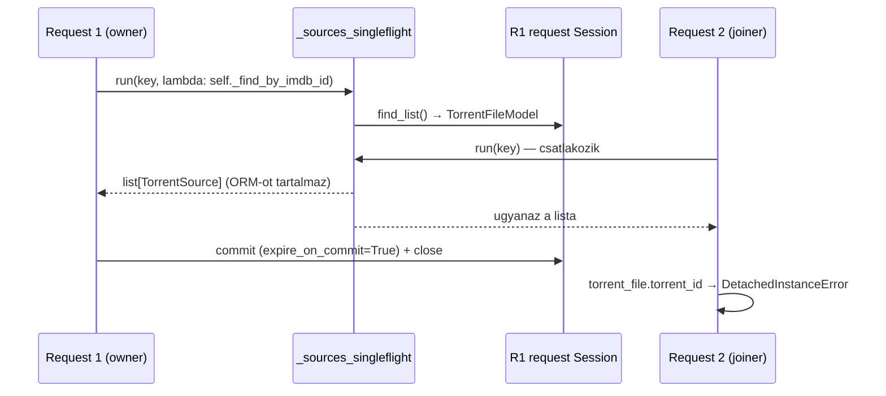

# CR17/c–d — provider/file ownership terv (21–22. csomag)

<!-- doc-nav:start -->
**Navigáció:** [Dokumentáció](../../README.md) · [AI-index](../../AI-INDEX.md)

> **Státusz:** Megvalósítva (21–22). A 21a kész. A 21b `cr17c-after-v1` kapuja egy soron FAIL maradt (érvényes, felmentés nélkül); a felhasználó döntése szerint az azt felváltó, előre regisztrált `cr17c-after-v2` kapu (GC-kontrollált hidegkérések) 316/316 PASS, a 21b ezután commitolva. A 22 runtime-kapuja (`cr17d-after-v1`) 35/316 memóriasoron FAIL maradt (felmentés nélkül); a felhasználó döntése szerint a kapcsolatszámot korlátozó 22b jelölt előre regisztrált `cr17e-after-v1` kapuja 316/316 PASS, a 22+22b commitolva (`f7cdb1a`). Az aktuális végrehajtási állapot a [kanonikus dokumentumban](../stability-and-optimization.md#execution-status) található.

**Kapcsolódó:** [implementation-plan.md — CR17](implementation-plan.md#cr17) · [stability-and-optimization.md](../stability-and-optimization.md)
<!-- doc-nav:end -->

<!-- doc-anchor:doc-cel-es-hatokor -->

## Cél és hatókör

Ez a dokumentum az [eredeti CR17-terv](implementation-plan.md#cr17) 21. (CR17/c) és 22. (CR17/d) csomagját bontja le a forrás jelenlegi állapotára. A historikus tervet nem módosítja. Cél, hogy a megosztott keresési eredményben ne maradjon request-Sessionhöz kötött ORM-objektum, a megosztott task ne használja a hívó request Sessionjét, és a válaszok payloadja, sorrendje és darabszáma változatlan maradjon.

Ellenőrzött forrás: HEAD `050cb33718353d16cbeeaca6ca41a0d9d7d45d6d` plusz a nem commitolt SourceV4 munkafa, amelynek 331 Python-fájlja bájtra egyezik a `cr17b-checked-v4-manifest.json`-nal. A 20. csomag (CR17/b) nincs lezárva: a kompozit V6 kapu FAIL, a V7 zaj- és GC-diagnosztika fut.

<!-- doc-anchor:doc-bizonyitek -->

## Bizonyíték és hibamechanizmus

**Mért (megfigyelés, nem okozati bizonyíték):**
- Kodi C-sorozat, Source2 előtte: 281/12280 kérés `DetachedInstanceError`, SourceV4 utána: 96/12280. Kizárólag párhuzamos cellákban jelentkezik.
- A pinned upstream A direct referencia mind az öt V6-kísérletben ugyanezzel állt le.
- Hibakeret: `torrent_streams/schemas.py` `from_imdb_id` (Kodi/IMDb) és `from_torrent_id` (direct), egy `TorrentFileModel` attribútumának frissítésekor („attribute refresh operation cannot proceed”).

**Forrásból levezetett mechanizmus (statikus hipotézis, a 21a reprodukciónak kell igazolnia):**

1. `get_db` → `db_session()` alapértelmezett `expire_on_commit=True`-val commitol, majd zár (`common/database.py:77–111`).
2. `TorrentSourceProviderService.find_by_imdb_id/find_by_torrent_id/find_by_query/find_one_by_indexer` a modulszintű `Singleflight`-ba `lambda: self._find_…` closure-t ad (`torrent_source_provider/service.py:51–166`). A `self` az első, tulajdonos request service-e, a request Sessionjére épülő `TorrentFilesService`-szel és `IndexersService`-szel.
3. `_sync_torrent_files` (`service.py:179–268`) a request Sessionből olvas `TorrentFileModel`-t (`find_list`), és ezek a `TorrentSource.torrent_file`-ba kerülnek. Az `IndexerTorrent.indexer_account` szintén a request Session `IndexerAccountModel`-je (`indexers/service.py:177–352`).
4. Amikor a tulajdonos request commitol és zár, ezek az objektumok lejárt és leválasztott állapotba kerülnek. A csatlakozó (joiner) kérés a közös eredményből olvas, és az első lejárt attribútumnál `DetachedInstanceError` keletkezik.
5. Ez illik ahhoz, hogy a hiba csak egyidejű, azonos kulcsú kéréseknél jelenik meg. A V4-es csökkenés is illik hozzá: a policy-olvasás Singleflightja más időzítést ad. Okozati bizonyíték csak a 21a determinisztikus reprodukciója lesz.

**További ORM-szivárgások ugyanebben a láncban:**

| Hely | ORM-objektum | Kockázat |
|---|---|---|
| `torrent_source_provider/schemas.py` `TorrentSource` | `TorrentFileModel`, `IndexerTorrent` | Megosztott eredmény mutable ORM-mal |
| `indexers/schemas/internal.py` `IndexerTorrent` | `IndexerAccountModel`, `MediaAttributeModel` | A request Session account-ja a shared taskban |
| `torrent_streams/schemas.py` `TorrentStream` | `indexer_account`, `attributes: MediaAttributeModel \| IndexerDefinitionModel` | Lazy `indexer_definition` olvasás az event loopon, idegen Sessionen |
| `stremio/schemas.py:221,327`, `kodi/schemas/api.py:58` | `indexer_account.indexer_definition.name/.id` | Lazy relationship a konverterben |
| `indexers/service.py:218,334,423` | `indexer_account.indexer_definition.name` timeout-ágon | Lazy load az event loopon |
| `stremio/catalogs_service.py:78–205`, `stremio/schemas.py:491–587`, `torznab/items.py:36–81` | `torrent_file.info`, `indexer_id/torrent_id` | Ugyanaz a `TorrentSource` |
| `torrent_files/isolated_service.py` | expunge-olt modellek | `expire_on_commit=False` mellett működik, de továbbra is ORM-példány |

A `media_attributes.utils.ATTRIBUTES_MAP` statikus, Sessionhöz nem kötött példányokat ad. Ezeket a 21b-ben is ellenőrizni kell, de nem elsődleges hibaforrás.

<!-- doc-anchor:doc-cel-architektura -->

## Célarchitektúra

Az eredeti terv elve marad: rövid szinkron UoW-k saját workerben nyitnak és zárnak Sessiont, és csak immutábilis értéket adnak vissza. A HTTP-await alatt nincs ORM-kapcsolat.

| Új értéktípus | Tartalom | Megjegyzés |
|---|---|---|
| `IndexerAccountRef` (frozen) | `indexer_id`, `definition_id`, `definition_name`, a konverterek által ténylegesen olvasott flagek | Jelszó/cookie nem kerülhet bele; a letöltés továbbra is az adapter saját tárából hitelesít |
| `IndexerDefinitionRef` (frozen) | a `TorrentStream.attributes`-ben használt `id`/`name`/megjelenítési mezők | Helyettesíti az ORM `IndexerDefinitionModel`-t a válaszobjektumban; a JSON-alakot meg kell őrizni |
| `TorrentFileSnapshot` (frozen) | `indexer_id`, `torrent_id`, `info_hash`, materializált `TorrentInfo` | `torrent_bytes` csak akkor, ha fogyasztó igényli (leltár a 21a-ban) |
| `IndexerTorrentSnapshot` (frozen) | `IndexerAccountRef`, `torrent_id`, `download_url`, `imdb_id`, `seeders`, attribútum-tuple | A `download_url` nem logolható |
| `TorrentSource` (frozen) | `IndexerTorrentSnapshot` + `TorrentFileSnapshot` | A shared eredmény tuple, nem módosítható lista |

Betöltő függvények saját izolált Sessionnel, workerben: `load_indexer_account_refs()`, `load_torrent_file_snapshots(ids)`, `store_torrent_files(items) -> list[TorrentFileSnapshot]`. A snapshot a Session lezárása előtt épül. A `TorrentInfo` materializálása a meglévő `_TORRENT_INFO_CACHE`-t használja; ennek CPU- és memóriaköltségét mérni kell.

A megosztott task factoryja modulszintű, állapotmentes függvény. Nem kap request service-t vagy request Sessiont, csak azokat a globális vagy stateless függőségeket, amelyeket a request-scope már a task indítása előtt feloldott (indexer definitions registry, izolált fájlszolgáltatás).

<!-- doc-anchor:doc-csomagbontas -->

## Csomagbontás

| Alcsomag | Tartalom | Érintett fájlok | Kész, ha |
|---|---|---|---|
| **21a — reprodukció és leltár** | Determinisztikus barrier-teszt fájl-DB-vel: owner commit+close, majd joiner-olvasás → jelenleg `DetachedInstanceError`. Tételes leltár az ORM-attribútum-olvasásokról minden fogyasztóban (Stremio, Kodi, Torznab, katalógus, relay/play útvonal) | csak `server/tests/` és ez a dokumentum | A teszt a jelenlegi forráson determinisztikusan bukik, és a leltár teljes |
| **21b — fájl- és account-UoW + DTO** | Értéktípusok, betöltők, `TorrentSource`/`IndexerTorrent` átállítása, `create_many`/`find_list` snapshotot ad vissza; a konverterek az új típusokat fogadják | `torrent_files/{isolated_service,repository,schemas}.py`, `torrent_source_provider/{schemas,service}.py`, `indexers/{service.py,schemas/internal.py}`, `torrent_streams/schemas.py`, `stremio/{schemas,catalogs_service}.py`, `kodi/schemas/api.py`, `torznab/items.py` | A 21a teszt zöld; 64 snapshot és minden payload-hash változatlan; ORM-példány nem fordul elő `TorrentSource`/`TorrentStream`-ben (típusszintű és futásidejű assert tesztben) |
| **22 — owned shared task** | A Singleflight-factory nem zár be request `self`-et; owner cancel, több joiner, shutdown (`close_source_searches`) és a `touch` fire-and-forget életciklusa ellenőrzött | `torrent_source_provider/{service,dependencies}.py`, `stremio/service.py`, `kodi/service.py`, `torrent_streams/{service,dependencies}.py` | A G17 négy trace-forgatókönyve (owner cancel + későbbi DB-read, azonos kulcs, két alias `to_thread`, shutdown közben) a meglévő `scripts/trace_cr_search_ownership.py` eszközzel owner-close utáni Session-use és overlap nélkül fut; pool checkout 0 |

Sorrend: 21a → 21b → 22. A 21b nem lehet a 22 nélkül hosszú életű félállapot: az ORM-mentes eredmény már önmagában megszünteti a hibát, a 22 a Session-tulajdonlást teszi explicitté.

### 21a állapot: reprodukció és leltár

A `server/tests/test_search_resource_ownership.py` két esete (`find_by_imdb_id`, `find_by_torrent_id`) valódi fájl-SQLite-tal, valódi providerrel és repositoryval fut; csak a tracker-metaadat egy kapuzott szintetikus dupla. A SourceV4 munkafán és a tiszta 050cb33 forráson is mindkettő `xfail(strict=True, raises=DetachedInstanceError)` eredményt adott (050cb33: 604 passed + 2 xfailed). `--runxfail` mellett a hiba helye a joiner első `TorrentFileModel`-attribútum-olvasása az owner Session commitja és lezárása után: *„Instance <TorrentFileModel> is not bound to a Session; attribute refresh operation cannot proceed”*. Ez a Kodi/direct sorozatban mért hibával azonos osztály. A 21b-ben a markert el kell távolítani, és a tesztnek zöldnek kell lennie.

Leltár: ORM-olvasás a megosztott eredményen. Megosztott eredmény a `_sources_singleflight` (`find_by_imdb_id`, `find_by_query`, `find_by_torrent_id`) és a `_single_source_singleflight` (`find_one_by_indexer`) kimenete.

| Fogyasztó | Olvasott ORM-mező | Megjegyzés |
|---|---|---|
| `torrent_streams/service.py` 136–137, 185–186, 230–267, 340–341 | `indexer_account.indexer_id`, `torrent_file.info(.name)` | Dedup, fallback cím, szűrés; `from_imdb_id`/`from_torrent_id` hívás |
| `torrent_streams/schemas.py` 74–147 (`from_torrent_id`), 214–309 (`from_imdb_id`) | `torrent_file.torrent_id`, `.info_hash`, `.info`; `indexer_account.indexer_id`, `.indexer_definition.name`, teljes `indexer_definition` az `attributes` listában (299) | A `TorrentStream.indexer_account` maga is ORM-példány, így a hiba a kimenetbe is továbbterjed |
| `torrent_streams/service.py` 674–697 (merge) | `TorrentStream.indexer_account.indexer_id`, `.indexer_definition.name`; `indexer_account` átadás a primary streamnek | Már `TorrentStream`-en fut, de ugyanazt az ORM-példányt olvassa |
| `stremio/schemas.py` 221, 327 | `indexer_account.indexer_definition.name`, `.id` | Lazy relationship, a válasz renderelésekor |
| `kodi/schemas/api.py` 58 | teljes `indexer_definition` (`IndexerDefinitionResponse.model_validate`) | Itt jelentkezik a mért Kodi-hiba |
| `torznab/service.py` 135–136, 255–259; `torznab/items.py` 36–125 | `indexer_account.indexer_id`, `.indexer_definition` (id, név), `torrent_file.info`, `.created_at` | A `created_at` csak itt kell |
| `stremio/catalogs_service.py` 78–160, 188–195 | `torrent_file` (`MetaPreview`/`MetaDetail.from_torrent_file`), `indexer_torrent.seeders/imdb_id`, `indexer_account.indexer_id` | `find_by_query`, `find_by_torrent_id`, `find_one_by_indexer` |
| `torrent_source_provider/service.py` 104–324 | `indexer_account.indexer_id` | Az owner saját futásán belül; nyitott Session mellett nem hibázik, de a 22-ben értékmezőre vált |

Nem megosztott, saját request Sessionben azonosító alapján betöltött olvasások, amelyeken a 21b nem változtat: `torrents/service.py` 51, 67–68, 210 (`TorrentModel.torrent_file.torrent_bytes` relay-hozzáadáshoz és -visszaállításhoz), `torrents/schemas/api.py` 64, `playbacks/schemas/api.py` 31, `playback_histories/repository.py`, `indexer_accounts/repository.py`, `stremio/catalogs_service.py` 180–181 (`torrent_files_service.find_by_id`). A `relay/schemas.py` 50 libtorrent handle, nem ORM. Az `IndexerTorrent.media_attributes` a statikus `ATTRIBUTES_MAP` tranziens példányait tartalmazza, Session nélkül; nem érintett.

Következmény a célarchitektúrára:
- A megosztott eredményből a `torrent_bytes` közvetlenül nem olvasódik. Csak a `TorrentFileModel.info` tulajdonság olvassa, ha a folyamatszintű `_TORRENT_INFO_CACHE` nem tartalmazza a hasht. A `TorrentFileSnapshot` ezért materializált `TorrentInfo`-val, `torrent_bytes` nélkül elég.
- A relay/play útvonal a bájtokat saját Sessionben, azonosító alapján tölti be.
- Szükséges mezők: `indexer_id`, `torrent_id`, `info_hash`, `created_at`, `info`; az `IndexerDefinitionRef`-hez `id`, `name` és a Kodi/attributes szerializáció teljes mezőkészlete (2. nyitott kérdés).
- Leltár-kiegészítés a 21b-ből: a `stremio/service.py` `_can_borrow_subtitle` `getattr`-ral olvassa a `download_full_torrent` accountflaget (és a definíció `requires_full_download` mezőjét). A pont-attribútumos keresés ezt nem találta, az elbukó teszt jelezte. Az `IndexerAccountRef` ezért hordozza ezt a flaget; jelszó, cookie, TOTP és username nem kerül bele.

### 21b állapot: Session nélküli keresési eredmény (050cb33 felett)

| Elem | Megvalósítás |
|---|---|
| `IndexerDefinitionRef`, `IndexerAccountRef` (`indexer_accounts/schemas.py`) | Frozen pydantic. A definícióból `id`, `name`, `url`, `details_path`, `requires_full_download`, `supports_totp`, `disabled`, `order`, `preference_id`; az accountból `indexer_id` és `download_full_torrent` |
| `TorrentFileSnapshot` (`torrent_files/schemas.py`) | Frozen; `indexer_id`, `torrent_id`, `info_hash`, `created_at`, materializált `info`; `torrent_bytes` nélkül |
| `IndexerTorrent`, `TorrentSource` | Frozen, csak a fenti értéktípusokat fogadják el |
| `IndexersService` | A keresési utak account-listája `owned_to_thread`-ben, még a Session-olvasás közben ref-fé alakul (`_find_account_refs`, `_get_account_ref`) |
| `TorrentSourceProviderService._sync_torrent_files` | A meglévő és az újonnan mentett sorok a workerben snapshotra alakulnak (`_find_snapshots`, `_store_snapshots`); a `create_many` API nem változott |
| `TorrentStream`, Stremio/Kodi/Torznab konverterek | Típusuk az új értékekre vált; mezőnevek azonosak, a payload-logika érintetlen. A `stremio/catalogs_service.py` részletes meta-útvonala szintén snapshotot ad |

A Singleflight-factory továbbra is a request `self`-et zárja be, és a megosztott task a tulajdonos request Sessionjén olvas; ezt a 22. csomag rendezi.

Ellenőrzés (helyi, nem Docker):
- A 21a teszt marker nélkül zöld, és futásidőben ellenőrzi, hogy a megosztott `TorrentSource`-ban nincs ORM-példány.
- Új payload-azonossági teszt: a Kodi `indexer` mező a refből ugyanaz, mint az ORM-ből; a ref reprezentációja nem tartalmaz hitelesítő adatot.
- Ruff 0 → basedpyright 0 → 607 passed / 64 snapshot, 0 failed.
- Hét meglévő tesztfájl fixture-jei ORM helyett a ref/snapshot értéket építik; az elvárt értékek nem változtak.
- A 21b forrás befagyasztva: `cr17c-checked-v1-manifest.json` (336 fájl). A kód a `cr17c-after-v2` PASS után, ugyanezzel a forrással került commitba a feature ágon.

<!-- doc-anchor:doc-21b-runtime-kapu -->

### 21b runtime-kapu: `cr17c-after-v1` — FAIL (1/316)

Előre regisztrált protokoll (controller- és assessor-hash a futás előtt rögzítve): [protokoll](evidence/cr17c-after-v1-protocol.json), [értékelés](evidence/cr17c-after-v1-assessment.json), [befejezési jelölő](evidence/cr17c-after-v1-complete.json); a scriptek a [reprodukciós archívumban](evidence/reproduction-followup-v1/manifest.json) (`packet21b-gate` csoport). Előtte: Source2 (050cb337), utána: befagyasztott 21b; a V6 keretek, utólagos felmentés nélkül.

| Kapu | Eredmény |
|---|---|
| Ownership (elsődleges cél) | Teljesült. Kodi C: before 251 HTTP 500 (250 `DetachedInstanceError` + 1 `InvalidRequestError`), after 12 280× HTTP 200, 0 hiba. Direct after mind a 10 futás teljes. A pinned upstream A direct referenciája 5/5 `DetachedInstanceError`-ral bukott (nyitott kérdés 3) |
| Rövid és direct kohorszok (2×5 párosított), payload/sorrend/darabszám | Minden cella a kereten belül; payload-hash azonos |
| Heap, 3 kortárs 1800 s-os pár | p95, CPU, SQL, heap, memória a kereten belül; pool 0, háttértask 0 |
| **heap/cold1 falidő** | **FAIL**: before 72,8/75,4/75,3 ms, after 102,4/102,9/106,3 ms, keret 78,0 ms |

Exit139 ebben a futásban nem fordult elő; az egyetlen sikertelen futás az A direct referencia.

**Diagnosztika (nem kapu, nem felmentés):** [cr17c-cold-gc-diagnostic-v1](evidence/cr17c-cold-gc-diagnostic-v1.json). A két hidegkérés tracemalloc alatt, ugyanazon image-en, 3–3 párban. A hatás determinisztikusan reprodukálódott: after alatt a cold0 ~30–40 ms-mal gyorsabb, a cold1 ~30 ms-mal lassabb, az összeg változatlan (≈440–450 ms). `gc.callbacks` szerint minden after futásban egy ~28 ms-os gen2-gyűjtés a cold1-be esik, minden before futásban a cold0-ba; az after a cold0-ban egy extra gen1-gyűjtést végez. SQL (10/10) és payload azonos; cProfile alatt az eltolódás eltűnik. Ez ugyanaz a gen2-fázis-mechanizmus, amit a V7 a 20. csomagnál talált. A regisztrált FAIL ettől érvényes marad.

**Döntési lehetőségek (felhasználói döntés):**
1. A 21b elfogadása a FAIL tudatában, a diagnosztika alapján, felhasználói kivételként rögzítve; ezután commit és a 22. csomag mérése.
2. Új, előre regisztrált `cr17c-after-v2` kapu, amelyben a hidegkérések GC-fázisa mindkét ágon azonosan kontrollált (pl. `gc.collect()` minden hidegkérés előtt, vagy a két hidegkérés összegére vonatkozó keret), minden más változatlan. Becsült futásidő ~4 óra.
3. A 21b félretétele; ekkor a Kodi/direct `DetachedInstanceError` megmarad.

**Döntés (2026-11-07, felhasználó):** 2. pont, új v2 kapu. A v1 FAIL a bizonyítékok között változatlanul megmarad.

<!-- doc-anchor:doc-21b-runtime-kapu-v2 -->

### 21b runtime-kapu: `cr17c-after-v2` — PASS (316/316)

A v1-et felváltó, a v2-adatok előtt regisztrált protokoll: [protokoll](evidence/cr17c-after-v2-protocol.json), [értékelés](evidence/cr17c-after-v2-assessment.json), [befejezési jelölő](evidence/cr17c-after-v2-complete.json); scriptek és a fixture-generátor a [reprodukciós archívumban](evidence/reproduction-followup-v1/manifest.json) (`packet21b-gate-v2` csoport).

Egyetlen eltérés a v1-től: minden hidegkérés előtt, az időmérésen kívül, teljes `gc.collect()` fut minden ágon és fixture-ben, és a kérés alatti generációnkénti gyűjtésszám megfigyelésként rögzül. Források (before Source2, after befagyasztott 21b, B baseline), sorozatok, ismétlésszám, rotáció és a V6 keretek változatlanok; a controller- és assessor-hash a futás előtt rögzítve.

| Kapu | Eredmény |
|---|---|
| Ownership | Kodi C: before 276 HTTP 500 (mind `DetachedInstanceError`, 34 cellában), after 12 280× HTTP 200, 0 hiba. Direct after 10/10 teljes |
| Rövid, direct, heap cellák (p95, CPU, SQL, memória, payload/sorrend/darabszám) | Mind a kereten belül |
| heap/cold0 falidő | before 344/339/351 ms, after 337/342/338 ms, keret 362 ms |
| heap/cold1 falidő | before 77,4/80,9/74,3 ms, after 82,3/75,8/81,3 ms, keret 87,5 ms |

A pinned upstream A direct referenciája 4/5 futásban `DetachedInstanceError`-ral bukott, egy futás teljes lett; a hiba versenyhelyzet-függő (3. nyitott kérdés). Exit139 nem fordult elő.

<!-- doc-anchor:doc-22-elokeszites -->

### 22 előkészítés: állapotmentes megosztott keresés (kapu FAIL, a 22b váltotta fel)

A helyi `wip/cr17d-owned-shared-task` ág (`22731a4`, a 21b WIP-commitra épül, nincs pusholva):
- `indexers/search.py`: folyamatszintű `IndexerSearchService`; az accountokat saját izolált Sessionben olvassa és refként adja vissza. Az `IndexersService` ide delegál.
- A provider Singleflight-factoryja csak állapotmentes függőséget zár be (`_SourceSearch`), a request `self`-et és Sessiont nem; a fájlsnapshot-olvasás is izolált Sessionben fut. A provider konstruktora két argumentumos, db nélkül.
- Ellenőrzés (helyi, nem Docker): célzott tesztek, Ruff 0 → basedpyright 0 → 609 passed / 64 snapshot. Új tesztek: tulajdonos cancel után nincs request-Session-munka és pool-checkout; az izolált account-olvasás refet ad, ORM nélkül. Az utóbbi a basedpyright által jelzett hibás `IndexerAccountsService`-konstrukciót fogja meg, amely futásidőben `TypeError` lett volna. Ownership-trace: 4/4 eset, átfedő Session-hívás nincs, pool 0.
- A kód a 21b commitra (`d1da34c`) konfliktus nélkül ráül (helyi `wip/cr17d-on-21b`, `41623ce`, a mért forrással byte-azonos); nincs pusholva.

<!-- doc-anchor:doc-22-runtime-kapu -->

### 22 runtime-kapu: `cr17d-after-v1` — FAIL (35/316, csak memória)

Előre regisztrált protokoll: [protokoll](evidence/cr17d-after-v1-protocol.json), [értékelés](evidence/cr17d-after-v1-assessment.json), [befejezési jelölő](evidence/cr17d-after-v1-complete.json), forrásmanifest: [cr17d-checked-v1](evidence/cr17d-checked-v1-manifest.json); scriptek a [reprodukciós archívumban](evidence/reproduction-followup-v1/manifest.json) (`packet22-gate`). Before = befagyasztott 21b (`d1da34c` server/app), after = befagyasztott 22 (`22731a4`). Mintavétel, GC-kontrollált hidegkérések és V6 keretek a `cr17c-after-v2`-vel azonosak.

**Áramszünet:** a 3. hosszú pár after futása közben megszakadt, kimenet nélkül. A folytatás módját [előre regisztrált kiegészítés](evidence/cr17d-after-v1-resume-amendment.json) rögzíti, amely bármely eredményérték olvasása előtt készült: a megszakított kísérlet `interrupted` jelöléssel megmaradt, a 3. pár (after, before) egyszer újrafutott, befejezett kísérletet nem futtattam újra és nem cseréltem. A memóriatöbblet mindhárom párban azonos irányú, tehát nem a megszakítás okozza.

| Kapu | Eredmény |
|---|---|
| Ownership | Teljesült: Kodi C before és after is 12 280×200, 0 hiba (a before már a 21b); direct after 10/10 teljes |
| HTTP p95, CPU, SQL, payload, hidegkérések, quiescence | Mind a kereten belül |
| **Memória (35 sor)** | **FAIL**: a heap-futások anon/RSS értéke minden cellában ~+6–10 MiB (pl. same-key c1 anon after 302,2/304,5/303,9 MB, before 296,3/294,1/293,4 MB, keret 298,4 MB); a rövid kohorszok párhuzamos cellái +3–10 MiB (100 sor, unique-key c8 anon after 150,1/149,8 MB, keret 143,3 MB). A keret +2 MiB |

Az upstream A direct referenciája 5/5 `DetachedInstanceError`-ral bukott (megfigyelés).

**Diagnosztika (nem kapu, nem felmentés):** [cr17d-pool-diagnostic-v1](evidence/cr17d-pool-diagnostic-v1.json). Ugyanaz a fixture SQLAlchemy `connect`/`checkout` számlálóval, rövid módban, before/after/after/before sorrendben. A 22 minden engine-en eléri az alapértelmezett QueuePool plafont (`pool_size` 5 + `max_overflow` 10 = 15 egyidejű checkout; before 10–11), és 102–135 fizikai SQLite-kapcsolatot nyit (before 26–56): az overflow-kapcsolatok ismételten nyílnak és záródnak. Minden élő SQLite-kapcsolat saját page cache-t tart, ami illeszkedik a párhuzamos cellák memóriatöbbletéhez. Következtetés (statikus, nem mért): a megosztott taskonkénti izolált Sessionök (account-ref és fájlsnapshot) a request-Sessionök mellé további egyidejű kapcsolatokat nyitnak; telített pool mellett nagyobb párhuzamosságnál a kérések a pool timeoutjáig várhatnak.

**Döntési lehetőségek** — a felhasználó 2026-11-07-én az 1. lehetőséget választotta, lásd [22b](#doc-22b-megosztott-olvasasi-kapu):
1. Új 22b jelölt, amely az egyidejű kapcsolatszámot a before szintjén tartja (pl. taskonként egyetlen izolált Session az account- és fájlolvasásra, vagy az izolált olvasások korlátozása), ezután új, előre regisztrált kapu (~4 óra).
2. A 22 félretétele: a 21b egymagában megszünteti a mért `DetachedInstanceError`-t; a megosztott task továbbra is a tulajdonos request Sessionjén olvas (a 22 explicit Session-szerződése elmarad).
3. A 22 elfogadása a memória-FAIL tudatában, felhasználói kivételként.

<!-- doc-anchor:doc-22b-megosztott-olvasasi-kapu -->

### 22b: korlátozott megosztott olvasás és `cr17e-after-v1` kapu — PASS (316/316)

**Változás a 22-höz képest:** `common/database.py:shared_read_session()` — folyamatszintű, egyhelyes (`BoundedSemaphore(1)`), nem újrabelépő kapu a megosztott keresések izolált olvasásai (account-refek, fájlsnapshotok) körül. Így egy megosztott keresés legfeljebb egy további kapcsolatot tart a request-Sessionök mellett. Beágyazott hívás holtpont helyett azonnal `RuntimeError`; kivételnél a hely felszabadul. Workerszálban (`owned_to_thread`) fut, az event loopot nem blokkolja. Az írások (touch, `create_many`) változatlanok.

**Ellenőrzés:** két új viselkedési teszt (egyszerre egy extra kapcsolat; beágyazás gyors hibája és felszabadítás hibaágon) — a kapu kikapcsolásával a párhuzamossági teszt elbukik. Ruff 0, basedpyright 0, 611 passed / 64 snapshot; ownership-trace Dockerben 4/4 tiszta, átfedő Session-használat nincs, pool 0. A trace alias-esete a sorosított olvasás miatt a barrier-találkozást rögzíti, nem követeli meg (az átfedés-ellenőrzés változatlan). Feltáró előszűrés (nem kapuadat): egyidejű checkout 10–11 (22: 15), fizikai kapcsolat 13–37 (22: 102–135).

**Kapu:** [protokoll](evidence/cr17e-after-v1-protocol.json), [értékelés](evidence/cr17e-after-v1-assessment.json), [befejezési jelölő](evidence/cr17e-after-v1-complete.json), forrásmanifest: [cr17e-checked-v1](evidence/cr17e-checked-v1-manifest.json); scriptek a [reprodukciós archívumban](evidence/reproduction-followup-v1/manifest.json) (`packet22b-gate`; a feltáró scriptek `packet22b-exploration`). Before = befagyasztott 21b (`d1da34c`), after = befagyasztott 22b (`5be09f2` server/app, fával azonos a `f7cdb1a` commit server/app fájával). Fixture-ök, mintavétel és V6 keretek a `cr17d-after-v1`-gyel azonosak; regisztráció előtt az értékelő a 22 adatain a korábbi 35 soros FAIL-t pontosan reprodukálta. A `cr17d-after-v1` FAIL eredménye érvényes marad.

| Kapu | Eredmény |
|---|---|
| Ownership | Teljesült: Kodi before és after 12 280×200, 0 hiba |
| HTTP p95, CPU, SQL, payload, hidegkérések, quiescence | Mind a kereten belül |
| Memória | Teljesült: heap-futások anon after 285–291 MB, before 292–295 MB (same-key c1 keret 295,3 MB); GC utáni heap +0,1 MB (keret +2 MiB); rövid unique-key c8 (100 sor) anon after 134,2/132,8 MB, before 138,6/140,4 MB |

Megfigyelés (nem gyorsulási állítás): a heap-futások unique-key c4/c8 cellájában a loop-lag p99 before 91–168 ms, after 62–65 ms. Az upstream A direct referenciája 5/5 `DetachedInstanceError`-ral bukott (megfigyelés).

<!-- doc-anchor:doc-fuggoseg-a-20-csomagtol -->

## Függőség a 20. csomagtól

A 21b a 20. csomaggal közös fájlokat érint (`torrent_streams/schemas.py`, `kodi/service.py`, `stremio/service.py`). Ha a két változás egy mérésbe kerül, a hatásuk nem választható szét. Ezért:

1. A 21a reprodukciós teszt és a leltár már most elkészíthető: csak tesztet ad hozzá, és a SourceV4 munkafára épül.
2. A 21b implementációja a 20. csomagról hozott felhasználói döntés után indul: elfogadott keret, új jelölt vagy elvetés. A 21b mérési előtte-állapota az a forrás, amelyet a 20. csomag döntése elfogad.
3. Ha a 20. csomagot elvetjük, a 21b a 050cb337 forrásra épül, és a policy-olvasás a mostani request-útvonalon marad.

**Döntés (2026-11-06, felhasználó):** a 20. csomag félretéve. A SourceV4 kód változatlanul a helyi `archive/cr17b-policy-snapshot-v4` ágon (a099da5) maradt meg; a 21b a 3. pont szerint a 050cb337 forrásra épül, a mérési előtte-állapot is ez.

<!-- doc-anchor:doc-teszt-es-meresi-kapu -->

## Teszt- és mérési kapu

**Funkcionális (21b és 22 lezárásakor):**
- 21a reprodukció zöld; új `test_search_resource_ownership.py`: owner/joiner commit, owner cancel, két user azonos kulccsal (nincs URL-/API-kulcs-keveredés), shutdown közbeni keresés.
- Meglévő regressziók változatlan elvárással: `test_singleflight.py`, `test_lifespan_cleanup.py`, `test_search_policy_snapshot.py`, `test_stremio_catalog_search.py`, `test_torznab_*`, `test_tvdb_streams.py`, `test_stream_*`, valamint a 64 snapshot.
- AGENTS 4. pont szerinti sorrend: célzott tesztek → Ruff → basedpyright → teljes pytest.

**Mérés (AGENTS 6. pont, a V6 keretrendszer szerint):**
- Friss párosított előtte/utána rövid kohorszok (2×5), rotált A/B/C, két teljes 1800 s-os heapfutás, direct és Kodi sorozat.
- Új funkcionális elfogadási feltétel: a C Kodi- és direct-sorozatban 0 `DetachedInstanceError` és 0 HTTP 500. Ez a csomag elsődleges célja; időbeli javulás nem elvárás.
- Időzítési és erőforráskeret: HTTP p95 +10 ms, CPU +10%, memória +2 MiB, SQL nem nőhet.
- A V7 eredményétől függően a heap c8 p95 kerete legyen előre rögzítve. Ha a V7 szerint a változatlan forrás zaja meghaladja a +10 ms-ot, a protokollban előre kell dönteni a futásszámról (pl. 3 párosított hosszú pár), nem utólag.
- Mérendő mellékhatás: a `TorrentInfo` előre materializálása több CPU-t használhat olyan forrásoknál, amelyeket a szűrő később eldob. A `torrent_bytes` elhagyása a megosztott eredményből memóriát takaríthat meg. Egyik sem állítható mérés nélkül.

<!-- doc-anchor:doc-invariansok -->

## Kritikus invariánsok

- A válaszséma, a payload, a sorrend, a dedup és a darabszám változatlan (Stremio, Kodi, Torznab, katalógus). A Range/HEAD és a lejátszási URL formátuma nem változik.
- A keresési DTO-ba nem kerülhet indexer-jelszó, cookie vagy API-kulcs; `download_url` és play URL nem kerülhet logba.
- A Singleflight dedup/shield/exception-consume algoritmusát nem írjuk újra. A kikapcsolása nem helyettesíti a javítást.
- Az event loopon nincs DB-művelet és nincs lazy load. A `to_thread` cancel nem állítja meg a workert; a tulajdonos a worker végét várja meg.
- Minden új cache vagy registry korlátos, és lifespan-zárással ürül.

<!-- doc-anchor:doc-rollback -->

## Rollback

A 21b és a 22 külön commit. A 21b visszavonása visszahozza az ORM-alapú eredményt és vele a mért `DetachedInstanceError`-t. A 22 visszavonása a 21b mellett nem okoz hibát, csak a Session-tulajdonlás explicit szerződését veszíti el. Külső API és DB-séma nem változik, migráció nincs.

<!-- doc-anchor:doc-nyitott-kerdesek -->

## Nyitott kérdések

1. ~~Mely fogyasztók igénylik a `torrent_bytes`-ot a keresési eredményből?~~ Megválaszolva a 21a leltárban: egyik sem közvetlenül, csak a `info` tulajdonság cache-hiány esetén; a relay/play saját Sessionben tölt.
2. A `TorrentStream.attributes`-ben szereplő `IndexerDefinitionModel` milyen mezői kerülnek a JSON-ba? A `IndexerDefinitionRef`-nek ugyanazt a szerializált alakot kell adnia.
3. A pinned upstream A ugyanebben a hibában bukik. Ez upstream-hiba is, de upstream-javaslat nem része ennek a csomagnak.
4. A Kodi C-sorozat Source2 előtte-állapotában egyszer exit139 is előfordult diagnosztika nélkül. A 21b mérésénél a crash-kimenetet (exit code, stderr) külön rögzíteni kell; ok nem feltételezhető.
