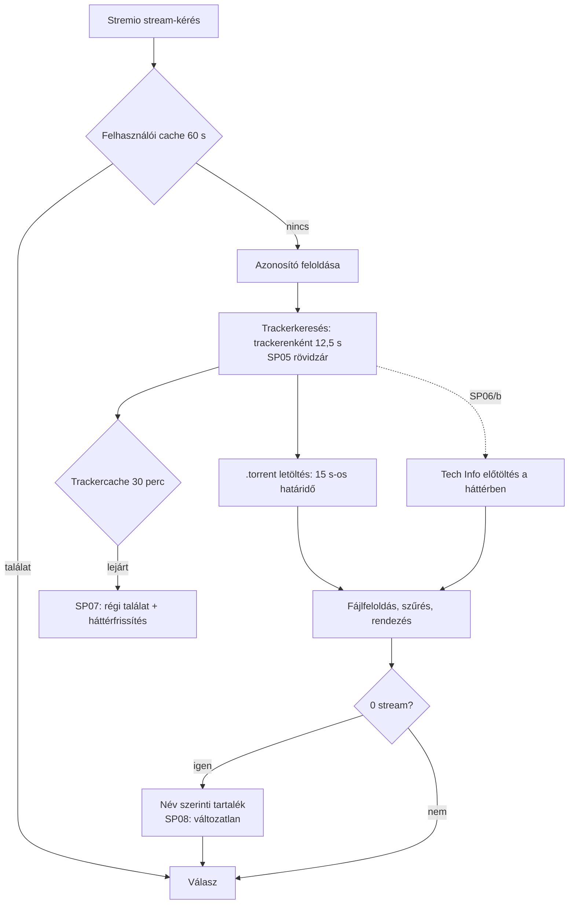
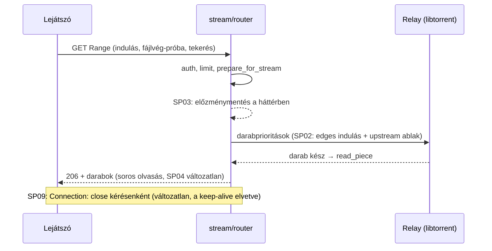

# Streamgyorsítás — branch-összefoglaló

<!-- doc-nav:start -->
**Navigáció:** [Dokumentáció](../README.md) · [AI-index](../AI-INDEX.md)

> **Státusz:** Kész, PR a `main` felé (2026-11-11). A csomagonkénti eredmény a [végrehajtási állapotban](#execution-status).

**Kapcsolódó:** [README.md](stream-performance/README.md) · [implementation-plan.md](stream-performance/implementation-plan.md)

Fejezetek / közvetlen ugrás

- [Cél és tényleges státusz](#doc-cel-es-tenyleges-statusz)
- [Kanonikus dokumentumok](#doc-kanonikus-dokumentumok)
- [Upstream-diffmátrix](#doc-upstream-diffmatrix-tervezett)
- [Érintett modulok és kritikus invariánsok](#doc-erintett-modulok-es-kritikus-invariansok)
- [Végrehajtási állapot](#execution-status)
- [UX/SLO-keret (felhasználói döntés, 2026-11-09)](#doc-ux-slo-keret)
- [Korlátok](#doc-korlatok)

<!-- doc-nav:end -->

<!-- doc-anchor:doc-cel-es-tenyleges-statusz -->

## Cél és tényleges státusz

**Cél:** gyorsabb találatlista és gyorsabb, kevésbé akadó lejátszás, a működés és a lejátszói kompatibilitás megőrzésével. A fejlesztés a [stabilitási ág](stability-and-optimization.md) menetét követi:
- értékelt tétel;
- előre regisztrált mérési kapu;
- kis csomag és célzott teszt;
- A/B/C és C előtte/utána mérés;
- dokumentált döntés.

**Státusz (2026-11-11):** minden csomag lezárva, a branch PR-ral a `main` felé. Élő változások: SP06/a (Tech Info-hiba nem kerül 1 órára a cache-be), a `gsp02-v4` PASS:C2 alapján az upstream-szerű indulás (`RELAY_START_POLICY=edges`, `RELAY_READAHEAD_POLICY=upstream`), a `gsp05-v1` PASS alapján a tracker-rövidzár (`INDEXER_BREAKER_THRESHOLD=2`), a `gsp06-v2` PASS alapján a Tech Info előtöltés (`TECH_INFO_PREFETCH=true`), a `gsp03-v1` PASS:C3 alapján a háttérben írt lejátszási előzmény (`PLAYBACK_HISTORY_BACKGROUND=true`), valamint a `gsp07-v2` PASS alapján a lejárt trackercache azonnali kiszolgálása háttérfrissítéssel (`INDEXER_CACHE_HARD_TTL_SECONDS=86400`). Mérve, változtatás nélkül lezárva: SP04 (`gsp04-v1` FAIL, nincs nyereség), SP08 (leíró mérés: a jelölt felső korlátja sem lényeges), SP10 (beragadó peerek: `gsp10-v1` és a nagyobb mintás `gsp10-v2` is FAIL), SP01 (bájtalapú előtöltési ablak: a `sp01-probe-v1` leíró mérés előre rögzített feltétele nem teljesült, kapu nem készült) és SP09 (keep-alive a streamválaszokon: a `gsp09-v1` PASS és a kézi kliensteszt után a felhasználó elvetette, mert kicsi és bizonytalan a nyereség, az upstream #274-nek pedig lehetett oka). A nem beolvasztott jelöltek és bizonyítékaik archív címkéken vannak: `archive/sp04-read-overlap`, `archive/sp08-fallback`, `archive/sp09-keep-alive`, `archive/sp10-stalled-peers`. A részletek a [végrehajtási állapotban](#execution-status).

<!-- doc-anchor:doc-kanonikus-dokumentumok -->

## Kanonikus dokumentumok

| Kérdés | Forrás |
|---|---|
| Mi a kilenc tétel, milyen bizonyítékkal, milyen sorrendben? | [Implementációs terv](stream-performance/implementation-plan.md) |
| Milyen sorrendben olvassam? | [Munkacsomag README](stream-performance/README.md) |
| Mi készült el ténylegesen, milyen méréssel? | [Végrehajtási állapot](#execution-status) |
| Hogyan mértünk a stabilitási ágon (minta)? | [Stabilitási végrehajtási állapot](stability-and-optimization.md#execution-status) |

<!-- doc-anchor:doc-upstream-diffmatrix-tervezett -->

## Upstream-diffmátrix

Funkcióeredet-baseline: `s4pp1/stremhu-source@8c99c7d` (helyben elérhető). A harmadik oszlop a branch állapota 2026-11-11-én: az **Alapértelmezés** sorok élők (mért PASS után); a többi változatlan, jelölt vagy mérve elvetett.

| Terület | Upstream `8c99c7d` | Fork `main` `0515d98` | `feature/stream-performance` (állapot) |
|---|---|---|---|
| Előtöltési ablak lejátszás közben | 4–8 hiányzó darab határidővel, a többi 0 prioritás; határidő `2000 + 1000·d` ms | Ugyanaz az ablak; határidő 0 / 300 / `1000 + 500·d` ms | **Alapértelmezés: az upstream képlete** (`RELAY_READAHEAD_POLICY=upstream`, `gsp02-v4` PASS:C2), ugyanazzal az ablakkal; a `legacy` visszaállítható. A bájtalapú ablak (SP01) kapcsoló mögött a kódban marad, alapból ki: a `sp01-probe-v1` leíró mérés alapján nem került kapura. |
| Indulási darabsorrend | A fájl első és utolsó darabja 0 ms (1+1) | Az első és utolsó 3 darab 0 ms (3+3) | **Alapértelmezés: az upstream 1+1** (`RELAY_START_POLICY=edges`, `gsp02-v4` PASS:C2): az indulás 5/6 kulcscellában gyorsabb (pl. 12,6 → 9,0 s); 16 MiB-nál a tekerés +0,2–0,7 s. A `legacy` (3+3) visszaállítható. |
| Lejátszási előzmény | A válasz előtt, minden kérésnél | Ugyanaz, zárral és izolált sessionnel | **Alapértelmezés: playbackenként egyszer, a háttérben** (SP03, `gsp03-v1` PASS:C3); a `PLAYBACK_HISTORY_BACKGROUND=false` visszaállítja a kérésenkénti írást |
| Darabolvasás | Soros | Soros, megosztott olvasási taskkal | **Változatlan.** Az egy darabos átfedő előreolvasás (SP04) mérve nem gyorsít: a helyben lévő 512 MiB-os fájl mindkét karon ~1 s alatt olvasható ki (`gsp04-v1` FAIL); a jelölt csak az `archive/sp04-read-overlap` archív címkén van |
| `Connection: close` | Igen (#274) | Igen | Változatlan: a `gsp09-v1` PASS és a kézi kliensteszt után a felhasználó elvetette a keep-alive-ot (SP09) |
| Trackerenkénti időkorlát | 12,5 s | 12,5 s, három másolatban | Egy segéd (SP05/a). **Alapértelmezés: rövidzár** nem válaszoló trackerre (SP05/b, `gsp05-v1` PASS): 2 egymás utáni időtúllépés vagy kapcsolódási hiba után 120 s kihagyás figyelmeztetéssel, ismétlődéskor duplázva, legfeljebb 600 s; `INDEXER_BREAKER_THRESHOLD=0` kikapcsolja. |
| Trackercache | Nincs | 30 perc (IMDb), 5 perc (lekérdezés) | **Alapértelmezés: a 30 perces puha TTL után azonnali régi találat, háttérfrissítés, 24 órás kemény határ** (SP07, `gsp07-v2` PASS); a torznab mindig friss listát kap; `INDEXER_CACHE_HARD_TTL_SECONDS=0` visszaállítja a szinkron újrakeresést |
| Tech Info | Nincs | Legfeljebb 1,5 s a keresés után, sorban | Hibák nem mérgezik a cache-t (SP06/a). **Alapértelmezés: előtöltés** (SP06/b, `gsp06-v2` PASS): a keresés a trackerfázis után a legtöbb seederű 5 Tech Info-adó találatra háttérlekérést indít (folyamatszinten legfeljebb 20, egyenként 10 s); a kérés a lekérés indulásától számított 1,5 s-ból csak a hátralévőt várja, a háttér befejezi és a következő kérés a cache-ből dúsít. A hideg kérés ~0,2 s-mal gyorsabb; lassú (2 s) Tech Info-nál a második kérés 1,5 s → 11 ms, és dúsított. `TECH_INFO_PREFETCH=false` visszaállítja a korábbi viselkedést. |
| Név szerinti tartalékkeresés | Fork funkció | Soros | **Változatlan.** A „két első lekérdezés párhuzamosan” jelölt mért felső korlátja sem lényeges, és megduplázná a trackerhívásokat (SP08 leíró mérés, az `archive/sp08-fallback` archív címkén) |
| Beragadó peerek (kérést elfogad, adatot nem küld) | libtorrent `piece_timeout` | Ugyanaz | **Változatlan** (`legacy`). Az SP10 watchdog (2 s adat nélkül, miközben más peer halad → 120 s ip_filter-tiltás) az `archive/sp10-stalled-peers` archív címkén: `gsp10-v1` FAIL kevés futás miatt, a `gsp10-v2` ismétlés (36 futás karonként) is FAIL: csak a 16 MiB/8 Mbit cella javul, a 4 MiB-os nyereség nem ismétlődött |

<!-- doc-anchor:doc-erintett-modulok-es-kritikus-invariansok -->

## Érintett modulok és kritikus invariánsok

**Modulok:**
- `server/app/modules/relay/` (entities, service);
- `server/app/modules/stream/` (router, service);
- `server/app/modules/indexers/search.py`;
- `server/app/modules/torrent_source_provider/service.py`;
- `server/app/modules/torrent_streams/service.py`;
- `server/app/modules/indexer_definitions/` (nCore Tech Info);
- `server/app/config.py`;
- `scripts/fixtures/`.

**Invariánsok:**
- **Lejátszói kompatibilitás:** a hitelesítés, a válaszsémák, a Range/HEAD és a lejátszói kompatibilitás megmarad.
- **Visszaállítható policy:** minden viselkedést változtató policy konfigurációval visszaállítható a legacy működésre; az alapérték csak PASS után vált.
- **Korlátos háttérmunka:** minden új háttérmunkának kapacitása, deduplikációja és lifespan-lezárása van. Az event loopon nem fut új blokkoló hívás.
- **Plug & play:** új kötelező beállítás vagy migráció nincs.

<!-- doc-anchor:execution-status -->

## Végrehajtási állapot

Még nincs végrehajtott csomag. A csomagonkénti eredmény, a regisztrált protokoll és a kapudöntés ide kerül, a [munkacsomag-tábla](stream-performance/implementation-plan.md#doc-5-munkacsomag-tabla) sorrendjében.

| Csomag | Állapot | Bizonyíték |
|---|---|---|
| 0 — G0 + mérőeszközök + baseline | **kész.** G0-próba; H1 (A és B). `pb0-v1` 3 futás után megszakítva (harnesshiba), `pb0-v2` 135/135 futás, 0 hibás futás. Leíró eredmény: a fork indulása J-n túl lassabb az upstreamnél (SP02), a beragadó peerek 13–18 s-ot okoznak (új SP10), nagy a fel nem használt letöltés. | [G0-próba](stream-performance/evidence/g0-libtorrent-probe-v2.json), [pb0-v2 protokoll](stream-performance/evidence/pb0-v2-protocol.json), [összesítés](stream-performance/evidence/pb0-v2-summary.json), [értékelés](stream-performance/evidence/pb0-v2-assessment.json), [minden futás](stream-performance/evidence/pb0-v2-complete.json), [pb0-v1 megszakítás](stream-performance/evidence/pb0-v1-aborted.json) |
| 1 — SP03 | jelölt a saját munkamenet-ágán (`f195048`; később a `feature/stream-performance`-be olvasztva, `c6fb704`), kapcsoló mögött: `PLAYBACK_HISTORY_BACKGROUND` (alapból false = a mai út) | — |
| 1 — GSP03 | **`gsp03-v1`: PASS:C3** (80/80 futás, 0 hiba, 0 traceback). Mind a 4 kulcscellában Holm után is gyorsabb a kérések TTFB-mediánja (p 0,0002–0,0246; a szabály 2-t kért), de kicsi a nyereség: kérésenként ~0,7–1,3 ms (RTT 1 ms: 15,8 → 14,5 ms, RTT 20 ms: 52,9 → 51,8 ms). Párhuzamos SQLite-írási terhelésnél a lejátszás első kérése nyer többet, mert a C0 ott az írási zárra vár: 21,5 → 16,1 ms, illetve 63,4 → 53,8 ms; terhelés nélkül az első kérés egyforma. 12 őrteszt, regresszió nincs; 0 elveszett előzmény-írás, 0 nem-206 válasz, 0 kliens-hiba mindkét karon. A gyakorlati haszon: az első írás után nincs kérésenkénti adatbázis-hívás; a lejátszó a kérésenkénti ~1 ms-ot nem érzékeli. Bekapcsolás alapértelmezésre a feature ágba olvasztás után, külön committal. | [protokoll](stream-performance/evidence/gsp03-v1-protocol.json), [döntés](stream-performance/evidence/gsp03-v1-decision.json), [értékelés](stream-performance/evidence/gsp03-v1-assessment.json), [összesítés](stream-performance/evidence/gsp03-v1-summary.json), [minden futás](stream-performance/evidence/gsp03-v1-complete.json) |
| 2 — SP05/a | **kész** (`40d166e`): egy időkorlát-segéd, változatlan viselkedés | `test_indexer_search_timeout.py` |
| 3 — SP06/a | **kész** (`cd4b0ad`): sikertelen Tech Info-lekérés nem kerül 1 órára a cache-be | `test_tech_info_failures.py` |
| 4–5 — SP02/SP01 kód | kapcsoló mögött bent (`b794167`), alapérték `legacy` | `test_relay_start_and_readahead_policy.py` |
| 4 — GSP02 | **`gsp02-v1`: FAIL** (250/250 futás, 0 hiba). A szabály kulcscellái mind a zajos mixed profilban voltak (J 2–12 s, a beragadó peerek miatt), ott egyik javulás sem lépte túl J-t mindkét sorozatban. A fast profilban a graded indulás J-n túl gyorsabb (4 MiB 6,8 → 4,7 s, 16 MiB 13,2 → 9,1 s, az upstream szintje), de kis regressziók is vannak (fast/1 MiB TTFB +0,2 s, fast/16 MiB tekerés +0,3–0,5 s). Az alapérték `legacy` marad; `gsp02-v2` következik upstream-szerű jelölttel. | [protokoll](stream-performance/evidence/gsp02-v1-protocol.json), [összesítés](stream-performance/evidence/gsp02-v1-summary.json), [döntés](stream-performance/evidence/gsp02-v1-decision.json), [értékelés](stream-performance/evidence/gsp02-v1-assessment.json), [minden futás](stream-performance/evidence/gsp02-v1-complete.json) |
| 4 — GSP02 v2 | **`gsp02-v2`: FAIL** (360/360 futás, 0 hiba). A C2 (upstream-szerű) indulása 5/6 kulcscellában J-n túl gyorsabb, 1 MiB-nál sem rosszabb (pl. fast/4 MiB 6,8 → 4,8 s, thin/16 MiB 14,5 → 11,3 s). Mindkét jelölt viszont lassítja a tekerés utáni újraindulást 16 MiB-os darabnál (thin 3,5 → 6,8–9 s). Nem a prioritás-szivárgás okozza; a mechanizmus diagnosztikája következik, utána v3. Az alapérték `legacy` marad. | [protokoll](stream-performance/evidence/gsp02-v2-protocol.json), [összesítés](stream-performance/evidence/gsp02-v2-summary.json), [döntés](stream-performance/evidence/gsp02-v2-decision.json), [értékelés](stream-performance/evidence/gsp02-v2-assessment.json), [minden futás](stream-performance/evidence/gsp02-v2-complete.json) |
| 4 — tekerési diagnózis | A régi stream tekeréskor azonnal elenged; a lassú tekerésnél a várt darab a következő ablakdarabbal osztozik a sávszélességen, és a jelöltek gyakrabban kerülnek ebbe az állapotba (thin/16 MiB gyors tekerés: C0 6/10, C1 1/10, C2 2/10). | [diagnózis](stream-performance/evidence/gsp02-diag-seek.json) |
| 4 — GSP02 v3 | **`gsp02-v3`: FAIL** (360/360 futás, 0 hiba). A C3 (`focus`) elvetve, egyértelműen rosszabb. A **C4 (csak `edges`, az upstream 1+1 határdarabja)** mind a 6 kulcscellában, mindkét sorozatban gyorsítja az indulást (fast/16 MiB 13,3 → 9,1 s, fast/4 MiB 6,8 → 4,7 s, thin/16 MiB 14,5 → 11,3 s, thin/1 MiB 6,4 → 5,8 s). Ára a tekerés utáni újraindulás nagy darabnál (+0,35–1,85 s): ez termékdöntés. A ritka traceback forrása azonosítva: asyncio-belső kettős kapcsolatlezárás kliens-lecsatlakozáskor, alkalmazás-keret nélkül, ártalmatlan. | [protokoll](stream-performance/evidence/gsp02-v3-protocol.json), [összesítés](stream-performance/evidence/gsp02-v3-summary.json), [döntés](stream-performance/evidence/gsp02-v3-decision.json), [értékelés](stream-performance/evidence/gsp02-v3-assessment.json), [minden futás](stream-performance/evidence/gsp02-v3-complete.json) |
| 4 — GSP02 v4 | **`gsp02-v4`: PASS:C2** (360/360 futás, 0 hiba, 0 alkalmazás-keretes traceback). A C2 (`edges` + `upstream`: csak a fájl első és utolsó darabja sürgős, az upstream határidő-képletével) 5/6 kulcscellában Holm-korrekció után is gyorsabban indul (fast/16 MiB 12,6 → 9,0 s, fast/4 MiB 6,4 → 4,5 s, thin/16 MiB 14,1 → 11,5 s, thin/4 MiB 9,8 → 6,7 s, thin/1 MiB 6,3 → 5,5 s), regresszió nélkül. Fenntartás: 16 MiB-os darabnál a tekerés utáni újraindulás +0,2–0,7 s (p 0,0015–0,0035, a korrigált küszöb felett); ugyanez az ár az upstreamen is (`pb1-v1`). | [protokoll](stream-performance/evidence/gsp02-v4-protocol.json), [döntés](stream-performance/evidence/gsp02-v4-decision.json), [értékelés](stream-performance/evidence/gsp02-v4-assessment.json), [összesítés](stream-performance/evidence/gsp02-v4-summary.json), [minden futás](stream-performance/evidence/gsp02-v4-complete.json) |
| 0b — `pb1-v1` referencia | 120/120 futás, 0 hiba: 8 és 60 Mbit/s-on is az upstream indul gyorsabban a mai forknál; 16 MiB-nál a tekerésben kis árat fizet. | [protokoll](stream-performance/evidence/pb1-v1-protocol.json), [értékelés](stream-performance/evidence/pb1-v1-assessment.json), [összesítés](stream-performance/evidence/pb1-v1-summary.json), [minden futás](stream-performance/evidence/pb1-v1-complete.json) |
| 6–7 — SP05/b, SP06/b kód | beolvasztva (`a998d45`, `e61ab39`), mindkettő kapcsoló mögött, alapból kikapcsolva; H2 keresési harness (`benchmark_sp_search.py`) és kapufuttató/-döntő (`run_sp_search_gate.py`, `decide_sp_search_gate.py`) | `test_indexer_breaker.py`, `test_tech_info_prefetch.py` |
| 6 — GSP05 | **`gsp05-v1`: PASS** (20/20 futás, 0 hiba, 0 külső HTTP). Nem válaszoló trackernél (S2) a hideg kérés steady p50-e 12 984 → 907 ms (p 0,0001), a meleg is 12 555 → 35 ms, mert a sikertelen tracker nem cache-elődik. Egészséges (S1) és lassú, de válaszoló (S3) trackernél nincs regresszió (8 őrteszt, Holm), a megszakító ott sosem nyit, a forráslisták azonosak. Leíró ár (S4, 90 s le / 90 s fel): a 120 s-os kihagyás a felfutó szakasz kéréseinek 67%-ában is kihagyja a trackert, figyelmeztetéssel; ez a 4. UX-döntés vállalt ára. | [protokoll](stream-performance/evidence/gsp05-v1-protocol.json), [döntés](stream-performance/evidence/gsp05-v1-decision.json), [értékelés](stream-performance/evidence/gsp05-v1-assessment.json), [összesítés](stream-performance/evidence/gsp05-v1-summary.json), [minden futás](stream-performance/evidence/gsp05-v1-complete.json) |
| 6 — SP05/b alapérték | **bekapcsolva** (`2595eaf`): `indexer_breaker_threshold` = 2 (120 s, duplázva 600 s-ig); `INDEXER_BREAKER_THRESHOLD=0` visszaállítja a korábbi viselkedést. Helyi Docker-ellenőrzés (nem mérés): env nélkül K = 2, S2-ben a megszakító nyit, S1-ben nem; env 0-val K = 0, nincs nyitás. Ruff, basedpyright tiszta; pytest 784 passed / 64 snapshot. | [Docker-ellenőrzés](stream-performance/evidence/default-breaker-docker-smoke.json), `test_indexer_breaker.py` |
| 7 — GSP06 | **`gsp06-v1`: FAIL** (80/80 futás, 0 hiba, 0 külső HTTP), egyetlen keményellenőrzés miatt. A mérés maga kedvező: a hideg kérés minden változatban ~0,2 s-mal gyorsabb (t02 884 → 683 ms, t10 1685 → 1472 ms, t20 2185 → 1973 ms), 2 s-os Tech Info-nál a második kérés 1513 → 11 ms, és 0 helyett 4 streamen van Tech Info; 24 őrteszt, regresszió nincs, a megjelenített streamek t02/t10-ben azonosak. A bukás oka harnesshiba: a „forráslista azonos” ellenőrzés a Stremio `filename`-t hasonlította, amelybe a termék beleírja a Tech Info attribútumait, így a dúsítás különbsége forráseltérésnek látszott (t20 meleg, t10f), miközben minden kérés ugyanazt a 12 torrentet adta. A `tech_info_prefetch` kikapcsolva marad; a `gsp06-v2` a torrent-azonosságot ellenőrzi. | [protokoll](stream-performance/evidence/gsp06-v1-protocol.json), [döntés](stream-performance/evidence/gsp06-v1-decision.json), [értékelés](stream-performance/evidence/gsp06-v1-assessment.json), [összesítés](stream-performance/evidence/gsp06-v1-summary.json), [minden futás](stream-performance/evidence/gsp06-v1-complete.json) |
| 7 — GSP06 v2 | **`gsp06-v2`: PASS** (80/80 futás, 0 hiba, 0 külső HTTP). Ugyanaz a terv, image, karok, magok és tesztek, mint a v1-ben; egyedül a forrásellenőrzés hasonlítja most a torrent-azonosságot (`bingeGroup`). A hideg kérés minden változatban ~0,2 s-mal gyorsabb (t02 884 → 683 ms, t10 1685 → 1473 ms, t20 2185 → 1973 ms; Holm után p 0,0001), 2 s-os Tech Info-nál a második kérés 1513 → 11 ms, és 0 helyett 4 streamen van Tech Info; 24 őrteszt, regresszió nincs; minden kérés ugyanazt a torrentkészletet adta, t02/t10-ben a megjelenített streamek is azonosak; t20-ban hideg kérésenként 8 helyett 4 Tech Info-hívás. Az összesítés átlagai 0,6 ms-on belül megegyeznek a v1-gyel, így a v1 bukása igazoltan harnesshiba volt. | [protokoll](stream-performance/evidence/gsp06-v2-protocol.json), [döntés](stream-performance/evidence/gsp06-v2-decision.json), [értékelés](stream-performance/evidence/gsp06-v2-assessment.json), [összesítés](stream-performance/evidence/gsp06-v2-summary.json), [minden futás](stream-performance/evidence/gsp06-v2-complete.json) |
| 7 — SP06/b alapérték | **bekapcsolva** (`d645d30`): `tech_info_prefetch` = true (legjobb 5 találat, folyamatszinten legfeljebb 20, egyenként 10 s); `TECH_INFO_PREFETCH=false` visszaállítja a korábbi viselkedést. Helyi Docker-ellenőrzés (nem mérés, 2 s-os Tech Info): env nélkül a második kérés ~11 ms, 4 dúsított streammel, hideg kérésenként 4 hívás; env false-szal ~1,5 s, 0 dúsított stream, 8 hívás. A hang/felirat-felismerési teszt nCore-szerű mockja a valódi definíciókhoz igazítva jelöli magát Tech Info-adónak. Ruff, basedpyright tiszta; pytest 785 passed / 64 snapshot. | [Docker-ellenőrzés](stream-performance/evidence/default-prefetch-docker-smoke.json), `test_tech_info_prefetch.py` |
| 1 — SP03 alapérték | **bekapcsolva** (`f183b3c`, a `c6fb704` beolvasztás után): `playback_history_background` = true; `PLAYBACK_HISTORY_BACKGROUND=false` visszaállítja a korábbi, kérésenkénti zárolt írást. Ruff, basedpyright tiszta; pytest 809 passed / 64 snapshot. Helyi Docker-ellenőrzés (nem mérés, `sp-cand-f183b3c`): a konténerben env nélkül true, env false-szal false (a breaker 2 és az előtöltés változatlanul él); egy-egy H1 futás az rtt1/dbload cellában mindkét beállítással 20/20 206-os választ ad, 2/2 előzménysort ír, 0 elveszett írással, alkalmazás-traceback nélkül. | [Docker-ellenőrzés](stream-performance/evidence/default-history-docker-smoke.json), `test_playback_history_recording.py` |
| 8 — GSP07 | **`gsp07-v1`: FAIL** (59/60 futás, 0 külső HTTP), kizárólag a „nincs sikertelen futás” feltétel miatt. Egy futás (C7, 6. ismétlés, m) 8 s után a Docker saját hibájával állt le (`docker run` exit 125, „error waiting for container: unexpected EOF”); a következő futás konténere a Docker eseménynaplója szerint csak az előző törlése után indult, és értékei a többi futás tartományában vannak. Minden más feltétel teljesült: a puha TTL után érkező kérés steady p50-e m 466 → 9,5 ms, mu 671 → 9,5 ms (Holm után p 0,0001), 20 őrteszt, regresszió nincs, a torrentkészlet minden sorban azonos, az új kiadás minden előírt sorban látszik, trackerhívás kérésenként mindkét karon azonos (elavult 3, követő 0). Az `ep` epizódnál a régi lista nem tartalmazza a kért részt, ezért a C7 is szinkron frissít (870 vs 870 ms), ahogy terveztük. A kemény TTL alapértéke 0 marad; a `gsp07-v2` ugyanazt a tervet futtatja, egyetlen előre rögzített változtatással: a futtató a Docker saját hibáját (exit 125, eredményfájl nélkül) egyszer újrapróbálja. | [protokoll](stream-performance/evidence/gsp07-v1-protocol.json), [döntés](stream-performance/evidence/gsp07-v1-decision.json), [értékelés](stream-performance/evidence/gsp07-v1-assessment.json), [összesítés](stream-performance/evidence/gsp07-v1-summary.json), [minden futás](stream-performance/evidence/gsp07-v1-complete.json) |
| 8 — GSP07 v2 | **`gsp07-v2`: PASS** (60/60 futás, 0 hiba, 0 Docker-újrapróbálás, 0 külső HTTP). Ugyanaz a terv, image, karok, magok, tesztek és keményellenőrzések, mint a v1-ben; csak a futtató próbálná újra egyszer a Docker saját hibáját, de erre nem volt szükség. A puha TTL után érkező kérés steady p50-e m 467 → 9,6 ms, mu 671 → 9,6 ms (Holm után p 0,0001); 20 őrteszt, regresszió nincs (a védett utak 0,6 ms-on belül); a torrentkészlet minden sorban azonos, az új kiadás minden előírt sorban látszik, a trackerhívások száma azonos. Minden összesített átlag 1,03 ms-on belül egyezik a v1-gyel, így a v1 bukását egyedül az elveszett futás okozta. A kemény TTL (24 óra) alapértelmezésre állítása a feature ágba olvasztás után, külön committal. | [protokoll](stream-performance/evidence/gsp07-v2-protocol.json), [döntés](stream-performance/evidence/gsp07-v2-decision.json), [értékelés](stream-performance/evidence/gsp07-v2-assessment.json), [összesítés](stream-performance/evidence/gsp07-v2-summary.json), [minden futás](stream-performance/evidence/gsp07-v2-complete.json) |
| 8 — SP07 alapérték | **bekapcsolva** (`8157b51`, a `591448c` beolvasztás után): `indexer_cache_hard_ttl_seconds` = 86400 (24 óra), a háttérfrissítések felső határa 4; `INDEXER_CACHE_HARD_TTL_SECONDS=0` visszaállítja a korábbi, szinkron újrakeresést. A torznab-kérések továbbra is friss listát kapnak. Ruff, basedpyright tiszta; pytest 835 passed / 64 snapshot. Helyi Docker-ellenőrzés (nem mérés, `sp-cand-8157b51`, H2 `default` policy, az összes élő alapértékkel): env nélkül a puhán lejárt filmkérés a régi listából ~10,5 ms alatt jön, env 0-val ~440 ms-ot vár a szinkron keresésre; a régi listából hiányzó epizódot mindkettő szinkron frissíti (~642 ms); minden elavult kérés 3 trackerhívás, 0 külső HTTP. | [Docker-ellenőrzés](stream-performance/evidence/default-swr-docker-smoke.json), `test_indexer_cache_swr.py` |
| 9 — SP04 + GSP04 | **nincs változtatás** (`gsp04-v1` FAIL, 120/120 futás, 0 hiba). Az előreolvasás egyik kulcscellában sem gyorsít: a helyben lévő 512 MiB-os fájl kiolvasása mindkét karon ~0,95–0,98 s (~530–560 MiB/s), a különbség cellánként ±0,01 s; egy 60 Mbit/s-os stream ennek ~1/75-ét igényli. Regresszió nincs. A jelölt, a protokoll és a bizonyítékok az `archive/sp04-read-overlap` archív címkén (`c9fa176`, `5d4331b`); nincs beolvasztva. | archív címkén |
| 10 — SP08 | **nincs változtatás** (leíró mérés). Az előre rögzített küszöb (a tökéletes jelölt felső korlátja ≥ 1 s és ≥ 20%) egyik cellában sem teljesül, ezért jelölt és kapu nem készült. A mérőeszköz és a bizonyíték az `archive/sp08-fallback` archív címkén (`001eaac`, `1ab5947`); nincs beolvasztva. | archív címkén |
| 5b — SP10 + GSP10 | **`gsp10-v1`: FAIL** (260/260 futás, 0 hiba) kevés futás miatt: a kemény ellenőrzések teljesültek (0 téves tiltás beragadt peer nélküli rajban, mixed rajban futásonként 1–2 tiltás, C0-ban 0), az indulás átlaga minden mixed kulcscellában kisebb (4 MiB: 15,1 → 9,5 s), de Holm után egyik cella sem szignifikáns. A **`gsp10-v2`: FAIL** (504/504 futás, 0 hiba; ugyanaz az image és szabály, a 7 mixed cella, 36 futás karonként és cellánként, új adat): Holm után csak a 16 MiB/8 Mbit cella javul (19,9 → 15,9 s), 4 kellene a 6-ból; a v1 4 MiB-os nyeresége nem ismétlődött (az átlagok egyformák). Regresszió nincs, a kemény ellenőrzések teljesültek. Leíróan az indulási szakasz akadásideje kisebb a watchdoggal (pl. 16 MiB/30 Mbit 1,64 → 0,04 s), de ez őrmetrika volt, utólag nem fogadható el. A `relay_stall_policy` `legacy` marad, az SP10 nincs beolvasztva. Bizonyítékok az `archive/sp10-stalled-peers` archív címkén (`9668e1e`, `a86b971`, `a64126e`). | archív címkén |
| 5 — SP01 próbamérés | **nincs változtatás** (`sp01-probe-v1`, leíró mérés, 72/72 futás, 0 hiba, 0 alkalmazás-traceback). 60 s lejátszás az élő alapértékkel (C0) és a bájtalapú ablakkal (W16: 16 MiB, W32: 32 MiB), cellánként és karonként 2 futás. A C0 csak a mixed profilban akad meg (5 cellában ≥ 1 s, pl. 1 MiB/60 Mbit 7,5 s, a kézbesítés 6,6 MB/s a szükséges 7,5 helyett); fast és thin rajban nem. A W16 az 5 cellából 4-ben legalább felezi az akadásidőt (1 MiB/60 Mbit 7,5 → 2,7 s), de a mixed/16 MiB/60 Mbit cellában 2 s-nál többel lassabban indul (25,9 → 29,5 s), a W32 egyik cellában sem felez, ezért az előre rögzített feltétel nem teljesült, GSP01-kapu nem készült. Leíró mellékhatások az ablakos karokon: több cellában lassabb a tekerés utáni újraindulás (pl. thin/1 MiB 1,8 → 7,6 s), és 3 tekerési olvasás időtúllépett (C0-ban 0). Az alapérték `upstream` marad; a kód kapcsoló mögött bent van. | [protokoll](stream-performance/evidence/sp01-probe-v1-protocol.json), [értékelés](stream-performance/evidence/sp01-probe-v1-assessment.json), [összesítés](stream-performance/evidence/sp01-probe-v1-summary.json), [minden futás](stream-performance/evidence/sp01-probe-v1-complete.json) |
| 11 — SP09 + GSP09 | **nincs változtatás** (felhasználói döntés). A jelölt kapcsoló mögött (`STREAM_KEEP_ALIVE`, alapból false): a 206-os streamválaszból kimarad a `Connection: close`; valódi Hypercornnal tesztelve, félbemaradt törzs után a szerver azonnal zár. Az upstream #274-nek nincs dokumentált indoka; HTTPS-en a HTTP/2 kliensekre a fejléc nem hat. **`gsp09-v1`: PASS:CK** (80/80 futás, 0 hiba): HTTP/1.1 kliensnél a 2.–20. Range-kérés első bájtja kb. egy körrel hamarabb jön (20 ms RTT: 50 → 28 ms, 80 ms RTT: 170 → 87 ms), az első kérés és a HTTP/2 cella változatlan. Kézi teszt helyi Dockerben, valódi tartalommal: a Nuvio (Windows) és az Android TV működik, érzékelhető különbség nélkül; iOS, Stremio asztali, Kodi és VLC nem lett kipróbálva. A felhasználó a kis és bizonytalan nyereség és az upstream #274 ismeretlen oka miatt elvetette; a kód és a bizonyítékok az `archive/sp09-keep-alive` archív címkén (`098838e`, `69b899a`, `2c47e96`, `0c2304d`, `6018e60`); nincs beolvasztva. | archív címkén |

Ellenőrzés a `b794167`-en: Ruff és basedpyright tiszta; pytest 738 passed / 64 snapshot.

<!-- doc-anchor:doc-ux-slo-keret -->

## UX/SLO-keret (felhasználói döntés, 2026-11-09)

A felhasználó írásban rögzítette, a kapcsolódó kapuk (GSP01, GSP02, GSP05) mérése előtt. A `pb0-v2` protokoll szerint ez az alapmérés után esedékes; a döntés annak 45/135 futásánál született, a felhasználó kifejezett kérésére, hogy a munka beavatkozás nélkül haladhasson. Utólag, az eredményekhez nem igazítható.

| Kérdés (terv 7. fejezet) | Döntés | Következmény a kapukra |
|---|---|---|
| 1. Célbitráták | 8, 30 és 60 Mbit/s | A GSP01/GSP02 mindhárom bitrátán mér. A thin profil (5 MB/s összesen) 60 Mbit/s-on a sávszélesség alatt van: ott az akadás elkerülhetetlen, ez a cella csak leíró, nem elfogadási feltétel. |
| 2. Fel nem használt letöltés | Nem korlát | Mért mellékmetrika marad, de nem buktat kaput. Az ablak felső korlátja a natív hívásköltség (G0) miatt megmarad. |
| 3. H&R-torrent lejátszás közben | Szüneteljen, mint most | Az SP01 C3-jelöltje (háttérprioritás) nem érinti a teljes letöltésű torrenteket; a mai viselkedés marad. |
| 4. Nem válaszoló tracker | Átmenetileg kimaradhat, figyelmeztetéssel | SP05/b: 2 egymás utáni időtúllépés után 120 s kihagyás, ismétlődéskor duplázva, legfeljebb 600 s. |
| 5. Elavultság (kemény TTL, SP07) | 24 óra (döntés: 2026-11-10) | A 30 perces puha TTL után a régi lista azonnal jön, háttérfrissítéssel; 24 óra felett szinkron keresés. Ha a régi lista a kért epizódra 0 streamet ad, szinkron frissítés. A GSP07 ezzel a kerettel mér. |
| 5b. Torznab (Sonarr/Radarr) és SP07 | Mindig friss lista (döntés: 2026-11-10) | Az automatizált kliensek bekapcsolt SP07 mellett sem kapnak régi trackerlistát (`allow_stale=False`): nekik a pontosság fontosabb a válaszidőnél, egy friss kiadás így nem csúszik a következő keresésre. A Stremio-út kapja a régi találatot háttérfrissítéssel. |
| 6. Natív kliensteszt (SP09) | Vállalta; a teszt után: a keep-alive nem kerül be (döntés: 2026-11-11, a `gsp09-v1` PASS után) | A Nuvio (Windows) és az Android TV bekapcsolt keep-alive-val működött, otthoni hálózaton érzékelhető különbség nélkül. A nyereség csak távoli elérésnél és a kapcsolatot újrahasznosító HTTP/1.1 kliensnél jelentkezne, az upstream #274 oka pedig ismeretlen, ezért a `Connection: close` marad. |
| 7. Valós címlista (SP08) | Nyitott, opcionális | Nélküle az SP08 szintetikus címekkel mér. |

<!-- doc-anchor:doc-korlatok -->

## Korlátok

- **Szintetikus mérés:** minden alapérték-váltás előre regisztrált kapun ment át, helyi Docker Desktopon, szintetikus swarmmal és trackerrel, belső Docker-hálózaton (az alkalmazás 2 CPU / 1 GiB kerettel). A számszerű nyereség valós trackerekkel, valós swarmmal és távoli kapcsolaton nincs mérve.
- **Kézi teszt:** a felhasználó az SP09 tesztpéldányán (a branch alapértékei + bekapcsolt keep-alive) valódi tartalommal a Nuvio (Windows) és az Android TV klienst próbálta ki, hiba nélkül. iOS, Stremio asztali, Kodi és VLC nem lett kipróbálva.
- **Upstream-eltérés:** az indulás (SP02) az upstream képletét veszi át; a többi élő változás (SP03, SP05/b, SP06/b, SP07) a fork saját, upstreamben nem létező működése.
